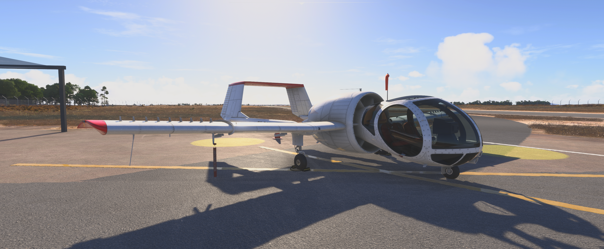
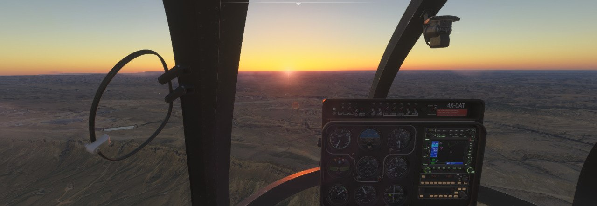

<!-- Explicit RTL lists and HTML tables preserve GitHub direction and column widths. -->

# בד״ח למטוס איירו־אלווירה Optica OA-7

<strong>!!! לשימוש סימולטור בלבד !!!</strong>

מיועד לשימוש עם Microsoft Flight Simulator 2024 ומודול AeroElvira Optica של Got Friends / Microsoft, מסדרות 300/301, עם לוח המכשירים המקורי ו־GNS 530

## מעבר מססנה 172 לאופטיקה

האופטיקה היא מטוס תצפית קל בעל שלושה מושבים בשורה אחת, תא מזוגג קדמי, מנוע מאחורי התא ומניפה המסתובבת בתוך תעלה במקום מדחף רגיל. האופטיקה מתוכננת לשהייה ממושכת בטיסה איטית ולשדה ראייה פתוח. ההשוואה כאן היא לססנה 172SP עם מנוע IO-360-L2A, מדחף בעל פסיעה קבועה ומכשירים אנאלוגיים עם יחידות GNS. הבסיס הוא טיסת ראייה (VFR, Visual Flight Rules).

### תמונת האופק והגובה מעל הקרקע

תא הבועה מספק שדה ראייה פנורמי של כ־270°, כולל מבט טוב מטה. התא נמוך, הטייס יושב לפני הכנף, ואין לפנים מכסה מנוע ארוך המשמש קו ייחוס. גובה הישיבה, מיקום לוח המכשירים ותחושת המרחק מהמסלול שונים מאוד מהססנה; בתחילת ריצת ההמראה המסלול נראה קרוב במיוחד לרגליים. ברגע ההמראה הקרקע נראית כאילו שהיא נשמטת מתחת לרגלי הטייס.

בשיוט ובגישה האף עשוי להיראות נמוך מההרגל מהססנה. משיכה בסטיק כדי לשחזר את תמונת הססנה תגרום להאטה ולטיפוס. היעזר בחלק העליון של קונסולת המכשירים כנקודת ייחוס עקבית, והצלב עם מד הגובה, מד הנסיקה ומד המהירות. בהצפה הבט לאורך המסלול ושמור על תנועה מתונה בסטיק, בהתאם לגובה ולמהירות.

מבט מתא הטייס בשיוט מעל מכתש רמון, לכיוון צומת הרוחות:

### כנף יעילה וגוף בעל גרר רב

הכנף הישרה והיעילה, בעלת פרופיל NASA GA(W)-1, מפיקה עילוי רב ומתאימה לטיסה איטית. התא הגדול והמעוגל, תעלת המניפה והזנב הכפול יוצרים גוף יעיל פחות מבחינה אווירודינמית. נוצר שילוב מורגש בין כנף שממשיכה לייצר עילוי במהירות נמוכה לבין גוף שיוצר גרר רב.

לכן הפחתת כוח יכולה להאט את המטוס במהירות, ורגישותו לסחיפה ברוח מורגשת יותר מאשר בססנה. יחס הגלישה המשוער שלו מעט פחות טוב. לעומת זאת, בקרבת הקרקע הכנף הנמוכה ואפקט הקרקע מעודדים ציפה: הגעה מהירה מדי עלולה להאריך מאוד את ההצפה. שמור על מהירות גישה מתאימה והימנע מניסיון להצמיד את המטוס למסלול.

מדפי האופטיקה מגיעים עד 50°, לעומת 30° בססנה 172SP. במצב מדפים גדול הגרר עולה מאוד ונדרש יותר כוח לשמירת הנתיב והמהירות. מגבלת המהירות היא 110&nbsp;KIAS&nbsp;[204&nbsp;kph] במצב 10°, וכבר במעבר ל־20° היא יורדת ל־90&nbsp;KIAS&nbsp;[167&nbsp;kph].

### תגובת הגאים וכוח במהירות נמוכה

בססנה זרימת המדחף מעל חלק מהכנף והזנב תורמת לתגובת ההגאים גם במהירות נמוכה. תצורת המניפה, המדפים החיצוניים והזנב הכפול באופטיקה מייצרת תחושה שונה. במהירות נמוכה מאוד ההגאים מגיבים באיטיות, ותוספת כוח אינה מייצרת את תחושת ההיחלצות המיידית המוכרת מהססנה.

בהליכה סביב יש לצפות לזמן האצה עד שתגובת ההגאים מתחזקת עם מהירות האוויר. תכנן את ההחלטה מוקדם ושמור על המהירות בעזרת תנועות מתונות בסטיק.

### הסעה וגלגל האף המוסט

גלגל האף מוסט שמאלה מציר המטוס ונמצא מתחת לתא הקדמי. המושב נמצא קדימה ביחס לכנף ולגלגלים הראשיים, ולכן תחילת פנייה ומיקום הגוף ביחס לקו ההסעה נראים אחרת מהססנה. רדיוס הפנייה ימינה גדול יותר מזה של הפנייה שמאלה, וההיגוי בדוושות רגיש. התחל במהירות נמוכה ובתנועות עדינות.

בלמי הגלגלים הראשיים מופעלים באמצעות ידית בלם מרכזית; אין בלימה דיפרנציאלית לצורך הקטנת רדיוס הפנייה. יש גם בלם חניה. בדוק בעדינות בלימה ותגובת היגוי בתחילת התנועה, ושמור מרווח לקצות הכנפיים ולזנב הכפול גם כאשר התא הקדמי כבר עבר מכשול.

## מנוע, מניפה וקיזוז

### מצערת ותערובת

המנוע הוא Lycoming IO-540-V4A5D: מנוע בוכנה מוזרק ומקורר אוויר, בעל שישה צילינדרים אופקיים מנוגדים. הוא מסובב מניפה בעלת חמישה להבים ופסיעה קבועה. בקרות המנוע הן מצערת ותערובת, כמו בססנה שבתצורת ההשוואה; אין ידית פסיעה נפרדת.

המצערת ותנאי הטיסה משפיעים על הסל״ד, והתערובת קובעת את יחס הדלק לאוויר. ההספק הנקוב הוא 260 כ״ס ב־2,700 RPM. בבד״חים מופיעים בנפרד סל״ד בדיקת המגנטו והסל״ד המזערי הנדרש בכוח המראה.

### ניטור וקירור

המנוע מאחור, בתוך אזור סגור, ונוטה להתחמם יותר ממנוע החרטום של הססנה, הפוגש את זרם האוויר ישירות. עקוב אחרי סל״ד, לחץ סעפת, לחץ דלק, לחץ שמן וטמפרטורת שמן, במיוחד בהסעה ממושכת, בטיפוס ובטיסה איטית עם כוח.

טמפרטורת ראשי הצילינדרים היא CHT (Cylinder Head Temperature); טמפרטורת גזי הפליטה היא EGT (Exhaust Gas Temperature). הראשונה מסייעת לנטר את עומס החום במנוע, והשנייה מסייעת בהערכת פעולת התערובת. מד לחץ הסעפת מציג את הלחץ בצנרת היניקה, לצד קריאת הסל״ד.

ה-CHT הוא נתון קריטי – אפילו שמנוע זהה במטוס אחר יכול לפעול ללא הפסקה בסל"ד מירבי, יש לשמור את ה-CHT מתחת למקסימום ולכן לא טסים עם כוח מלא כל הזמן, במיוחד בטמפרטורה סביבתית גבוהה (כגון הערבה בקיץ).

### קיזוז גובה וקיזוז גלגול

בקונסולה יש גלגל קיזוז גובה וגם גלגל קיזוז מאזנות. קיזוז הגובה מפחית לחץ מתמשך בסטיק בעלרוד; קיזוז המאזנות מפחית לחץ מתמשך בגלגול. תחילה מייצבים את המטוס בכוח ובמצב ההגאים המתאימים, ואז מקזזים להפחתת המאמץ.

## העמסה וזבורית

### מדוע ההעמסה שונה מהססנה

המנוע מאחור והמושבים בחלק הקדמי, ולכן נוסעים וזבורית משנים משמעותית את מרכז הכובד. העמסת התא הקדמי מזיזה את מרכז הכובד קדימה. יש להבחין בין משקל המראה, מטען מועיל ומרכז כובד: עמידה במשקל המרבי לבדה אינה מוכיחה שהחלוקה תקינה. משקל הזבורית נכלל במשקל המטוס ומפחית את המשקל שנותר לנוסעים, לדלק ולכבודה.

משקולות האף וזבורית קורות הזנב הן אמצעים נפרדים. משקולות האף מיועדות למצב של טייס בלבד; זבורית הזנב מיועדת לצוות מלא, כלומר טייס ושני נוסעים. הכמות בפועל תלויה במשקל יושבי התא, בדלק ובהעמסה כולה.

<ul dir="rtl">
<li dir="rtl"><strong>משקולות אף:</strong> עד שש משקולות של 7&nbsp;lb&nbsp;[3.18&nbsp;kg] כל אחת; עד 42&nbsp;lb&nbsp;[19.05&nbsp;kg] בסך הכול.</li>
<li dir="rtl"><strong>זבורית זנב שמאל:</strong> עד 21&nbsp;lb&nbsp;[9.53&nbsp;kg], בתצורת צוות מלא.</li>
<li dir="rtl"><strong>זבורית זנב ימין:</strong> עד 21&nbsp;lb&nbsp;[9.53&nbsp;kg], בתצורת צוות מלא.</li>
</ul>

ב־MSFS 2024 משנים נוסעים, דלק וזבורית במסכי ההעמסה של תיק הטיסה האלקטרוני (EFB, Electronic Flight Bag). בדוק את ההעמסה מול מעטפת מרכז הכובד. כמויות הזבורית שלעיל מתארות את המתקנים הזמינים במודול, ולא הוראה להוסיף תמיד את הכמות המרבית.

### מה מראות נוריות הזבורית

בלוח העליון יש נוריות למשקל באף, לנוסעים ולזבורית בכל קורת זנב. הן מציינות קיום משקל במקום המתאים. לחצן האיפוס מנקה את חיוויי הנוריות; בדיקת מרכז הכובד נעשית בנפרד מול ההעמסה בפועל.

## קשר ללא כיסוי בקרה

CTAF (Common Traffic Advisory Frequency) הוא תדר לתיאום בין טייסים בסביבת שדה כשאין שירות בקרה מתאים. בהמשך משתמשים בכיתוב UNICOM/CTAF; הערוץ בפועל תלוי באזור ובנוהל המקומי. השתמש ב־UNICOM באזור שבו CTAF אינו קיים/בשימוש.

הבד״חים ערוכים להפעלת הטרנספונדר לפי נוהל הקרקע המשמש בשדות כגון נתב״ג ורמון. בשדות אחרים פעל לפי הנוהל המקומי והוראות הבקרה.

## טבלאות השוואה ונתוני ייחוס

<table dir="rtl" width="100%">
<thead>
<tr>
<th dir="rtl" align="right" width="25%"><strong>סקירה ותצורה</strong></th>
<th dir="rtl" align="right" width="30%"><strong>Cessna 172SP</strong></th>
<th dir="rtl" align="right" width="45%"><strong>AeroElvira Optica OA-7</strong></th>
</tr>
</thead>
<tbody>
<tr>
<td dir="rtl" align="right" width="2500">תפקיד</td>
<td dir="rtl" align="right" width="3000">אימון, תיור ותובלה קלה</td>
<td dir="rtl" align="right" width="4500">תצפית, סיור ותיור בטיסה איטית</td>
</tr>
<tr>
<td dir="rtl" align="right">מושבים</td>
<td dir="rtl" align="right">ארבעה, בשתי שורות</td>
<td dir="rtl" align="right">שלושה, בשורה אחת</td>
</tr>
<tr>
<td dir="rtl" align="right">תא ושדה ראייה</td>
<td dir="rtl" align="right">תא מאחורי המנוע; הראות קדימה ומטה מוגבלת בחרטום</td>
<td dir="rtl" align="right">תא בועה קדמי; כ־270° ומבט טוב מטה</td>
</tr>
<tr>
<td dir="rtl" align="right">מנוע ומניפה</td>
<td dir="rtl" align="right">מנוע קדמי ומדחף מושך</td>
<td dir="rtl" align="right">מנוע מאחורי התא ומניפה בתוך תעלה</td>
</tr>
<tr>
<td dir="rtl" align="right">מבנה גוף וזנב</td>
<td dir="rtl" align="right">גוף אלומיניום חצי־מונוקוק; זנב יחיד</td>
<td dir="rtl" align="right">שתי קורות זנב מאלומיניום, שני סנפירים ומייצב גובה המחבר ביניהם</td>
</tr>
</tbody>
</table>

<table dir="rtl" width="100%">
<thead>
<tr>
<th dir="rtl" align="right" width="25%"><strong>ממדים</strong></th>
<th dir="rtl" align="right" width="30%"><strong>Cessna 172SP</strong></th>
<th dir="rtl" align="right" width="45%"><strong>Optica</strong><strong> — מפרט המודול</strong></th>
</tr>
</thead>
<tbody>
<tr>
<td dir="rtl" align="right" width="2500">מוטת כנפיים</td>
<td dir="rtl" align="right" width="3000">36.08&nbsp;ft&nbsp;[11.00&nbsp;m]</td>
<td dir="rtl" align="right" width="4500">39.3&nbsp;ft&nbsp;[11.98&nbsp;m]</td>
</tr>
<tr>
<td dir="rtl" align="right">אורך</td>
<td dir="rtl" align="right">27.17&nbsp;ft&nbsp;[8.28&nbsp;m]</td>
<td dir="rtl" align="right">28.0&nbsp;ft&nbsp;[8.53&nbsp;m]</td>
</tr>
<tr>
<td dir="rtl" align="right">שטח כנף</td>
<td dir="rtl" align="right">174.0 ft² [16.17 m²]</td>
<td dir="rtl" align="right">170.5 ft² [15.84 m²]</td>
</tr>
</tbody>
</table>

<table dir="rtl" width="100%">
<thead>
<tr>
<th dir="rtl" align="right" width="25%"><strong>משקלים והעמסה</strong></th>
<th dir="rtl" align="right" width="30%"><strong>Cessna 172SP</strong><strong> — דוגמת מפרט</strong></th>
<th dir="rtl" align="right" width="45%"><strong>Optica</strong><strong> — מפרט המודול</strong></th>
</tr>
</thead>
<tbody>
<tr>
<td dir="rtl" align="right" width="2500">משקל המראה מרבי</td>
<td dir="rtl" align="right" width="3000">2,550&nbsp;lb&nbsp;[1,157&nbsp;kg]</td>
<td dir="rtl" align="right" width="4500">2,899&nbsp;lb&nbsp;[1,315&nbsp;kg]</td>
</tr>
<tr>
<td dir="rtl" align="right">דוגמת משקל ריק</td>
<td dir="rtl" align="right">1,663&nbsp;lb&nbsp;[754&nbsp;kg]</td>
<td dir="rtl" align="right">2,090&nbsp;lb&nbsp;[948&nbsp;kg]</td>
</tr>
<tr>
<td dir="rtl" align="right">זמין להמראה: מרבי פחות ריק</td>
<td dir="rtl" align="right">887&nbsp;lb&nbsp;[402&nbsp;kg]</td>
<td dir="rtl" align="right">809&nbsp;lb&nbsp;[367&nbsp;kg]</td>
</tr>
<tr>
<td dir="rtl" align="right">משקל רמפה מרבי</td>
<td dir="rtl" align="right">2,558&nbsp;lb&nbsp;[1,160&nbsp;kg]</td>
<td dir="rtl" align="right">לא פורסם ערך רמפה נפרד</td>
</tr>
<tr>
<td dir="rtl" align="right">מטען מועיל מרבי לפי משקל רמפה</td>
<td dir="rtl" align="right">895&nbsp;lb&nbsp;[406&nbsp;kg]</td>
<td dir="rtl" align="right">לא הוגדר בנפרד</td>
</tr>
<tr>
<td dir="rtl" align="right">המשמעות</td>
<td dir="rtl" align="right">דלק, אנשים וכבודה חולקים את המשקל הזמין</td>
<td dir="rtl" align="right">דלק, אנשים, כבודה וזבורית חולקים את המשקל הזמין</td>
</tr>
</tbody>
</table>

<table dir="rtl" width="100%">
<thead>
<tr>
<th dir="rtl" align="right" width="25%"><strong>כנף, מדפים והגאים</strong></th>
<th dir="rtl" align="right" width="30%"><strong>Cessna 172SP</strong></th>
<th dir="rtl" align="right" width="45%"><strong>AeroElvira Optica</strong></th>
</tr>
</thead>
<tbody>
<tr>
<td dir="rtl" align="right" width="2500">מבנה כנף</td>
<td dir="rtl" align="right" width="3000">כנף עילית עם תמוכות</td>
<td dir="rtl" align="right" width="4500">כנף ישרה מאחורי התא, נמוכה יותר ביחס לקרקע</td>
</tr>
<tr>
<td dir="rtl" align="right">פרופיל כנף</td>
<td dir="rtl" align="right">NACA 2412</td>
<td dir="rtl" align="right">NASA GA(W)-1; עילוי גבוה לטיסה איטית, עם גרר מורגש</td>
</tr>
<tr>
<td dir="rtl" align="right">זווית התקפה קריטית משוערת</td>
<td dir="rtl" align="right">כ־17°</td>
<td dir="rtl" align="right">כ־18°</td>
</tr>
<tr>
<td dir="rtl" align="right">יחס גלישה משוער</td>
<td dir="rtl" align="right">9:1</td>
<td dir="rtl" align="right">8.5:1</td>
</tr>
<tr>
<td dir="rtl" align="right">מבנה המדפים</td>
<td dir="rtl" align="right">מדפים מחורצים בחלק הפנימי של הכנף</td>
<td dir="rtl" align="right">מדפים נעים מחוץ לקורות הזנב; משטחים מחורצים קבועים ביניהן</td>
</tr>
<tr>
<td dir="rtl" align="right">מצבי מדפים, בורר חשמלי</td>
<td dir="rtl" align="right">0°, 10°, 20°, 30°</td>
<td dir="rtl" align="right">0°, 10°, 20°, 30°, 40°, 50°</td>
</tr>
<tr>
<td dir="rtl" align="right">מאזנות</td>
<td dir="rtl" align="right">בחלק החיצוני של הכנף</td>
<td dir="rtl" align="right">בחלק החיצוני של הכנף</td>
</tr>
<tr>
<td dir="rtl" align="right">מערכת שליטה</td>
<td dir="rtl" align="right">שני הגאי יד ודוושות; גלגל קיזוז מימין להגה השמאלי</td>
<td dir="rtl" align="right">שני סטיקים ודוושות; קיזוז גובה ומאזנות בקונסולה</td>
</tr>
</tbody>
</table>

<table dir="rtl" width="100%">
<thead>
<tr>
<th dir="rtl" align="right" width="25%"><strong>מנוע ומדחף</strong></th>
<th dir="rtl" align="right" width="30%"><strong>Cessna 172SP</strong></th>
<th dir="rtl" align="right" width="45%"><strong>AeroElvira Optica</strong></th>
</tr>
</thead>
<tbody>
<tr>
<td dir="rtl" align="right" width="2500">דגם מנוע</td>
<td dir="rtl" align="right" width="3000">Lycoming IO-360-L2A</td>
<td dir="rtl" align="right" width="4500">Lycoming IO-540-V4A5D</td>
</tr>
<tr>
<td dir="rtl" align="right">תצורה וקירור</td>
<td dir="rtl" align="right">ארבעה צילינדרים אופקיים מנוגדים, הזרקה, קירור אוויר, אטמוספרי</td>
<td dir="rtl" align="right">שישה צילינדרים אופקיים מנוגדים, הזרקה, קירור אוויר, אטמוספרי</td>
</tr>
<tr>
<td dir="rtl" align="right">נפח מנוע נקוב</td>
<td dir="rtl" align="right">360&nbsp;in³&nbsp;[5.90&nbsp;L]</td>
<td dir="rtl" align="right">541.5&nbsp;in³&nbsp;[8.87&nbsp;L]</td>
</tr>
<tr>
<td dir="rtl" align="right">הספק נקוב</td>
<td dir="rtl" align="right">180 כ״ס ב־2,700 RPM</td>
<td dir="rtl" align="right">260 כ״ס ב־2,700 RPM</td>
</tr>
<tr>
<td dir="rtl" align="right">מדחף</td>
<td dir="rtl" align="right">McCauley, שני להבים, אלומיניום, פסיעה קבועה; קוטר 6.33&nbsp;ft&nbsp;[1.93&nbsp;m]</td>
<td dir="rtl" align="right">מניפת חמישה להבים, פסיעה קבועה, בתוך תעלה</td>
</tr>
<tr>
<td dir="rtl" align="right">בקרות מנוע</td>
<td dir="rtl" align="right">מצערת ותערובת</td>
<td dir="rtl" align="right">מצערת ותערובת</td>
</tr>
<tr>
<td dir="rtl" align="right">תחושת רעש בסימולטור</td>
<td dir="rtl" align="right">רעש בוכנה בולט, בתדר גבוה יחסית</td>
<td dir="rtl" align="right">שריקת מניפה שקטה יותר, בתדר נמוך יחסית</td>
</tr>
</tbody>
</table>

<table dir="rtl" width="100%">
<thead>
<tr>
<th dir="rtl" align="right" width="25%"><strong>דלק</strong></th>
<th dir="rtl" align="right" width="30%"><strong>Cessna 172SP</strong></th>
<th dir="rtl" align="right" width="45%"><strong>AeroElvira Optica</strong></th>
</tr>
</thead>
<tbody>
<tr>
<td dir="rtl" align="right" width="2500">סוג דלק</td>
<td dir="rtl" align="right" width="3000">100LL Avgas, בנזין תעופתי כחול</td>
<td dir="rtl" align="right" width="4500">100LL Avgas, בנזין תעופתי כחול</td>
</tr>
<tr>
<td dir="rtl" align="right">קיבולת כוללת / נקובה</td>
<td dir="rtl" align="right">56&nbsp;US&nbsp;gal&nbsp;[212.0&nbsp;L]</td>
<td dir="rtl" align="right">68&nbsp;US&nbsp;gal&nbsp;[257.4&nbsp;L]</td>
</tr>
<tr>
<td dir="rtl" align="right">קיבולת שמישה לערכה</td>
<td dir="rtl" align="right">53&nbsp;US&nbsp;gal&nbsp;[200.6&nbsp;L]</td>
<td dir="rtl" align="right">66&nbsp;US&nbsp;gal&nbsp;[249.8&nbsp;L]</td>
</tr>
<tr>
<td dir="rtl" align="right">מיכלים</td>
<td dir="rtl" align="right">שני מיכלים בכנפיים; 28&nbsp;US&nbsp;gal&nbsp;[106.0&nbsp;L] לכל צד</td>
<td dir="rtl" align="right">שני מיכלי שפת התקפה; נפח נקוב 34&nbsp;US&nbsp;gal&nbsp;[128.7&nbsp;L] לכל צד</td>
</tr>
<tr>
<td dir="rtl" align="right">בורר מיכלים בסימולטור</td>
<td dir="rtl" align="right">LEFT / RIGHT / BOTH</td>
<td dir="rtl" align="right">LEFT / RIGHT / BOTH</td>
</tr>
<tr>
<td dir="rtl" align="right">בחירה רגילה בסימולטור</td>
<td dir="rtl" align="right">BOTH</td>
<td dir="rtl" align="right">BOTH</td>
</tr>
<tr>
<td dir="rtl" align="right">הזנה ומשאבות</td>
<td dir="rtl" align="right">זרימת כבידה מהמיכלים, משאבה מונעת מנוע ומשאבה חשמלית</td>
<td dir="rtl" align="right">משאבה מונעת מנוע ומשאבה חשמלית לגיבוי</td>
</tr>
<tr>
<td dir="rtl" align="right">ניתוק דלק</td>
<td dir="rtl" align="right">ידית נפרדת</td>
<td dir="rtl" align="right">ידית נפרדת</td>
</tr>
<tr>
<td dir="rtl" align="right">הטלת דלק</td>
<td dir="rtl" align="right">אין</td>
<td dir="rtl" align="right">ידית נפרדת לריקון משני המיכלים</td>
</tr>
</tbody>
</table>

<table dir="rtl" width="100%">
<thead>
<tr>
<th dir="rtl" align="right" width="25%"><strong>כן נסע ובלמים</strong></th>
<th dir="rtl" align="right" width="30%"><strong>Cessna 172SP</strong></th>
<th dir="rtl" align="right" width="45%"><strong>AeroElvira Optica</strong></th>
</tr>
</thead>
<tbody>
<tr>
<td dir="rtl" align="right" width="2500">כן נסע</td>
<td dir="rtl" align="right" width="3000">קבוע, בתצורת משולש</td>
<td dir="rtl" align="right" width="4500">קבוע, בתצורת משולש</td>
</tr>
<tr>
<td dir="rtl" align="right">גלגל אף</td>
<td dir="rtl" align="right">במרכז החרטום</td>
<td dir="rtl" align="right">מוסט שמאלה, מתחת לתא הקדמי</td>
</tr>
<tr>
<td dir="rtl" align="right">בלמים ראשיים</td>
<td dir="rtl" align="right">בלמי דיסק בגלגלים הראשיים</td>
<td dir="rtl" align="right">בלמי דיסק בגלגלים הראשיים</td>
</tr>
<tr>
<td dir="rtl" align="right">הפעלת בלמי שירות</td>
<td dir="rtl" align="right">דוושות בלם המשולבות בדוושות הכיוון</td>
<td dir="rtl" align="right">ידית בלם מרכזית</td>
</tr>
<tr>
<td dir="rtl" align="right">בלימה דיפרנציאלית</td>
<td dir="rtl" align="right">באמצעות דוושות בלם נפרדות</td>
<td dir="rtl" align="right">אין</td>
</tr>
<tr>
<td dir="rtl" align="right">בלם חניה</td>
<td dir="rtl" align="right">קיים</td>
<td dir="rtl" align="right">קיים</td>
</tr>
<tr>
<td dir="rtl" align="right">היגוי</td>
<td dir="rtl" align="right">בדוושות הכיוון, באמצעות קישור קפיצי</td>
<td dir="rtl" align="right">בדוושות הכיוון; רגיש, עם רדיוס פנייה שונה לימין ולשמאל</td>
</tr>
</tbody>
</table>

<table dir="rtl" width="100%">
<thead>
<tr>
<th dir="rtl" align="right" width="25%"><strong>מהירויות ייחוס</strong></th>
<th dir="rtl" align="right" width="30%"><strong>Cessna 172SP</strong></th>
<th dir="rtl" align="right" width="45%"><strong>AeroElvira Optica</strong></th>
</tr>
</thead>
<tbody>
<tr>
<td dir="rtl" align="right" width="2500">הזדקרות בנחיתה, Vs0</td>
<td dir="rtl" align="right" width="3000">40&nbsp;KIAS&nbsp;[74&nbsp;kph], מדפים 30°</td>
<td dir="rtl" align="right" width="4500">38&nbsp;KIAS&nbsp;[70&nbsp;kph], מדפים מלאים</td>
</tr>
<tr>
<td dir="rtl" align="right">הזדקרות נקייה, Vs1</td>
<td dir="rtl" align="right">48&nbsp;KIAS&nbsp;[89&nbsp;kph]</td>
<td dir="rtl" align="right">43&nbsp;KIAS&nbsp;[80&nbsp;kph]</td>
</tr>
<tr>
<td dir="rtl" align="right">רוטציה, Vr</td>
<td dir="rtl" align="right">55&nbsp;KIAS&nbsp;[102&nbsp;kph]</td>
<td dir="rtl" align="right">55&nbsp;KIAS&nbsp;[102&nbsp;kph]</td>
</tr>
<tr>
<td dir="rtl" align="right">זווית טיפוס מיטבית, Vx</td>
<td dir="rtl" align="right">62&nbsp;KIAS&nbsp;[115&nbsp;kph]</td>
<td dir="rtl" align="right">58&nbsp;KIAS&nbsp;[107&nbsp;kph]</td>
</tr>
<tr>
<td dir="rtl" align="right">קצב טיפוס מיטבי, Vy</td>
<td dir="rtl" align="right">74&nbsp;KIAS&nbsp;[137&nbsp;kph]</td>
<td dir="rtl" align="right">65&nbsp;KIAS&nbsp;[120&nbsp;kph]</td>
</tr>
<tr>
<td dir="rtl" align="right">גלישה מיטבית, Vbg</td>
<td dir="rtl" align="right">68&nbsp;KIAS&nbsp;[126&nbsp;kph]</td>
<td dir="rtl" align="right">70&nbsp;KIAS&nbsp;[130&nbsp;kph]</td>
</tr>
<tr>
<td dir="rtl" align="right">גישה סופית, Vref</td>
<td dir="rtl" align="right">60–70&nbsp;KIAS&nbsp;[111–130&nbsp;kph], לפי התצורה</td>
<td dir="rtl" align="right">52&nbsp;KIAS&nbsp;[96&nbsp;kph], מדפים מלאים</td>
</tr>
</tbody>
</table>

<strong>שימוש במהירויות:</strong> המהירויות מתייחסות למצבי טיסה ותצורות שונים, ומשתנות עם המשקל. מהירות הזדקרות אינה יעד לגישה. מהירויות הטיפוס המיטביות אינן בהכרח המהירות שנבחרת לטיפוס רגיל.

<table dir="rtl" width="100%">
<thead>
<tr>
<th dir="rtl" align="right" width="25%"><strong>מגבלות מדפים ומהירות</strong></th>
<th dir="rtl" align="right" width="30%"><strong>Cessna 172SP</strong></th>
<th dir="rtl" align="right" width="45%"><strong>AeroElvira Optica</strong></th>
</tr>
</thead>
<tbody>
<tr>
<td dir="rtl" align="right" width="2500">Vfe — מדפים 10°</td>
<td dir="rtl" align="right" width="3000">110&nbsp;KIAS&nbsp;[204&nbsp;kph]</td>
<td dir="rtl" align="right" width="4500">110&nbsp;KIAS&nbsp;[204&nbsp;kph]</td>
</tr>
<tr>
<td dir="rtl" align="right">Vfe — מעבר ל־10°</td>
<td dir="rtl" align="right">מדפים 20°–30°: 85&nbsp;KIAS&nbsp;[157&nbsp;kph]</td>
<td dir="rtl" align="right">מדפים 20°–50°: 90&nbsp;KIAS&nbsp;[167&nbsp;kph]</td>
</tr>
<tr>
<td dir="rtl" align="right">שיוט מבני מרבי, Vno</td>
<td dir="rtl" align="right">129&nbsp;KIAS&nbsp;[239&nbsp;kph]</td>
<td dir="rtl" align="right">110&nbsp;KIAS&nbsp;[204&nbsp;kph]</td>
</tr>
<tr>
<td dir="rtl" align="right">אין לעבור, Vne</td>
<td dir="rtl" align="right">163&nbsp;KIAS&nbsp;[302&nbsp;kph]</td>
<td dir="rtl" align="right">140&nbsp;KIAS&nbsp;[259&nbsp;kph]</td>
</tr>
<tr>
<td dir="rtl" align="right">מהירות תמרון, Va</td>
<td dir="rtl" align="right">105&nbsp;KIAS&nbsp;[194&nbsp;kph], במשקל 2,550&nbsp;lb&nbsp;[1,157&nbsp;kg]</td>
<td dir="rtl" align="right">113&nbsp;KIAS&nbsp;[209&nbsp;kph]</td>
</tr>
</tbody>
</table>

<table dir="rtl" width="100%">
<thead>
<tr>
<th dir="rtl" align="right" width="25%"><strong>מגבלות עומס ותמרונים</strong></th>
<th dir="rtl" align="right" width="30%"><strong>Cessna 172SP</strong></th>
<th dir="rtl" align="right" width="45%"><strong>AeroElvira Optica</strong></th>
</tr>
</thead>
<tbody>
<tr>
<td dir="rtl" align="right" width="2500">מקדמי עומס</td>
<td dir="rtl" align="right" width="3000">Normal, מדפים למעלה: ‎+3.8g / −1.52g</td>
<td dir="rtl" align="right" width="4500">‎+3.5g / −1.0g</td>
</tr>
<tr>
<td dir="rtl" align="right">תמרונים וסחרורים</td>
<td dir="rtl" align="right">הזדקרויות רגילות מותרות ב־Normal וב־Utility, בהתאם למגבלות המשקל ומרכז הכובד. סחרור מכוון מותר רק ב־Utility: עד 2,200&nbsp;lb&nbsp;[998&nbsp;kg], מושבים אחוריים פנויים וללא כבודה.</td>
<td dir="rtl" align="right">תמרונים אירובטיים, כולל סחרורים, אינם מאושרים</td>
</tr>
</tbody>
</table>

<table dir="rtl" width="100%">
<thead>
<tr>
<th dir="rtl" align="right" width="25%"><strong>ביצועים ושיוט</strong></th>
<th dir="rtl" align="right" width="30%"><strong>Cessna 172SP</strong></th>
<th dir="rtl" align="right" width="45%"><strong>Optica</strong><strong> — נתוני ייחוס</strong></th>
</tr>
</thead>
<tbody>
<tr>
<td dir="rtl" align="right" width="2500">תקרת שירות</td>
<td dir="rtl" align="right" width="3000">14,000&nbsp;ft&nbsp;[4,267&nbsp;m]</td>
<td dir="rtl" align="right" width="4500">14,000&nbsp;ft&nbsp;[4,267&nbsp;m]</td>
</tr>
<tr>
<td dir="rtl" align="right">טיפוס מרבי בגובה פני הים</td>
<td dir="rtl" align="right">730&nbsp;fpm&nbsp;[223&nbsp;m/min]</td>
<td dir="rtl" align="right">810&nbsp;fpm&nbsp;[247&nbsp;m/min]</td>
</tr>
<tr>
<td dir="rtl" align="right">מהירות מרבית בטיסה אופקית</td>
<td dir="rtl" align="right">126&nbsp;kt&nbsp;[233&nbsp;kph], בגובה פני הים</td>
<td dir="rtl" align="right">115&nbsp;kt&nbsp;[213&nbsp;kph], בגובה פני הים</td>
</tr>
<tr>
<td dir="rtl" align="right">דוגמת שיוט</td>
<td dir="rtl" align="right">124&nbsp;KTAS&nbsp;[230&nbsp;kph], כוח 75%, גובה 8,500&nbsp;ft&nbsp;[2,591&nbsp;m]</td>
<td dir="rtl" align="right">כ־100&nbsp;kt&nbsp;[185&nbsp;kph] לשיוט חסכוני מתון; אפשר לטוס מהר יותר לפי התנאים</td>
</tr>
</tbody>
</table>

### סיור ושהייה ממושכת

מטרת מהירות הסיור היא שהייה ממושכת וחיסכון בדלק, ולא כיסוי המרחק המרבי. הדוגמה הבאה משתמשת בהערכות הצריכה של הערכה ובקצב קבוע, עם רזרבה של  45 דקות. יש להפחית בנפרד דלק להתנעה, להסעה ולטיפוס; גובה, משקל ודילול התערובת משפיעים על הצריכה בפועל. משכי הדוגמה עוגלו כלפי מטה לדקה שלמה.

<table dir="rtl" width="100%">
<thead>
<tr>
<th dir="rtl" align="right" width="25%"><strong>דוגמת חישוב זמן שהייה</strong></th>
<th dir="rtl" align="right" width="30%"><strong>Cessna 172SP</strong></th>
<th dir="rtl" align="right" width="45%"><strong>AeroElvira Optica</strong></th>
</tr>
</thead>
<tbody>
<tr>
<td dir="rtl" align="right" width="2500">מהירות סיור לדוגמה</td>
<td dir="rtl" align="right" width="3000">כ־90&nbsp;KIAS&nbsp;[167&nbsp;kph]</td>
<td dir="rtl" align="right" width="4500">כ־70–75&nbsp;KIAS&nbsp;[130–139&nbsp;kph]</td>
</tr>
<tr>
<td dir="rtl" align="right">כוח בדוגמה</td>
<td dir="rtl" align="right">לא נקבע ערך כוח נפרד</td>
<td dir="rtl" align="right">כ־40%</td>
</tr>
<tr>
<td dir="rtl" align="right">צריכה משוערת</td>
<td dir="rtl" align="right">8.5–10.0&nbsp;US&nbsp;gal/h&nbsp;[32.2–37.9&nbsp;L/h]</td>
<td dir="rtl" align="right">7.0–8.0&nbsp;US&nbsp;gal/h&nbsp;[26.5–30.3&nbsp;L/h]</td>
</tr>
<tr>
<td dir="rtl" align="right">דלק שמיש לחישוב</td>
<td dir="rtl" align="right">53&nbsp;US&nbsp;gal&nbsp;[200.6&nbsp;L]</td>
<td dir="rtl" align="right">66&nbsp;US&nbsp;gal&nbsp;[249.8&nbsp;L]</td>
</tr>
<tr>
<td dir="rtl" align="right">רזרבת זמן</td>
<td dir="rtl" align="right">45 min</td>
<td dir="rtl" align="right">45 min</td>
</tr>
<tr>
<td dir="rtl" align="right">זמן תיאורטי עד הרזרבה</td>
<td dir="rtl" align="right">4 h 33 min עד 5 h 29 min</td>
<td dir="rtl" align="right">7 h 30 min עד 8 h 40 min</td>
</tr>
</tbody>
</table>

<table dir="rtl" width="100%">
<thead>
<tr>
<th dir="rtl" align="right" width="25%"><strong>מכשור וטייס אוטומטי</strong></th>
<th dir="rtl" align="right" width="30%"><strong>Cessna 172SP</strong><strong> — מכשירים אנאלוגיים</strong></th>
<th dir="rtl" align="right" width="45%"><strong>AeroElvira Optica</strong><strong> — תצורה מקורית</strong></th>
</tr>
</thead>
<tbody>
<tr>
<td dir="rtl" align="right" width="2500">לוח טיסה</td>
<td dir="rtl" align="right" width="3000">מכשירים אנאלוגיים מול המושב השמאלי</td>
<td dir="rtl" align="right" width="4500">מכשירים אנאלוגיים בקונסולה מרכזית מול המושבים השמאלי והאמצעי</td>
</tr>
<tr>
<td dir="rtl" align="right">ניווט וקשר</td>
<td dir="rtl" align="right">יחידות GNS</td>
<td dir="rtl" align="right">GNS 530 יחיד</td>
</tr>
<tr>
<td dir="rtl" align="right">מקלטי COM</td>
<td dir="rtl" align="right">שני מקלטים בתצורת ההשוואה</td>
<td dir="rtl" align="right">מקלט אחד ביחידת GNS</td>
</tr>
<tr>
<td dir="rtl" align="right">מקלטי NAV</td>
<td dir="rtl" align="right">שני מקלטים ושני מחוונים בתצורת ההשוואה</td>
<td dir="rtl" align="right">מקלט אחד ומחוון VOR/LOC יחיד</td>
</tr>
<tr>
<td dir="rtl" align="right">טייס אוטומטי</td>
<td dir="rtl" align="right">KAP-140, דו־צירי, בחירת גובה מראש</td>
<td dir="rtl" align="right">KAP-140, דו־צירי, בחירת גובה מראש</td>
</tr>
</tbody>
</table>

<table dir="rtl" width="100%">
<thead>
<tr>
<th dir="rtl" align="right" width="25%"><strong>נוסעים וכבודה</strong></th>
<th dir="rtl" align="right" width="30%"><strong>Cessna 172SP</strong></th>
<th dir="rtl" align="right" width="45%"><strong>AeroElvira Optica</strong></th>
</tr>
</thead>
<tbody>
<tr>
<td dir="rtl" align="right" width="2500">סידור מושבים</td>
<td dir="rtl" align="right" width="3000">טייס ושלושה נוסעים; שניים מלפנים ושניים מאחור</td>
<td dir="rtl" align="right" width="4500">טייס ושני נוסעים, בשורה אחת</td>
</tr>
<tr>
<td dir="rtl" align="right">עמדות שליטה</td>
<td dir="rtl" align="right">שמאל וימין בשורה הקדמית</td>
<td dir="rtl" align="right">מושב שמאל ומושב אמצעי; הנוסע הנוסף מימין</td>
</tr>
<tr>
<td dir="rtl" align="right">מיקום כבודה</td>
<td dir="rtl" align="right">תא אחורי עם דלת גישה חיצונית</td>
<td dir="rtl" align="right">מדף מאחורי שלושת המושבים</td>
</tr>
<tr>
<td dir="rtl" align="right">משקל כבודה</td>
<td dir="rtl" align="right">עד 120&nbsp;lb&nbsp;[54&nbsp;kg] בשני האזורים יחד; באזור האחורי עד 50&nbsp;lb&nbsp;[23&nbsp;kg], בתנאי ההעמסה המתאימים</td>
<td dir="rtl" align="right">66&nbsp;lb&nbsp;[30&nbsp;kg]</td>
</tr>
</tbody>
</table>

## תכנון והכנה לטיסה

הרשימה הבאה נוגעת לתכנון ואינה מחליפה את בדיקות המטוס. השתמש בדלק השמיש ובדוגמת חישוב השהייה שבטבלאות, ובדוק בנפרד את ההעמסה ואת צריכת הדלק הצפויה בתנאי הטיסה.

<ol dir="rtl" type="1">
<li dir="rtl">מסלול טיסה חזותי ומפות — הוכנו.</li>
<li dir="rtl">מזג אוויר, מסלול, רוח וחלופה — נבדקו.</li>
<li dir="rtl">משקל טייס, נוסעים, כבודה ודלק — נרשמו.</li>
<li dir="rtl">משקולות אף וזבורית זנב — נכללו במשקל ובהעמסה.</li>
<li dir="rtl">מעטפת מרכז הכובד — נבדקה; תצורה לא ברורה לא אושרה.</li>
<li dir="rtl">תקציב דלק — חושב, כולל התנעה, הסעה, טיפוס ורזרבות.</li>
<li dir="rtl">כיסוי בקרה וערוץ UNICOM/CTAF — נבדקו.</li>
<li dir="rtl">תוכנית טיסה — הוגשה כנדרש.</li>
<li dir="rtl">יחידת COM, טרנספונדר ואמצעי ניתוק KAP-140 — מוכרים.</li>
</ol>

## בד״ח הכנה

<ol dir="rtl" type="1">
<li dir="rtl">כיסוי פיטו וסדי גלגלים — הוסרו.</li>
<li dir="rtl">דלתות — סגורות ונעולות.</li>
<li dir="rtl">בלם חניה — מופעל.</li>
<li dir="rtl">הצתה — OFF.</li>
<li dir="rtl">מתח חיצוני — ON בלחצן שבתא.</li>
<li dir="rtl">מד זרם — בדוק חיווי תקין.</li>
<li dir="rtl">תאורת לוח — ON בתאורה חלשה.</li>
<li dir="rtl">אורות ניווט — ON.</li>
<li dir="rtl">בהירות לוח ואוויוניקה — כוון לקריאה נוחה.</li>
<li dir="rtl">זבורית והעמסה — הגדר ואמת מרכז כובד ב־EFB.</li>
</ol>

## בד״ח לפני התנעה

<ol dir="rtl" type="1">
<li dir="rtl">שסתום הטלת דלק — סגור.</li>
<li dir="rtl">שסתום ניתוק דלק — פתוח.</li>
<li dir="rtl">בורר מיכלים — BOTH.</li>
<li dir="rtl">מדי דלק — בדוק כמות מספקת לטיסה המתוכננת.</li>
</ol>

## בד״ח התנעה

<ol dir="rtl" type="1">
<li dir="rtl"><strong>עם בקרה — קבל מרשה התנעה אם נדרש בנוהל המקומי.</strong></li>
<li dir="rtl"><strong>ללא בקרה — הכרז כוונות התנעה ב־</strong><strong>UNICOM/CTAF</strong><strong> לפי הצורך.</strong></li>
<li dir="rtl">תערובת — FULL RICH.</li>
<li dir="rtl">מצבר — ON.</li>
<li dir="rtl">משאבת דלק עזר — הפעל למשך 3–5 שניות.</li>
<li dir="rtl">מצבר — OFF. מתח חיצוני נשאר מחובר.</li>
<li dir="rtl">מצערת — הזז קדימה כ־0.25 inch [6.35 mm].</li>
<li dir="rtl">אורות נצנוץ — ON.</li>
<li dir="rtl">דלת שמאל — פתח כדי לבדוק שאזור המניפה פנוי.</li>
<li dir="rtl">אזור המניפה — הכרז שהוא פנוי לאחר הבדיקה.</li>
<li dir="rtl">דלת שמאל — סגור ונעל.</li>
<li dir="rtl">הצתה — START.</li>
</ol>

## בד״ח אחרי התנעה ולפני הסעה

<ol dir="rtl" type="1">
<li dir="rtl">לחץ דלק — בדוק חיווי תקין.</li>
<li dir="rtl">לחץ שמן — בדוק עליית לחץ תוך 30 שניות. אין חיווי? הפסק מנוע.</li>
<li dir="rtl">מצבר — ON.</li>
<li dir="rtl">גנרטור — ON.</li>
<li dir="rtl">מתח חיצוני — OFF.</li>
<li dir="rtl">מד זרם — בדוק טעינה.</li>
<li dir="rtl">מזג אוויר בשדה — קבל מידע עדכני, כולל ATIS אם זמין.</li>
<li dir="rtl">מד גובה — כוון ל־QNH המקומי.</li>
<li dir="rtl">חימום פיטו — ON בתנאי טיסה קרים.</li>
<li dir="rtl">שמן מנוע — חמם בהדרגה ובדוק טמפרטורה בתחום 135–235 °F [57–113 °C].</li>
<li dir="rtl">מצערת — סרק.</li>
<li dir="rtl">טרנספונדר — כוון קוד והעבר ל־ALT בהיערכות להסעה.</li>
<li dir="rtl"><strong>עם בקרה — קבל מרשה הסעה וקרא חזרה את ההוראות.</strong></li>
<li dir="rtl"><strong>ללא בקרה — הכרז כוונות הסעה ב־</strong><strong>UNICOM/CTAF</strong><strong> לפי הצורך.</strong></li>
</ol>

## בד״ח הסעה

<ol dir="rtl" type="1">
<li dir="rtl">פנס הסעה — ON.</li>
<li dir="rtl">תערובת — התאם לפעולת מנוע חלקה בהסעה.</li>
<li dir="rtl">בלם חניה — שחרר.</li>
<li dir="rtl">תחילת תנועה — במהירות נמוכה ובמרחב פנוי.</li>
<li dir="rtl">בלמי שירות — בדוק תגובה בהפעלת הידית למשך עד 3 שניות.</li>
<li dir="rtl">היגוי — בדוק תגובה עדינה ימינה ושמאלה.</li>
<li dir="rtl">מד כיוון — ודא שינוי בכיוון הפנייה.</li>
<li dir="rtl">מד פנייה והחלקה — ודא תגובה מתאימה בפנייה.</li>
<li dir="rtl">אופק מלאכותי — בדוק חיווי יציב בהסעה.</li>
<li dir="rtl">קצות כנפיים וזנב — שמור מרווח.</li>
<li dir="rtl">טמפרטורות מנוע — נטר.</li>
<li dir="rtl">נקודת המתנה — עצור לפני כניסה למסלול ללא מרשה נדרש.</li>
</ol>

## בד״ח לפני המראה והרצת מנוע

<ol dir="rtl" type="1">
<li dir="rtl">בלם חניה — הפעל באזור הרצה פנוי.</li>
<li dir="rtl">פנס נחיתה — ON.</li>
<li dir="rtl">קשר וניווט — כוון תדרים ליציאה.</li>
<li dir="rtl">טרנספונדר — ודא קוד ומצב ALT.</li>
<li dir="rtl">מד כיוון — תאם למצפן.</li>
<li dir="rtl">אופק מלאכותי — בדוק חיווי וכיוון סימון המטוס.</li>
<li dir="rtl">מד גובה — אמת QNH.</li>
<li dir="rtl">הגאים — תנועה חופשית, מלאה ובכיוון הנכון.</li>
<li dir="rtl">מדפים — בדוק מעבר למצב נחיתה וחזרה ל־UP.</li>
<li dir="rtl">קיזוז גובה — נייטרלי.</li>
<li dir="rtl">קיזוז מאזנות — ודא 0.3° כפי שמוגדר בטעינת המטוס.</li>
<li dir="rtl">תערובת — FULL RICH. בהמראה משדה שגובהו מעל 3,000&nbsp;ft&nbsp;[914&nbsp;m], דלל מעט.</li>
<li dir="rtl">מצערת — כוון ל־1,700 RPM לבדיקת מגנטו.</li>
<li dir="rtl">מגנטו — בדוק כל צד בנפרד וחזור ל־BOTH בין הבדיקות ובסיומן.</li>
<li dir="rtl">נפילת סל״ד — עד 150 RPM בכל צד.</li>
<li dir="rtl">הפרש בין הצדדים — עד 50 RPM.</li>
<li dir="rtl">מצערת — סרק.</li>
<li dir="rtl">בלם חניה — שחרר כשמוכנים לתנועה.</li>
</ol>

## בד״ח המראה וטיפוס ראשוני

<ol dir="rtl" type="1">
<li dir="rtl">מדפים להמראה — 10°.</li>
<li dir="rtl"><strong>עם בקרה — קבל מרשה לפני כניסה למסלול. ודא מרשה המראה לפני תחילת הריצה.</strong></li>
<li dir="rtl"><strong>ללא בקרה — בדוק שהמסלול פנוי והכרז המראה וכוונות ב־</strong><strong>UNICOM/CTAF</strong><strong>.</strong></li>
<li dir="rtl">כיוון מסלול — אמת מול מד הכיוון.</li>
<li dir="rtl">מצערת — קדם בהדרגה לכוח מלא.</li>
<li dir="rtl">סל״ד בהמראה — ודא לפחות 2,300 RPM.</li>
<li dir="rtl">חיוויי מנוע — נטר.</li>
<li dir="rtl">כיוון — שמור בדוושות.</li>
<li dir="rtl">הרמת אף — 55&nbsp;KIAS&nbsp;[102&nbsp;kph].</li>
<li dir="rtl">מדפים — UP בגובה 300&nbsp;ft&nbsp;AGL&nbsp;[91&nbsp;m].</li>
<li dir="rtl">טיפוס ראשוני — Vy הוא 65&nbsp;KIAS&nbsp;[120&nbsp;kph]. לטיפוס רגיל אפשר גם 70–80&nbsp;KIAS&nbsp;[130–148&nbsp;kph].</li>
<li dir="rtl"><strong>עם בקרה — החלף תדר וצור קשר עם הבקר הבא לפי ההוראות.</strong></li>
<li dir="rtl"><strong>ללא בקרה — הכרז יציאה מההקפה וכוונות ב־</strong><strong>UNICOM/CTAF</strong><strong> לפי הצורך.</strong></li>
</ol>

## בד״ח שיוט

<ol dir="rtl" type="1">
<li dir="rtl">תערובת — כוון לפי הצורך בשיוט.</li>
<li dir="rtl">פנס הסעה — לפי הצורך.</li>
<li dir="rtl">קיזוז גובה — כוון להפחתת הלחץ בסטיק.</li>
<li dir="rtl">קיזוז מאזנות — כוון להפחתת המאמץ בגלגול.</li>
<li dir="rtl">עקוב אחרי מכשירי מנוע – ובמיוחד CHT.</li>
<li dir="rtl">תפעל קשר: <strong>עם בקרה — תאם גובה, נתיב והחלפות תדר לפי הוראות הבקר. ללא בקרה — שדר דיווחי מיקום וכוונות ב־</strong><strong>UNICOM/CTAF</strong><strong> לפי הצורך.</strong></li>
</ol>

## בד״ח לפני נחיתה

<ol dir="rtl" type="1">
<li dir="rtl">מסלול, רוח ונתיב הצטרפות — נבחרו.</li>
<li dir="rtl">מד גובה — אמת QNH.</li>
<li dir="rtl"><strong>עם בקרה — תאם הצטרפות להקפה לפי ההוראות.</strong></li>
<li dir="rtl"><strong>ללא בקרה — הכרז מיקום וכוונות הצטרפות ב־</strong><strong>UNICOM/CTAF</strong><strong>.</strong></li>
<li dir="rtl">חגורות ודלתות — מאובטחות.</li>
<li dir="rtl">טייס אוטומטי — OFF.</li>
<li dir="rtl">פנס נחיתה — ON.</li>
<li dir="rtl">בורר מיכלים — BOTH.</li>
<li dir="rtl">מדפים לגישה ראשונית — 10° מתחת ל־110&nbsp;KIAS&nbsp;[204&nbsp;kph], או 20° מתחת ל־90&nbsp;KIAS&nbsp;[167&nbsp;kph].</li>
</ol>

## בד״ח נחיתה

עם מדפים מלאים, Vref הוא 52&nbsp;KIAS&nbsp;[96&nbsp;kph]. טווח הסופית ב־EFB הוא 50–60&nbsp;KIAS&nbsp;[93–111&nbsp;kph] בתצורה זו.

<ol dir="rtl" type="1">
<li dir="rtl">מדפים לנחיתה — בחר 30°–50° במהירות עד 90&nbsp;KIAS&nbsp;[167&nbsp;kph].</li>
<li dir="rtl">ברוח חזקה — בחר פחות מדפים בהתאם לתנאים ולאורך המסלול.</li>
<li dir="rtl">למסלול קצר — מדפים מלאים כשמתאים לתנאי הרוח.</li>
<li dir="rtl">מהירות בסופית — כוון ל־50–52&nbsp;KIAS&nbsp;[93–96&nbsp;kph] במדפים מלאים.</li>
<li dir="rtl">קצב הנמכה — כוון לכ־300–400&nbsp;fpm&nbsp;[91–122&nbsp;m/min] בגישה מיוצבת.</li>
<li dir="rtl">מצערת — התאם לשמירת נתיב גלישה ומהירות.</li>
<li dir="rtl"><strong>עם בקרה — ודא מרשה נחיתה.</strong></li>
<li dir="rtl"><strong>ללא בקרה — הכרז סופית וכוונות נחיתה ב־</strong><strong>UNICOM/CTAF</strong><strong>.</strong></li>
<li dir="rtl">מסלול — ודא פנוי ומתאים לנחיתה.</li>
<li dir="rtl">הצפה — בצע בעדינות ושמור כיוון.</li>
<li dir="rtl">נגיעה — כוון לנגיעת שלושת הגלגלים יחד.</li>
<li dir="rtl">בלימה — הפעל בהדרגה, במידה הנדרשת להאטה.</li>
</ol>

## בד״ח הליכה סביב

<ol dir="rtl" type="1">
<li dir="rtl">מצערת — קדם לכוח מלא.</li>
<li dir="rtl">מדפים — עבור למצב המראה, 10°.</li>
<li dir="rtl">טיפוס — התייצב בטיפוס והמשך לפי פרופיל הטיפוס לאחר המראה.</li>
<li dir="rtl"><strong>עם בקרה — דווח הליכה סביב כשניתן.</strong></li>
<li dir="rtl"><strong>ללא בקרה — הכרז הליכה סביב וכוונות ב־</strong><strong>UNICOM/CTAF</strong><strong>.</strong></li>
</ol>

## בד״ח אחרי נחיתה ופינוי מסלול

<ol dir="rtl" type="1">
<li dir="rtl">כל המטוס — מעבר לנקודת ההמתנה, פנוי מהמסלול.</li>
<li dir="rtl"><strong>עם בקרה — דווח מסלול פנוי וקבל הוראות הסעה לפי הצורך.</strong></li>
<li dir="rtl"><strong>ללא בקרה — הכרז מסלול פנוי וכוונות הסעה ב־</strong><strong>UNICOM/CTAF</strong><strong>.</strong></li>
<li dir="rtl">מדפים — UP, ‏0°.</li>
<li dir="rtl">תערובת — התאם לפעולת מנוע חלקה בהסעה.</li>
<li dir="rtl">פנס הסעה — ON.</li>
<li dir="rtl">פנס נחיתה — OFF.</li>
<li dir="rtl">טרנספונדר — השאר ב־ALT עד לעמדת החניה.</li>
</ol>

## בד״ח כיבוי ואבטחה

<ol dir="rtl" type="1">
<li dir="rtl">מצערת — סרק.</li>
<li dir="rtl">בלם חניה — הפעל בעמדת החניה.</li>
<li dir="rtl">פנס הסעה — OFF.</li>
<li dir="rtl">טרנספונדר — OFF.</li>
<li dir="rtl">משאבת דלק עזר — OFF.</li>
<li dir="rtl">תערובת — IDLE CUT-OFF.</li>
<li dir="rtl">לאחר עצירת המנוע, הצתה — OFF.</li>
<li dir="rtl">אורות נצנוץ — OFF לאחר עצירת המנוע.</li>
<li dir="rtl">שסתום ניתוק דלק — סגור.</li>
<li dir="rtl">אורות ניווט — OFF.</li>
<li dir="rtl">גנרטור — OFF.</li>
<li dir="rtl">מצבר — OFF.</li>
<li dir="rtl">דלתות וציוד קרקע — אבטח את המטוס.</li>
</ol>

