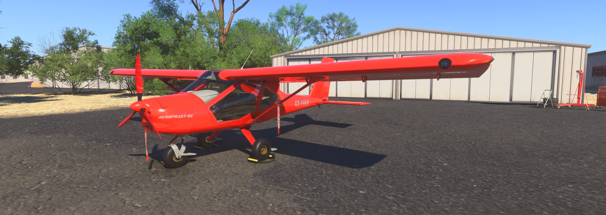
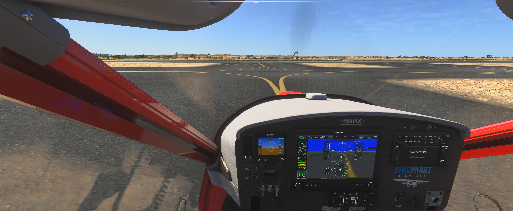

<!-- Explicit RTL lists and HTML tables preserve GitHub direction and column widths. -->

# בד״ח למטוס איירופראקט A⁠-⁠32 ויקסן

<strong>!!! לשימוש סימולטור בלבד !!!</strong>

מיועד לשימוש עם Microsoft Flight Simulator 2024 ומודול Got Friends Aeroprakt A⁠-⁠32 Vixxen Explorer עם מנוע Rotax&nbsp;912&nbsp;iS&nbsp;Sport ולוח G3X&nbsp;Touch

## תכונות המטוס ומעבר מססנה&nbsp;172

הוויקסן הוא מטוס ספורט קל עם שני מושבים, כנף עילית ודלתות שקופות. ההשוואה כאן היא לססנה&nbsp;172SP עם לוח אנלוגי. בתצורת Explorer מותקנים צמיגי טונדרה ומגיני בוץ לבחירה. תצוגת G3X&nbsp;Touch מרכזת את מכשירי הטיסה, ה־G5 מספק תצוגת אופק נוספת, וה־MFD⁠-⁠650 משמש לניווט בתצורה הבסיסית.

מדדי המנוע מופיעים בשמאל תצוגת G3X&nbsp;Touch. בצילום שלהלן, מכשיר הניווט הימני מציג את מסך האתחול של GTN&nbsp;650Xi.

<ul dir="rtl">
<li dir="rtl"><strong>ראות והסעה</strong> — הדלתות השקופות עוזרות לראות את הקרקע ואת התנועה לצדדים. הדוושות מכוונות את גלגל האף וידית אחת מפעילה את שני הבלמים. הורד מצערת לסרק לפני עצירה והפעל את הבלם בעדינות.</li>
<li dir="rtl"><strong>הגאים ורוח</strong> — המטוס קל יותר מהססנה ומגיב היטב לתיקונים קטנים. התאם את הדוושות והמאזנות לרוח והקפד על מהירות גישה יציבה. במשבי רוח חזקים המטוס נזרק בקלות. טיסה בתנאי רוח חזקה אינה מומלצת.</li>
<li dir="rtl"><strong>המראה ונחיתה</strong> — בוויקסן המאזנות משמשות גם כמדפים (Flaperons). מצבי המדפים הם מקופל (0°), ביניים (10°) ומלא (20°). הוצא מדפים רק בתוך תחום המהירות שלהם. בהליכה סביב הפחת את המדפים בהדרגה לאחר טיפוס מבוסס ובגובה בטוח.</li>
<li dir="rtl"><strong>מצערת בלבד</strong> — מערכת ניהול המנוע שולטת בהזרקה ובהצתה. אין ידית תערובת או ידית פסיעת מדחף. מד הסל״ד מציג את מהירות המנוע. תיבת ההפחתה גורמת למדחף להסתובב לאט יותר מהמנוע.</li>
<li dir="rtl"><strong>מנוע יעיל</strong> — צריכת הדלק של הוויקסן נמוכה ביחס למטוסים גדולים יותר. המנוע יכול לפעול על בנזין נטול עופרת בדירוג 95&nbsp;RON ומעלה.</li>
</ul>

### מנוע והזנת דלק

יחידת בקרת המנוע (ECU) כוללת שני ערוצים, Lane&nbsp;A ו־Lane&nbsp;B. שניהם פועלים בטיסה רגילה. במהלך הבדיקה הקרקעית בודקים כל ערוץ בתורו ומחזירים אותו למצב ON לפני כיבוי הערוץ השני. ודא שנוריות שני הערוצים כבויות בסיום הבדיקה. לכיבוי המנוע מכבים את שני הערוצים ולאחר מכן את משאבות הדלק.

<strong>הבדל מהססנה בחניה</strong> — בשגרת החניה של הססנה&nbsp;172SP המשמשת להשוואה, בורר הדלק על LEFT וברז הניתוק למנוע סגור. ידית הניתוק גלויה בתא הטייס. בוויקסן סוגרים בחניה שני ברזים נפרדים, אחד לכל מכל כנף. מאחורי הטייס מותקן ברז אחד על מסגרת הדלת השמאלית וברז אחד על מסגרת הדלת הימנית. שניהם מחוץ לשדה הראייה הרגיל של הטייס.

<strong>חובה לבדוק את שני הברזים לפני ההתנעה ושוב לפני ההמראה.</strong> בסימולטור, הדלק שנותר במערכת עשוי להספיק להתנעה ולהסעה עד לעמדת ההמראה גם כששני הברזים סגורים. המנוע עלול לכבות עם פתיחת המצערת להמראה או זמן קצר אחרי הניתוק. הסתכל ישירות על שני הברזים. ודא שלפחות אחד פתוח ושמצב שניהם מתאים לכמויות הדלק.

כששני המכלים מעל שלושה רבעים, פתח ברז אחד בלבד כדי לצמצם מעבר דלק ואובדן דרך פתחי האוורור. כשאחד המכלים בשלושה רבעים או פחות, פתח את שני הברזים. אם מאזנים מכלים בטיסה, ודא ששניהם מעל רבע ושהברז השני פתוח לפני סגירת ברז כלשהו. כשאחד המכלים ברבע או פחות, השאר את שני הברזים פתוחים. בדוק כמות בשני הצדדים גם אחרי ההמראה.

### בלימה ואביזרי קרקע

ידית הבלם מפעילה את בלמי שני הגלגלים הראשיים ללא בלימה דיפרנציאלית. ידית בלם החניה משמשת לנעילה בעצירה. גלגל האף מחובר להגה הכיוון ומכוון את המטוס בהסעה. בתפריט האביזרים של המודול, כיסויי המטוס מונעים התנעה וסדי הגלגלים מונעים תנועה. הסר אותם בהכנה לטיסה.

### קשר בסימולטור

ברשת VATSIM, תדר תיאום התנועה בשדה ללא פיקוח נקרא CTAF (Common Traffic Advisory Frequency) כאשר הוקצה לשדה תדר ייעודי. במקומות שבהם אין תדר ייעודי, ובהם ישראל, השתמש ב־UNICOM בתדר 122.800&nbsp;MHz. הביטוי UNICOM/CTAF בבד״ח מציין את תדר התיאום החל בשדה.

<table dir="rtl" width="100%">
<thead>
<tr>
<th dir="rtl" align="right" width="25%"><strong>סקירה כללית ותפקיד</strong></th>
<th dir="rtl" align="right" width="30%"><strong>Cessna 172SP</strong></th>
<th dir="rtl" align="right" width="45%"><strong>Aeroprakt A⁠-⁠32 Vixxen</strong></th>
</tr>
</thead>
<tbody>
<tr>
<td dir="rtl" align="right" width="2500">שימוש עיקרי</td>
<td dir="rtl" align="right" width="3000">מטוס אימון, תיור ותובלה קלה</td>
<td dir="rtl" align="right" width="4500">מטוס ספורט קל לטיסות פנאי, אימון וניווט</td>
</tr>
<tr>
<td dir="rtl" align="right">תא טייס וראות</td>
<td dir="rtl" align="right">תא סגור וכנף עילית</td>
<td dir="rtl" align="right">תא סגור וכנף עילית. דלתות שקופות משפרות את הראות מטה ולצדדים.</td>
</tr>
<tr>
<td dir="rtl" align="right">מבנה</td>
<td dir="rtl" align="right">כנף עילית עם תמוכות, גוף אלומיניום</td>
<td dir="rtl" align="right">כנף עילית עם תמוכות, גוף אלומיניום</td>
</tr>
</tbody>
</table>

<table dir="rtl" width="100%">
<thead>
<tr>
<th dir="rtl" align="right" width="25%"><strong>ממדים ומשקלים</strong></th>
<th dir="rtl" align="right" width="30%"><strong>Cessna 172SP</strong></th>
<th dir="rtl" align="right" width="45%"><strong>Aeroprakt A⁠-⁠32 Vixxen</strong></th>
</tr>
</thead>
<tbody>
<tr>
<td dir="rtl" align="right" width="2500">מוטת כנפיים</td>
<td dir="rtl" align="right" width="3000">36.08&nbsp;ft&nbsp;[11.00&nbsp;m]</td>
<td dir="rtl" align="right" width="4500">31.00&nbsp;ft&nbsp;[9.45&nbsp;m]</td>
</tr>
<tr>
<td dir="rtl" align="right">אורך</td>
<td dir="rtl" align="right">27.17&nbsp;ft&nbsp;[8.28&nbsp;m]</td>
<td dir="rtl" align="right">20.58&nbsp;ft&nbsp;[6.27&nbsp;m]</td>
</tr>
<tr>
<td dir="rtl" align="right">גובה</td>
<td dir="rtl" align="right">8.92&nbsp;ft&nbsp;[2.72&nbsp;m]</td>
<td dir="rtl" align="right">7.28&nbsp;ft&nbsp;[2.22&nbsp;m]</td>
</tr>
<tr>
<td dir="rtl" align="right">שטח כנף</td>
<td dir="rtl" align="right">174&nbsp;ft²&nbsp;[16.2&nbsp;m²]</td>
<td dir="rtl" align="right">138&nbsp;ft²&nbsp;[12.8&nbsp;m²]</td>
</tr>
<tr>
<td dir="rtl" align="right">משקל ריק לדוגמה</td>
<td dir="rtl" align="right">1,665&nbsp;lb&nbsp;[755&nbsp;kg]</td>
<td dir="rtl" align="right">800&nbsp;lb&nbsp;[363&nbsp;kg]</td>
</tr>
<tr>
<td dir="rtl" align="right">משקל המראה מרבי</td>
<td dir="rtl" align="right">2,550&nbsp;lb&nbsp;[1,157&nbsp;kg]</td>
<td dir="rtl" align="right">1,320&nbsp;lb&nbsp;[599&nbsp;kg]</td>
</tr>
<tr>
<td dir="rtl" align="right">מטען מועיל לפי משקל ריק זה</td>
<td dir="rtl" align="right">885&nbsp;lb&nbsp;[401&nbsp;kg]</td>
<td dir="rtl" align="right">520&nbsp;lb&nbsp;[236&nbsp;kg]</td>
</tr>
</tbody>
</table>

<table dir="rtl" width="100%">
<thead>
<tr>
<th dir="rtl" align="right" width="25%"><strong>כנפיים והגאי טיסה</strong></th>
<th dir="rtl" align="right" width="30%"><strong>Cessna 172SP</strong></th>
<th dir="rtl" align="right" width="45%"><strong>Aeroprakt A⁠-⁠32 Vixxen</strong></th>
</tr>
</thead>
<tbody>
<tr>
<td dir="rtl" align="right" width="2500">אמצעי עילוי והפעלה</td>
<td dir="rtl" align="right" width="3000">מדפים חשמליים נפרדים. מקופל (0°), ביניים ראשון (10°), ביניים שני (20°) ומלא (30°).</td>
<td dir="rtl" align="right" width="4500">מאזנות משולבות במדפים, הפעלה מכנית. מקופל (0°), ביניים (10°) ומלא (20°).</td>
</tr>
<tr>
<td dir="rtl" align="right">הגאי טיסה</td>
<td dir="rtl" align="right">הגה ודוושות בשני המושבים הקדמיים</td>
<td dir="rtl" align="right">הגה ודוושות בשני המושבים</td>
</tr>
<tr>
<td dir="rtl" align="right">קיזוז בגובה</td>
<td dir="rtl" align="right">מקזז גובה ידני</td>
<td dir="rtl" align="right">ידית מקזז גובה ידנית</td>
</tr>
<tr>
<td dir="rtl" align="right">זווית התקפה קריטית</td>
<td dir="rtl" align="right">כ־16°</td>
<td dir="rtl" align="right">19.5° נקי, 17.75° במדפים מלאים</td>
</tr>
</tbody>
</table>

<table dir="rtl" width="100%">
<thead>
<tr>
<th dir="rtl" align="right" width="25%"><strong>מנוע ומדחף</strong></th>
<th dir="rtl" align="right" width="30%"><strong>Cessna 172SP</strong></th>
<th dir="rtl" align="right" width="45%"><strong>Aeroprakt A⁠-⁠32 Vixxen</strong></th>
</tr>
</thead>
<tbody>
<tr>
<td dir="rtl" align="right" width="2500">מנוע</td>
<td dir="rtl" align="right" width="3000">Lycoming IO-360-L2A, ארבעה צילינדרים, הזרקה וקירור אוויר</td>
<td dir="rtl" align="right" width="4500">Rotax&nbsp;912&nbsp;iS&nbsp;Sport, ארבעה צילינדרים, הזרקה וקירור משולב של אוויר ונוזל</td>
</tr>
<tr>
<td dir="rtl" align="right">נפח מנוע</td>
<td dir="rtl" align="right">360&nbsp;in³&nbsp;[5.90&nbsp;L]</td>
<td dir="rtl" align="right">82.6&nbsp;in³&nbsp;[1.35&nbsp;L]</td>
</tr>
<tr>
<td dir="rtl" align="right">הספק להמראה</td>
<td dir="rtl" align="right">180 כ״ס ב־2,700&nbsp;RPM</td>
<td dir="rtl" align="right">100 כ״ס ב־5,800&nbsp;RPM למשך עד 5 דקות</td>
</tr>
<tr>
<td dir="rtl" align="right">סל״ד מנוע רציף מרבי</td>
<td dir="rtl" align="right">2,700&nbsp;RPM</td>
<td dir="rtl" align="right">5,500&nbsp;RPM</td>
</tr>
<tr>
<td dir="rtl" align="right">ניהול תערובת והצתה</td>
<td dir="rtl" align="right">ידית תערובת ומפתח מגנטואים</td>
<td dir="rtl" align="right">תערובת והצתה בניהול ממוחשב, מתגי Lane&nbsp;A ו־Lane&nbsp;B</td>
</tr>
<tr>
<td dir="rtl" align="right">מדחף</td>
<td dir="rtl" align="right">דו־להבי, פסיעה קבועה, קוטר 6.33&nbsp;ft&nbsp;[1.93&nbsp;m]</td>
<td dir="rtl" align="right">תלת־להבי, פסיעה קבועה במודול, קוטר 5.68&nbsp;ft&nbsp;[1.73&nbsp;m]</td>
</tr>
</tbody>
</table>

<table dir="rtl" width="100%">
<thead>
<tr>
<th dir="rtl" align="right" width="25%"><strong>מערכת דלק</strong></th>
<th dir="rtl" align="right" width="30%"><strong>Cessna 172SP</strong></th>
<th dir="rtl" align="right" width="45%"><strong>Aeroprakt A⁠-⁠32 Vixxen</strong></th>
</tr>
</thead>
<tbody>
<tr>
<td dir="rtl" align="right" width="2500">דלק</td>
<td dir="rtl" align="right" width="3000">100LL&nbsp;Avgas</td>
<td dir="rtl" align="right" width="4500">בנזין נטול עופרת RON&nbsp;95 ומעלה או 100LL&nbsp;Avgas לפי מפרט המטוס</td>
</tr>
<tr>
<td dir="rtl" align="right">קיבולת כוללת</td>
<td dir="rtl" align="right">56&nbsp;US&nbsp;gal&nbsp;[212.0&nbsp;L]</td>
<td dir="rtl" align="right">30.1&nbsp;US&nbsp;gal&nbsp;[113.9&nbsp;L]</td>
</tr>
<tr>
<td dir="rtl" align="right">קיבולת שמישה</td>
<td dir="rtl" align="right">53&nbsp;US&nbsp;gal&nbsp;[200.6&nbsp;L]</td>
<td dir="rtl" align="right">29.6&nbsp;US&nbsp;gal&nbsp;[112.0&nbsp;L]</td>
</tr>
<tr>
<td dir="rtl" align="right">מכלים ובקרה</td>
<td dir="rtl" align="right">שני מכלי כנף, בורר ומנתק דלק</td>
<td dir="rtl" align="right">שני מכלי כנף, ברז נפרד לכל מכל</td>
</tr>
<tr>
<td dir="rtl" align="right">מצב ברזים בחניה</td>
<td dir="rtl" align="right">בשגרת ההשוואה הבורר על LEFT וידית הניתוק הגלויה בתא הטייס במצב סגור</td>
<td dir="rtl" align="right">שני הברזים סגורים. ברז על כל אחת ממסגרות הדלתות, אחד בכל צד מאחורי הטייס.</td>
</tr>
<tr>
<td dir="rtl" align="right">הזנה</td>
<td dir="rtl" align="right">הזנת כבידה למכל איסוף ומשאבות</td>
<td dir="rtl" align="right">שתי משאבות חשמליות והחזרת דלק למכל לפי מצב הברזים</td>
</tr>
</tbody>
</table>

<table dir="rtl" width="100%">
<thead>
<tr>
<th dir="rtl" align="right" width="25%"><strong>כן נסע ובלימה</strong></th>
<th dir="rtl" align="right" width="30%"><strong>Cessna 172SP</strong></th>
<th dir="rtl" align="right" width="45%"><strong>Aeroprakt A⁠-⁠32 Vixxen</strong></th>
</tr>
</thead>
<tbody>
<tr>
<td dir="rtl" align="right" width="2500">תצורת כן נסע</td>
<td dir="rtl" align="right" width="3000">כן נסע קבוע עם גלגל אף</td>
<td dir="rtl" align="right" width="4500">כן נסע קבוע עם גלגל אף</td>
</tr>
<tr>
<td dir="rtl" align="right">היגוי גלגל אף</td>
<td dir="rtl" align="right">באמצעות הדוושות</td>
<td dir="rtl" align="right">באמצעות הדוושות</td>
</tr>
<tr>
<td dir="rtl" align="right">בלמי גלגלים</td>
<td dir="rtl" align="right">דוושות נפרדות, בלימה דיפרנציאלית</td>
<td dir="rtl" align="right">ידית משותפת לשני הבלמים, ללא בלימה דיפרנציאלית</td>
</tr>
<tr>
<td dir="rtl" align="right">בלם חניה</td>
<td dir="rtl" align="right">ידית נעילה</td>
<td dir="rtl" align="right">ידית נעילה לצד ידית הבלם</td>
</tr>
</tbody>
</table>

<table dir="rtl" width="100%">
<thead>
<tr>
<th dir="rtl" align="right" width="25%"><strong>מהירויות ומגבלות</strong></th>
<th dir="rtl" align="right" width="30%"><strong>Cessna 172SP</strong></th>
<th dir="rtl" align="right" width="45%"><strong>Aeroprakt A⁠-⁠32 Vixxen</strong></th>
</tr>
</thead>
<tbody>
<tr>
<td dir="rtl" align="right" width="2500">הזדקרות במשקל מרבי</td>
<td dir="rtl" align="right" width="3000">נקי 48&nbsp;KIAS&nbsp;[89&nbsp;kph] מדפים מלאים 40&nbsp;KIAS&nbsp;[74&nbsp;kph]</td>
<td dir="rtl" align="right" width="4500">נקי 32&nbsp;KIAS&nbsp;[59&nbsp;kph] מדפים מלאים 27&nbsp;KIAS&nbsp;[50&nbsp;kph]</td>
</tr>
<tr>
<td dir="rtl" align="right">טיפוס בזווית מיטבית (Vx)</td>
<td dir="rtl" align="right">62&nbsp;KIAS&nbsp;[115&nbsp;kph] בגובה פני הים</td>
<td dir="rtl" align="right">54&nbsp;KIAS&nbsp;[100&nbsp;kph]</td>
</tr>
<tr>
<td dir="rtl" align="right">טיפוס בשיעור מיטבי (Vy)</td>
<td dir="rtl" align="right">74&nbsp;KIAS&nbsp;[137&nbsp;kph] בגובה פני הים</td>
<td dir="rtl" align="right">65&nbsp;KIAS&nbsp;[120&nbsp;kph]</td>
</tr>
<tr>
<td dir="rtl" align="right">מגבלת מדפים (Vfe)</td>
<td dir="rtl" align="right">110&nbsp;KIAS&nbsp;[204&nbsp;kph] ב־10° 85&nbsp;KIAS&nbsp;[157&nbsp;kph] ב־20° או 30°</td>
<td dir="rtl" align="right">79&nbsp;KIAS&nbsp;[146&nbsp;kph]</td>
</tr>
<tr>
<td dir="rtl" align="right">גבול הקשת הירוקה (Vno)</td>
<td dir="rtl" align="right">129&nbsp;KIAS&nbsp;[239&nbsp;kph]</td>
<td dir="rtl" align="right">112&nbsp;KIAS&nbsp;[207&nbsp;kph]</td>
</tr>
<tr>
<td dir="rtl" align="right">מהירות שאין לעבור (Vne)</td>
<td dir="rtl" align="right">163&nbsp;KIAS&nbsp;[302&nbsp;kph]</td>
<td dir="rtl" align="right">130&nbsp;KIAS&nbsp;[241&nbsp;kph]</td>
</tr>
<tr>
<td dir="rtl" align="right">מהירות גלישה מיטבית (Vbg)</td>
<td dir="rtl" align="right">68&nbsp;KIAS&nbsp;[126&nbsp;kph]</td>
<td dir="rtl" align="right">59&nbsp;KIAS&nbsp;[109&nbsp;kph]</td>
</tr>
<tr>
<td dir="rtl" align="right">גישה סופית</td>
<td dir="rtl" align="right">60&#8288;–&#8288;70&nbsp;KIAS&nbsp;[111&#8288;–&#8288;130&nbsp;kph] בגישה רגילה</td>
<td dir="rtl" align="right">רגילה 54&nbsp;KIAS&nbsp;[100&nbsp;kph] שדה קצר או רך 49&nbsp;KIAS&nbsp;[91&nbsp;kph]</td>
</tr>
</tbody>
</table>

<table dir="rtl" width="100%">
<thead>
<tr>
<th dir="rtl" align="right" width="25%"><strong>ביצועים ושיוט</strong></th>
<th dir="rtl" align="right" width="30%"><strong>Cessna 172SP</strong></th>
<th dir="rtl" align="right" width="45%"><strong>Aeroprakt A⁠-⁠32 Vixxen</strong></th>
</tr>
</thead>
<tbody>
<tr>
<td dir="rtl" align="right" width="2500">יחס גלישה</td>
<td dir="rtl" align="right" width="3000">כ־9:1</td>
<td dir="rtl" align="right" width="4500">12:1</td>
</tr>
<tr>
<td dir="rtl" align="right">קצב טיפוס מרבי בגובה פני הים</td>
<td dir="rtl" align="right">730&nbsp;fpm&nbsp;[223&nbsp;m/min]</td>
<td dir="rtl" align="right">827&nbsp;fpm&nbsp;[252&nbsp;m/min] ב־Vy, במשקל המראה מרבי ובתנאים תקניים</td>
</tr>
<tr>
<td dir="rtl" align="right">נתון שיוט להשוואה</td>
<td dir="rtl" align="right">124&nbsp;KTAS&nbsp;[230&nbsp;kph] ב־75% כוח ובגובה לחץ 8,500&nbsp;ft&nbsp;[2,591&nbsp;m] בתנאים תקניים</td>
<td dir="rtl" align="right">94&nbsp;KIAS&nbsp;[174&nbsp;kph] ב־4,650&nbsp;RPM לפי טבלת ביצועי המטוס.</td>
</tr>
<tr>
<td dir="rtl" align="right">עומס תמרון</td>
<td dir="rtl" align="right">‎+3.8&nbsp;g עד −1.52&nbsp;g בקטגוריה רגילה.</td>
<td dir="rtl" align="right">‎+4.0&nbsp;g עד −2.0&nbsp;g בנתוני המטוס במשקל מרבי. תמרונים אירובטיים וסחרורים מחוץ להיקף הבד״ח.</td>
</tr>
</tbody>
</table>

<table dir="rtl" width="100%">
<thead>
<tr>
<th dir="rtl" align="right" width="25%"><strong>אוויוניקה והעמסה</strong></th>
<th dir="rtl" align="right" width="30%"><strong>Cessna 172SP</strong></th>
<th dir="rtl" align="right" width="45%"><strong>Aeroprakt A⁠-⁠32 Vixxen</strong></th>
</tr>
</thead>
<tbody>
<tr>
<td dir="rtl" align="right" width="2500">לוח מכשירים</td>
<td dir="rtl" align="right" width="3000">מכשירי טיסה אנלוגיים</td>
<td dir="rtl" align="right" width="4500">G3X&nbsp;Touch, תצוגת אופק G5 ונוריות Lane נפרדות</td>
</tr>
<tr>
<td dir="rtl" align="right">קשר וניווט</td>
<td dir="rtl" align="right">מכשירי קשר וניווט לפי התקנה</td>
<td dir="rtl" align="right">MFD⁠-⁠650 בתצורת הבסיס, עם לוח שמע GMA⁠-⁠345</td>
</tr>
<tr>
<td dir="rtl" align="right">טייס אוטומטי</td>
<td dir="rtl" align="right">KAP 140 בתצורת הייחוס</td>
<td dir="rtl" align="right">בקר GMC⁠-⁠307 בלוח הדיגיטלי. הבד״ח מניח הטסה ידנית.</td>
</tr>
<tr>
<td dir="rtl" align="right">מושבים</td>
<td dir="rtl" align="right">ארבעה</td>
<td dir="rtl" align="right">שניים זה לצד זה</td>
</tr>
<tr>
<td dir="rtl" align="right">כבודה</td>
<td dir="rtl" align="right">עד 120&nbsp;lb&nbsp;[54&nbsp;kg] בכפוף למעטפת ההעמסה</td>
<td dir="rtl" align="right">תא מאחורי המושבים. 66&nbsp;lb&nbsp;[30&nbsp;kg], בכפוף למשקל ולאיזון.</td>
</tr>
</tbody>
</table>

## בד״ח לפני התנעה

<ol dir="rtl" type="1">
<li dir="rtl">מזג אוויר, מסלול, מפות ותדרים – בדוק.</li>
<li dir="rtl">משקל ומרכז כובד – בדוק לפי ההעמסה בסימולטור.</li>
<li dir="rtl">דלק – בדוק כמות בשני המכלים מול התכנון.</li>
<li dir="rtl">כיסויי מטוס ופיטו – הסר.</li>
<li dir="rtl">סדי גלגלים – הסר.</li>
<li dir="rtl">בלם חניה – נעל בעצירה.</li>
<li dir="rtl">כבודה וחפצים רופפים – אבטח.</li>
<li dir="rtl">מושבים וחגורות – כוון ואבטח.</li>
<li dir="rtl">דלתות – סגור ונעל.</li>
<li dir="rtl">מפסקי חשמל – כבויים.</li>
<li dir="rtl">הגאים – חופשיים ובכיוון הנכון.</li>
<li dir="rtl">מקזז גובה – מצב המראה.</li>
<li dir="rtl">מדפים – 0°.</li>
<li dir="rtl">שני ברזי הדלק מאחור – קבע לפי הכמויות בשני המכלים.</li>
</ol>

## בד״ח התנעה

<strong>ברזי דלק להתנעה</strong> — כששני המכלים מעל שלושה רבעים, ברז אחד פתוח בלבד. בכל מצב אחר שני הברזים פתוחים.

<ol dir="rtl" type="1">
<li dir="rtl">אזור המדחף – פנוי.</li>
<li dir="rtl">מפסק חיבור מצבר מתחת למושב – ON.</li>
<li dir="rtl">מפתח מצבר ראשי – ON.</li>
<li dir="rtl"><strong>שני ברזי הדלק מאחור – בדוק במבט ישיר שלפחות אחד פתוח ושמצבם מתאים לכמויות.</strong></li>
<li dir="rtl">מצערת – כ־50% בתנאי טמפרטורה רגילים.</li>
<li dir="rtl">נצנוץ (STROBE) – ON.</li>
<li dir="rtl"><strong>עם פיקוח, קבל מרשה התנעה אם נדרש.</strong></li>
<li dir="rtl"><strong>ללא פיקוח, האזן ב־</strong><strong>UNICOM/CTAF</strong><strong> ודווח כוונת התנעה לפי התנועה.</strong></li>
<li dir="rtl">משאבה ראשית (Pump 1) – ON.</li>
<li dir="rtl">משאבת גיבוי (Pump 2) – OFF.</li>
<li dir="rtl">Lane&nbsp;A – ON.</li>
<li dir="rtl">Lane&nbsp;B – ON.</li>
<li dir="rtl">מתג START&nbsp;POWER – הרם.</li>
<li dir="rtl">נוריות Lane – המתן לכיבוין בסיום הבדיקה העצמית.</li>
<li dir="rtl">לחצן START – לחץ כשיש כוח התנעה. עד 10 שניות לניסיון, עם המתנה של 2 דקות בין ניסיונות.</li>
<li dir="rtl">מצערת – הפחת מיד לאחר ההתנעה.</li>
<li dir="rtl">לחץ שמן – בדוק עלייה.</li>
</ol>

## בד״ח חימום אחרי התנעה

<ol dir="rtl" type="1">
<li dir="rtl">מנוע קר – כוון ל־2,000&nbsp;RPM למשך 2 דקות.</li>
<li dir="rtl">חימום מנוע קר – המשך ב־2,500&nbsp;RPM עד לפחות 50°C&nbsp;[122°F] שמן.</li>
<li dir="rtl">מנוע חם – התייצב בסרק. אמת שטמפרטורת השמן לפחות 50°C&nbsp;[122°F].</li>
<li dir="rtl">טעינת מצבר – בדוק ב־2,500–2,600&nbsp;RPM.</li>
<li dir="rtl">מחווני מנוע – בטווח התקין.</li>
<li dir="rtl">מצערת – סרק.</li>
</ol>

## בד״ח מבחן מנוע

<ol dir="rtl" type="1">
<li dir="rtl">בלם – הפעל.</li>
<li dir="rtl">נוזל קירור – לפחות 60°C&nbsp;[140°F].</li>
<li dir="rtl">מצערת – 4,000&nbsp;RPM.</li>
<li dir="rtl">Lane&nbsp;A – כבה. שינוי מרבי של 250&nbsp;RPM.</li>
<li dir="rtl">Lane&nbsp;A – החזר ל־ON.</li>
<li dir="rtl">Lane&nbsp;B – כבה. שינוי מרבי של 250&nbsp;RPM.</li>
<li dir="rtl">Lane&nbsp;B – החזר ל־ON.</li>
<li dir="rtl">נוריות Lane – בדוק ששתיהן כבויות.</li>
<li dir="rtl">מצערת – 2,500&nbsp;RPM.</li>
<li dir="rtl">משאבת גיבוי (Pump 2) – ON.</li>
<li dir="rtl">משאבה ראשית (Pump 1) – OFF.</li>
<li dir="rtl">פעולת המנוע – יציבה.</li>
<li dir="rtl">משאבה ראשית (Pump 1) – ON. ודא ששתי המשאבות פועלות.</li>
<li dir="rtl">מצערת – סרק.</li>
</ol>

<strong>עצור את ההכנות להמראה אם פעולת המנוע אינה יציבה, אם נורית </strong><strong>Lane</strong><strong> נשארת דולקת או אם השינוי בסל״ד חורג מהגבול.</strong>

## בד״ח לפני הסעה והסעה

<ol dir="rtl" type="1">
<li dir="rtl">אוויוניקה – ON.</li>
<li dir="rtl">קשר וניווט – קבע תדרים ונתיב.</li>
<li dir="rtl">מד גובה – קבע לחץ מקומי (QNH).</li>
<li dir="rtl">חיווי כיוון בתצוגת G3X – השווה למצפן.</li>
<li dir="rtl">טרנספונדר – קבע קוד לפי ההנחיות ומצב ALT אם נדרש.</li>
<li dir="rtl">מדפים – בדוק תנועה מלאה והחזר ל־0°.</li>
<li dir="rtl">פנס הסעה – ON.</li>
<li dir="rtl"><strong>עם פיקוח, קבל מרשה הסעה וחזור על מסלול ההסעה.</strong></li>
<li dir="rtl"><strong>ללא פיקוח, דווח מיקום וכוונת הסעה ב־</strong><strong>UNICOM/CTAF</strong><strong>.</strong></li>
<li dir="rtl">נתיב הסעה – פנוי.</li>
<li dir="rtl">בלם חניה – שחרר.</li>
<li dir="rtl">בלמים – בדוק עם תחילת התנועה.</li>
<li dir="rtl">גלגל אף – בדוק היגוי.</li>
<li dir="rtl">מכשירי פנייה וכיוון – בדוק תגובה בפניות.</li>
<li dir="rtl">מאזנות – לתוך רוח הצד.</li>
<li dir="rtl">מצערת – התאם למהירות הסעה איטית. עבור לסרק לפני עצירה.</li>
</ol>

## בד״ח לפני המראה

<ol dir="rtl" type="1">
<li dir="rtl">בלם – הפעל.</li>
<li dir="rtl">הגאים – חופשיים ובכיוון הנכון.</li>
<li dir="rtl">מקזז גובה – מצב המראה.</li>
<li dir="rtl">טמפרטורת שמן – לפחות 50°C&nbsp;[122°F].</li>
<li dir="rtl">טמפרטורת נוזל קירור – לפחות 60°C&nbsp;[140°F].</li>
<li dir="rtl">כמות דלק – בדוק בשני המכלים.</li>
<li dir="rtl"><strong>שני ברזי הדלק מאחור – בדוק במבט ישיר שלפחות אחד פתוח ושמצבם מתאים לכמויות.</strong></li>
<li dir="rtl">משאבות דלק – שתיהן ON.</li>
<li dir="rtl">מדפים – 10° להמראה רגילה או 20° להמראה משדה קצר או רך.</li>
<li dir="rtl">אורות ניווט ונחיתה – הפעל.</li>
<li dir="rtl">פנס הסעה – כבה.</li>
<li dir="rtl"><strong>עם פיקוח, קבל מרשה כניסה למסלול והמראה לפי השלב.</strong></li>
<li dir="rtl"><strong>ללא פיקוח, דווח מסלול וכוונת המראה ב־</strong><strong>UNICOM/CTAF</strong><strong>.</strong></li>
</ol>

## בד״ח המראה רגילה

<ol dir="rtl" type="1">
<li dir="rtl">מסלול – אמת כיוון מול החיווי בתצוגת G3X.</li>
<li dir="rtl">מאזנות – לתוך רוח הצד.</li>
<li dir="rtl">בלם – שחרר.</li>
<li dir="rtl">מצערת – פתח בהדרגה לכוח מלא.</li>
<li dir="rtl">מכשירי מנוע – בדוק סל״ד ולחצים.</li>
<li dir="rtl">ציר מסלול – שמור בעזרת הדוושות.</li>
<li dir="rtl">אף – הרם בעדינות והנח למטוס להתנתק.</li>
<li dir="rtl">לאחר ניתוק – האץ לפחות ל־43&nbsp;KIAS&nbsp;[80&nbsp;kph] לפני טיפוס.</li>
</ol>

## בד״ח המראה משדה קצר או רך

<ol dir="rtl" type="1">
<li dir="rtl">אורך מסלול ומכשולים – בדוק מראש.</li>
<li dir="rtl">מדפים – 20°.</li>
<li dir="rtl">מסלול – אמת כיוון.</li>
<li dir="rtl">מצערת – פתח בהדרגה לכוח מלא.</li>
<li dir="rtl">בלם – שחרר.</li>
<li dir="rtl">ציר מסלול – שמור בעזרת הדוושות.</li>
<li dir="rtl">ניתוק – כ־35&nbsp;KIAS&nbsp;[65&nbsp;kph].</li>
<li dir="rtl">לאחר ניתוק – האץ לפחות ל־49&nbsp;KIAS&nbsp;[91&nbsp;kph] קרוב למסלול.</li>
<li dir="rtl">טיפוס לפינוי מכשולים – 54&nbsp;KIAS&nbsp;[100&nbsp;kph].</li>
</ol>

## בד״ח טיפוס

<ol dir="rtl" type="1">
<li dir="rtl">מהירות – 65&nbsp;KIAS&nbsp;[120&nbsp;kph] לשיעור טיפוס מיטבי, או 54&nbsp;KIAS&nbsp;[100&nbsp;kph] לפינוי מכשולים.</li>
<li dir="rtl">מדפים – קפל בהדרגה בגובה בטוח לאחר התבססות בטיפוס.</li>
<li dir="rtl">סל״ד מנוע – עד 5,800&nbsp;RPM למשך עד 5 דקות. לאחר מכן עד 5,500&nbsp;RPM.</li>
<li dir="rtl">מכשירי מנוע – בדוק.</li>
<li dir="rtl">מקזז גובה – התאם.</li>
<li dir="rtl">פנס נחיתה – כבה בעזיבת ההקפה או השדה.</li>
<li dir="rtl"><strong>דווח עזיבה לפיקוח לפי ההנחיות, או ב־</strong><strong>UNICOM/CTAF</strong><strong> לפי התנועה.</strong></li>
</ol>

## בד״ח שיוט

<ol dir="rtl" type="1">
<li dir="rtl">גובה – התייצב.</li>
<li dir="rtl">מצערת – קבע סל״ד שיוט לפי מהירות וצריכה רצויות.</li>
<li dir="rtl">מקזז גובה – התאם לטיסה ישרה ואופקית.</li>
<li dir="rtl">מחווני מנוע – בדוק.</li>
<li dir="rtl">דלק – בדוק כמויות ומצב שני הברזים.</li>
<li dir="rtl">נתיב ומרווח ממכשולים – אמת.</li>
</ol>

<table dir="rtl" width="100%">
<thead>
<tr>
<th dir="rtl" align="right" width="25%"><strong>סל״ד מנוע</strong></th>
<th dir="rtl" align="right" width="30%"><strong>מהירות שיוט להשוואה</strong></th>
<th dir="rtl" align="right" width="45%"><strong>צריכת דלק להשוואה</strong></th>
</tr>
</thead>
<tbody>
<tr>
<td dir="rtl" align="right" width="2500">3,400&nbsp;RPM</td>
<td dir="rtl" align="right" width="3000">43&nbsp;KIAS&nbsp;[80&nbsp;kph]</td>
<td dir="rtl" align="right" width="4500">1.83&nbsp;US&nbsp;gal/h&nbsp;[6.9&nbsp;L/h]</td>
</tr>
<tr>
<td dir="rtl" align="right">3,500&nbsp;RPM</td>
<td dir="rtl" align="right">54&nbsp;KIAS&nbsp;[100&nbsp;kph]</td>
<td dir="rtl" align="right">1.90&nbsp;US&nbsp;gal/h&nbsp;[7.2&nbsp;L/h]</td>
</tr>
<tr>
<td dir="rtl" align="right">3,800&nbsp;RPM</td>
<td dir="rtl" align="right">67&nbsp;KIAS&nbsp;[124&nbsp;kph]</td>
<td dir="rtl" align="right">2.24&nbsp;US&nbsp;gal/h&nbsp;[8.5&nbsp;L/h]</td>
</tr>
<tr>
<td dir="rtl" align="right">4,200&nbsp;RPM</td>
<td dir="rtl" align="right">81&nbsp;KIAS&nbsp;[150&nbsp;kph]</td>
<td dir="rtl" align="right">2.78&nbsp;US&nbsp;gal/h&nbsp;[10.5&nbsp;L/h]</td>
</tr>
<tr>
<td dir="rtl" align="right">4,650&nbsp;RPM</td>
<td dir="rtl" align="right">94&nbsp;KIAS&nbsp;[174&nbsp;kph]</td>
<td dir="rtl" align="right">3.43&nbsp;US&nbsp;gal/h&nbsp;[13.0&nbsp;L/h]</td>
</tr>
<tr>
<td dir="rtl" align="right">5,150&nbsp;RPM</td>
<td dir="rtl" align="right">108&nbsp;KIAS&nbsp;[200&nbsp;kph]</td>
<td dir="rtl" align="right">4.47&nbsp;US&nbsp;gal/h&nbsp;[16.9&nbsp;L/h]</td>
</tr>
<tr>
<td dir="rtl" align="right">5,500&nbsp;RPM</td>
<td dir="rtl" align="right">116&nbsp;KIAS&nbsp;[215&nbsp;kph]</td>
<td dir="rtl" align="right">5.69&nbsp;US&nbsp;gal/h&nbsp;[21.5&nbsp;L/h]</td>
</tr>
</tbody>
</table>

נתוני ייחוס מהמטוס במשקל המראה מרבי ובאטמוספרה תקנית (ISA), עם מדחף KievProp מכוון ל־5,100&nbsp;RPM בהמראה. פירוט המהירויות מ־3,500&nbsp;RPM מופיע בגובה 1,000&nbsp;ft&nbsp;[305&nbsp;m].

## בד״ח הנמכה ולפני נחיתה

<ol dir="rtl" type="1">
<li dir="rtl">מסלול, רוח ולחץ מקומי – בדוק.</li>
<li dir="rtl">נתיב הנמכה ומכשולים – בדוק.</li>
<li dir="rtl"><strong>עם פיקוח, דווח מיקום ובקש הנחיות כניסה להקפה.</strong></li>
<li dir="rtl"><strong>ללא פיקוח, דווח מיקום וכוונת הצטרפות ב־</strong><strong>UNICOM/CTAF</strong><strong>.</strong></li>
<li dir="rtl">דלק – בדוק כמות ומצב ברזים.</li>
<li dir="rtl">משאבות דלק – שתיהן ON.</li>
<li dir="rtl">פנס נחיתה – ON.</li>
<li dir="rtl">מהירות – האט אל מתחת ל־79&nbsp;KIAS&nbsp;[146&nbsp;kph] לפני הוצאת מדפים.</li>
<li dir="rtl">מדפים – 10° בגישה רגילה. ברוח מעל 16&nbsp;kt&nbsp;[30&nbsp;kph], 0°.</li>
<li dir="rtl">שדה קצר או רך – מדפים 20° וגישה סופית ב־49&nbsp;KIAS&nbsp;[91&nbsp;kph].</li>
<li dir="rtl">גישה רגילה – 54&nbsp;KIAS&nbsp;[100&nbsp;kph]. בגשם או בטלטלה חזקה הוסף 5&nbsp;kt&nbsp;[9&nbsp;kph] ליעד הגישה.</li>
<li dir="rtl">מקזז גובה – התאם.</li>
</ol>

## בד״ח נחיתה

<ol dir="rtl" type="1">
<li dir="rtl"><strong>עם פיקוח, דווח פיינל לפי ההנחיות וודא מרשה נחיתה.</strong></li>
<li dir="rtl"><strong>ללא פיקוח, דווח פיינל ב־</strong><strong>UNICOM/CTAF</strong><strong>.</strong></li>
<li dir="rtl">גישה – ייצב מהירות וציר. עבור להליכה סביב אם הגישה אינה מיוצבת.</li>
<li dir="rtl">הגה כיוון – יישר לציר המסלול.</li>
<li dir="rtl">מאזנות – בטל סחיפה ברוח צד.</li>
<li dir="rtl">הצפה – התחל קרוב למסלול והפחת מצערת לסרק.</li>
<li dir="rtl">נגיעה – על הגלגלים הראשיים. הורד את גלגל האף בעדינות.</li>
<li dir="rtl">מדפים – קפל לאחר הנגיעה.</li>
<li dir="rtl">בלם – לפי הצורך לאחר הורדת גלגל האף. במשטח רך הימנע מבלימה.</li>
</ol>

## בד״ח הליכה סביב

<ol dir="rtl" type="1">
<li dir="rtl">מצערת – פתח בהדרגה לכוח מלא.</li>
<li dir="rtl">הנמכה – עצור.</li>
<li dir="rtl">מהירות – האץ לפחות ל־54&nbsp;KIAS&nbsp;[100&nbsp;kph].</li>
<li dir="rtl">טיפוס – התבסס ב־54&nbsp;KIAS&nbsp;[100&nbsp;kph].</li>
<li dir="rtl">מדפים – קפל בהדרגה בגובה בטוח.</li>
<li dir="rtl"><strong>דווח על הליכה סביב לפיקוח או ב־</strong><strong>UNICOM/CTAF</strong><strong>.</strong></li>
<li dir="rtl">המשך בבדיקות טיפוס.</li>
</ol>

## בד״ח אחרי נחיתה ופינוי מסלול

<ol dir="rtl" type="1">
<li dir="rtl">מסלול – פנה במהירות הסעה בטוחה.</li>
<li dir="rtl"><strong>לאחר הפינוי, דווח לפיקוח או ב־</strong><strong>UNICOM/CTAF</strong><strong>.</strong></li>
<li dir="rtl">מדפים – 0°.</li>
<li dir="rtl">פנס נחיתה – OFF.</li>
<li dir="rtl">פנס הסעה – ON.</li>
</ol>

## בד״ח כיבוי ואבטחה

<ol dir="rtl" type="1">
<li dir="rtl">בלם חניה – נעל בעצירה.</li>
<li dir="rtl">מצערת – סרק.</li>
<li dir="rtl">מכשירי מנוע – בדוק. אם המנוע חם מהרגיל, קרר בסרק לפחות 2 דקות.</li>
<li dir="rtl">אוויוניקה ופנס הסעה – OFF.</li>
<li dir="rtl">Lane&nbsp;B – OFF.</li>
<li dir="rtl">Lane&nbsp;A – OFF.</li>
<li dir="rtl">שתי משאבות הדלק – OFF.</li>
<li dir="rtl">אורות – OFF.</li>
<li dir="rtl">מפתח מצבר ראשי – OFF.</li>
<li dir="rtl">מפסק חיבור מצבר – OFF.</li>
<li dir="rtl">ברזי דלק – סגור את שניהם.</li>
<li dir="rtl">ציוד ותא טייס – אבטח.</li>
</ol>

## בד״ח אובדן כוח בריצת המראה

<ol dir="rtl" type="1">
<li dir="rtl">מצערת – סרק.</li>
<li dir="rtl">שני ערוצי המנוע – OFF.</li>
<li dir="rtl">שתי משאבות הדלק – OFF.</li>
<li dir="rtl">בלם – הפעל לפי הצורך לשם עצירה.</li>
<li dir="rtl"><strong>דווח על ביטול המראה לפיקוח או ב־</strong><strong>UNICOM/CTAF</strong><strong>.</strong></li>
</ol>

## בד״ח אובדן כוח מיד אחרי המראה

<ol dir="rtl" type="1">
<li dir="rtl">אף – הורד וקבע 54&nbsp;KIAS&nbsp;[100&nbsp;kph].</li>
<li dir="rtl"><strong>אזור נחיתה – בחר לפנים והימנע ממכשולים. אל תבצע פניית </strong><strong>180°</strong><strong> בגובה נמוך.</strong></li>
<li dir="rtl">מצערת – סרק.</li>
<li dir="rtl">שני ערוצי המנוע – OFF.</li>
<li dir="rtl">שתי משאבות הדלק – OFF.</li>
<li dir="rtl">ברזי דלק – סגור כשיש פנאי לכך.</li>
<li dir="rtl"><strong>עם פיקוח, דווח חירום ומיקום אם הזמן מאפשר. ללא פיקוח, דווח מיקום וכוונות ב־</strong><strong>UNICOM/CTAF</strong><strong>.</strong></li>
<li dir="rtl"><strong>נחיתה – לפנים.</strong></li>
</ol>

## בד״ח אובדן כוח בשיוט

<ol dir="rtl" type="1">
<li dir="rtl">מהירות – קבע 59&nbsp;KIAS&nbsp;[109&nbsp;kph] לגלישה.</li>
<li dir="rtl">אתר נחיתה – בחר לפי גובה, רוח ומכשולים.</li>
<li dir="rtl"><strong>עם פיקוח, דווח חירום ומיקום אם הזמן מאפשר. ללא פיקוח, דווח מיקום וכוונות ב־</strong><strong>UNICOM/CTAF</strong><strong>.</strong></li>
<li dir="rtl">בגישה לנחיתה ללא כוח – מדפים 10°.</li>
<li dir="rtl">שתי משאבות הדלק – OFF.</li>
<li dir="rtl">ברזי דלק – סגור.</li>
<li dir="rtl">בפיינל לנחיתה, כשההגעה מובטחת – מדפים 20°.</li>
<li dir="rtl">נחיתה – במהירות מזערית בתנאים הקיימים.</li>
</ol>

