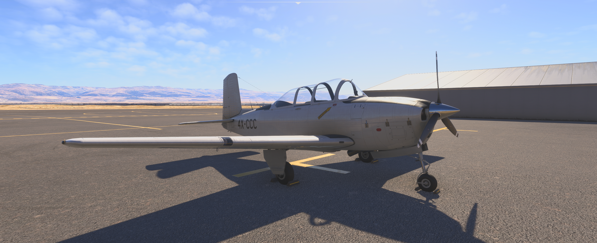

<!-- Explicit RTL lists and HTML tables preserve GitHub direction and column widths. -->

# בד״ח למטוס ביצ׳קראפט T-34B מנטור

<strong>!!! לשימוש סימולטור בלבד !!!</strong>

מיועד לשימוש עם Microsoft Flight Simulator 2024 ומודול T-34B של Carenado, עם לוח המכשירים המקורי ו־GNS

## תכונות מטוס והשוואה לססנה 172

הביצ׳קראפט T-34B מנטור, הנגזר מהביצ׳קראפט בוננזה, הוא מטוס אימון חד־מנועי בוכנתי, בעל כנף תחתית, שני מושבים בטנדם, כן נסע תלת־גלגלי מתקפל ומדחף בעל מהירות קבועה. הוא תוכנן לאימון טייסים צבאיים ולכן משלב ביצועים גבוהים מאלו של מטוס אימון בסיסי, ניהול מנוע ותצורה הדורש משמעת, ותא טייס צר ופונקציונלי המזכיר מטוס קרב. המנטור מהיר בהרבה מהססנה בתצורה נקייה (גלגלים למעלה, מדפים למעלה), אך בתצורת נחיתה הוא מטוס נוח וסלחני, ודומה לה במהירויות הגישה.

<ol dir="rtl" type="1">
<li dir="rtl"><strong>מטוס מורכב</strong> – בניגוד לססנה 172 הבסיסית, ניהול הטיסה כולל כן נסע מתקפל ומדחף בעל מהירות קבועה, נוסף על המדפים. לכן יש לבצע בדיקות תצורה חוזרות, במיוחד לאחר ההמראה ולפני הנחיתה.</li>
<li dir="rtl"><strong>כוח וניהול מנוע</strong> – מנוע Continental IO-520-BB בהספק של כ-285 כ״ס מניע מדחף במהירות קבועה. במקום מצערת ותערובת בלבד, הטייס מנהל גם סל״ד באמצעות ידית המדחף ועוקב אחר לחץ סעפת, סל״ד, זרימת דלק וטמפרטורות.</li>
<li dir="rtl"><strong>מהירות ואנרגיה</strong> – בתצורת נחיתה המנטור קרוב לססנה. מהירות ההזדקרות עם כן נסע ומדפים למטה (Vso) היא כ־50&nbsp;KIAS&nbsp;[93&nbsp;kph]. מהירות הרוטציה (Vr) היא 55&nbsp;KIAS&nbsp;[102&nbsp;kph] בשני המטוסים. יעד הפיינל עם מדפים מלאים הוא 70&#8288;–&#8288;75&nbsp;KIAS&nbsp;[130&#8288;–&#8288;139&nbsp;kph] במנטור ו־60&#8288;–&#8288;70&nbsp;KIAS&nbsp;[111&#8288;–&#8288;130&nbsp;kph] בססנה. בתצורה נקייה המנטור מהיר יותר: מהירות הטיפוס (Vy) היא 95&nbsp;KIAS&nbsp;[176&nbsp;kph] במנטור ו־74&nbsp;KIAS&nbsp;[137&nbsp;kph] בססנה. מהירויות השיוט הן כ־165&nbsp;KTAS&nbsp;[306&nbsp;kph] וכ־124&nbsp;KTAS&nbsp;[230&nbsp;kph], בהתאמה. עם כן נסע מקופל וללא מדפים המנטור מאיץ מהר בהנמכה. תכנן את ההאטה והמעבר לתצורת נחיתה לפני הכניסה להקפה או לגישה.</li>
<li dir="rtl"><strong>משקל ויציבות</strong> – משקל ההמראה המרבי גבוה מזה של הססנה, והכנף קטנה יחסית ולכן בעלת העמסה גבוהה יותר (העמסת הכנף היא היחס בין משקל המטוס לשטח הכנף, והעמסת כנף גבוהה יותר מובילה למטוס יותר יציב במזג אוויר מאתגר, אך גם גורמת למהירות הזדקרות גבוהה יותר מאשר בכנף בעלת העמסה נמוכה). המטוס מרגיש יציב ומרוסן יותר ברוחות ובאופן כללי בפיינל, ובתצורת נחיתה הוא נוח וסלחני, אך עוצר פחות בקלות אם מגיעים עם עודף מהירות.</li>
<li dir="rtl"><strong>תצורת הכנף, הזנב והחופה</strong> – למנטור כנף תחתית וזנב קונבנציונלי, הכולל מייצב אופקי, הגה גובה, מייצב אנכי והגה כיוון. הטייסים יושבים בטנדם תחת חופה ארוכה. לעומת הכנף העילית של הססנה, הראות לתוך פנייה טובה יותר, אך הכנף התחתונה מגבילה את הראות כלפי מטה בטיסה אופקית. הטייס יושב גבוה יותר מאשר בססנה ולכן הראות קדימה טובה יותר, אפילו שהמנוע גדול יותר.</li>
<li dir="rtl"><strong>אוויוניקה מוכרת</strong> – תצורת הייחוס של הססנה היא Cessna 172SP עם לוח מכשירים אנלוגי ויחידות GNS. בתא הקדמי של המנטור מותקנים Garmin GNS 430, מחוון HSI וטייס אוטומטי Bendix/King KAP 140. יש להכיר את מיקומי המכשירים, את מיקומי המפסקים (חלקם מימין ומשמאל למושב הטייס) ואת ידית כן הנסע לפני הטיסה הראשונה.</li>
<li dir="rtl"><strong>שני מושבים ותכנון העמסה</strong> – התא כולל שני מושבים בטנדם, לעומת ארבעה מושבים בססנה, ושטח מטען מוגבל. המטוס לא יכול לשאת מיכלי דלק מלאים לגמרי, שני טייסים וגם מטען בו זמנית. לכן יש לתכנן העמסה בסימולטור בשביל לא לחרוג ממשקל ההמראה המירבי.</li>
</ol>

בטיסה ברשת VATSIM, ‏CTAF (Common Traffic Advisory Frequency) הוא התדר שבו הטייסים מתאמים מיקום וכוונות עם התנועה בשדה ללא פיקוח. כשאין לשדה תדר ייעודי, השתמש בתדר ברירת המחדל (122.800 MHz). בבד״ח, הכיתוב UNICOM/CTAF מציין את תדר התיאום החל בשדה.

## מבוא לניהול מדחף, כוח וקירור מנוע

השינוי המהותי ביותר לעומת הססנה 172 הוא שהטייס מנהל בנפרד את כוח המנוע ואת סל״ד המדחף. ידית המצערת קובעת את פתיחת שסתום המצערת ומשפיעה על לחץ הסעפת, ואילו ידית המדחף בוחרת את סל״ד היעד של וסת המדחף. הווסת משנה אוטומטית את פסיעת הלהבים כדי לשמור, ככל שניתן, על הסל״ד שנבחר.

### ידיות המנוע בצד שמאל

בתא הקדמי של המנטור יד שמאל מפעילה את ידיות המנוע ויד ימין אוחזת בסטיק. המצערת נמצאת בצד החיצוני (השמאלי) של בית הידיות, ידית המדחף במרכז וידית התערובת בצד הפנימי. בתרגול בסימולטור, זהה כל ידית לפי הסימון ובדוק את התאמתה למד המתאים: לחץ סעפת למצערת, סל״ד למדחף, וזרימת דלק ו־EGT לתערובת.

### מהו לחץ סעפת?

לחץ סעפת (Manifold Pressure — MAP) הוא הלחץ המוחלט של האוויר בסעפת היניקה, בין שסתום המצערת לצילינדרים, והוא מוצג באינצ׳ים של כספית (in.Hg). פתיחת המצערת מעלה בדרך כלל את לחץ הסעפת וסגירתה מפחיתה אותו. לחץ הסעפת אינו מד כוח יחיד: ההספק בפועל תלוי גם בסל״ד, בתערובת, בגובה ובטמפרטורה. יש טווח מותר של לחץ סעפת אל מול סל"ד המתואר בספר המטוס. אין להפעיל את המנוע מחוץ לטווח זה.

צירוף לחץ הסעפת והסל״ד קובע את מצב ההפעלה של המנוע. בחר צירוף שמתאים להספק הרצוי ונמצא בתחום המותר, ובדוק את שני המדים אחרי שינוי כוח.

כאשר המנוע מכובה, מד לחץ הסעפת מראה את הלחץ האטמוספרי ולכן מתנהג כברומטר.

### ניהול על הקרקע

בהתנעה, בהסעה וברוב פעולות הקרקע ידית המדחף נשארת קדימה עד הסוף — סל״ד מרבי נבחר, 2,700 סל״ד. בפועל, כשהמצערת מכוונת ללחץ סעפת נמוך, המנוע אינו מגיע ל-2,700 סל״ד כי טווח הווסת לא מאפשר 2700 סל"ד בלחץ סעפת נמוך מידי; לכן שולטים בסל״ד ובמהירות ההסעה באמצעות המצערת, בדומה למטוס בעל מדחף פסיעה קבועה. החריג הוא בבדיקת וסת המדחף במבחן המנוע בבד"ח לפני המראה: מזיזים את ידית המדחף לפי הבד״ח כדי לוודא שהווסת ומנגנון שינוי הפסיעה מגיבים כראוי.

### שינויי כוח באוויר

בהגדלת כוח, העשר את התערובת לפי הצורך, הגדל את סל״ד היעד בידית המדחף ואז פתח מצערת ללחץ הסעפת הרצוי. בהפחתת כוח, הפחת תחילה את לחץ הסעפת, כוון את סל״ד המדחף ואז התאם את התערובת. בצע את השינויים בצורה חלקה ובדוק שוב את לחץ הסעפת לאחר כיוון הסל״ד. <strong>כלל זיכרון: בהגדלת כוח — מדחף לפני מצערת; בהפחתת כוח — מצערת לפני מדחף.</strong>

### ניטור תרמי של המנוע

בנוסף ללחץ סעפת וסל״ד, עקוב אחר טמפרטורת ראשי הצילינדרים (CHT), טמפרטורת גזי הפליטה (EGT), טמפרטורת ולחץ השמן וזרימת הדלק. נתוני הייחוס למנוע IO-520-BB הם טמפרטורת שמן מזערית להמראה של 75 °F [24 °C], טמפרטורה מומלצת בשיוט של 170 °F [77 °C] וטמפרטורה מרבית של 240 °F [116 °C]. ההספק הרציף המרבי הנקוב של המנוע הוא 285 כ״ס ב־2,700 RPM, ללא מגבלת זמן.

בלוח הקדמי לחץ הסעפת וזרימת הדלק מוצגים במד משולב, עם סולם נפרד לכל נתון. מדי טמפרטורת ראשי הצילינדרים והשמן מסומנים במעלות צלזיוס.

למטוס אין תריסי קירור מתכווננים למנוע אלא מערכת קירור מכאנית אוטומטית, ולכן הטייס אינו שולט ישירות בזרימת אוויר הקירור. את טמפרטורות המנוע מנהלים באמצעות הספק, תערובת ומהירות; כאשר ה-CHT עולה, מפחיתים הספק, מעשירים את התערובת או מגדילים מהירות. שינוי בגובה, בכוח או בתערובת מחייב בדיקה מחדש של הטמפרטורות.

<table dir="rtl" width="100%">
<thead>
<tr>
<th dir="rtl" align="right" width="25%"><strong>סקירה כללית ותפקיד</strong></th>
<th dir="rtl" align="right" width="30%"><strong>Cessna 172SP Skyhawk</strong></th>
<th dir="rtl" align="right" width="45%"><strong>Beechcraft T-34B Mentor</strong></th>
</tr>
</thead>
<tbody>
<tr>
<td dir="rtl" align="right" width="2500">תפקיד</td>
<td dir="rtl" align="right" width="3000">מטוס אימון ותיור בסיסי, ארבעה מושבים</td>
<td dir="rtl" align="right" width="4500">מטוס אימון צבאי מהיר, שני מושבים בטנדם עם בקרות כפולות</td>
</tr>
<tr>
<td dir="rtl" align="right">מורכבות</td>
<td dir="rtl" align="right">כן נסע קבוע ומדחף פסיעה קבועה, בעל מדפים מתכווננים. מטוס "פשוט" לפי הגדרת ה-FAA.</td>
<td dir="rtl" align="right">כן נסע מתקפל, מדחף מהירות קבועה עם פסיעה משתנה ומדפים. מטוס "מורכב" לפי ה-FAA.</td>
</tr>
<tr>
<td dir="rtl" align="right">שדה ראייה</td>
<td dir="rtl" align="right">כנף עילית; ראות טובה מטה לצדדים, מוגבלת קדימה, וכלפי מעלה. הכנפיים מסתירות את האופק בפניה חדה.</td>
<td dir="rtl" align="right">כנף תחתית מגבילה ראות כלפי מטה. בפניה הראות לתוך הפניה מצויינת.</td>
</tr>
</tbody>
</table>

<table dir="rtl" width="100%">
<thead>
<tr>
<th dir="rtl" align="right" width="25%"><strong>ממדים ומשקלים</strong></th>
<th dir="rtl" align="right" width="30%"><strong>Cessna 172SP</strong></th>
<th dir="rtl" align="right" width="45%"><strong>Beechcraft T-34B Mentor</strong></th>
</tr>
</thead>
<tbody>
<tr>
<td dir="rtl" align="right" width="2500">מוטת כנפיים</td>
<td dir="rtl" align="right" width="3000">36.08&nbsp;ft&nbsp;[11.00&nbsp;m]</td>
<td dir="rtl" align="right" width="4500">כ־32.83&nbsp;ft&nbsp;[10.01&nbsp;m]</td>
</tr>
<tr>
<td dir="rtl" align="right">אורך</td>
<td dir="rtl" align="right">27.17&nbsp;ft&nbsp;[8.28&nbsp;m]</td>
<td dir="rtl" align="right">כ־25.98&nbsp;ft&nbsp;[7.92&nbsp;m]</td>
</tr>
<tr>
<td dir="rtl" align="right">משקל המראה מרבי</td>
<td dir="rtl" align="right">2,550&nbsp;lb&nbsp;[1,157&nbsp;kg]</td>
<td dir="rtl" align="right">בסימולטור: 2,900&nbsp;lb&nbsp;[1,315&nbsp;kg] דגם D45 מקורי: 2,985&nbsp;lb&nbsp;[1,354&nbsp;kg]</td>
</tr>
<tr>
<td dir="rtl" align="right">השפעה בטיסה</td>
<td dir="rtl" align="right">קל יחסית ורגיש יותר למשבים</td>
<td dir="rtl" align="right">כבד יותר מהססנה ובעל עומס כנף גבוה – יציב יותר בגישה ובמזג אוויר מאתגר, אך בעל תנע ואנרגיה גבוהים יותר</td>
</tr>
</tbody>
</table>

<table dir="rtl" width="100%">
<thead>
<tr>
<th dir="rtl" align="right" width="25%"><strong>כנפיים, מדפים והגאי טיסה</strong></th>
<th dir="rtl" align="right" width="30%"><strong>Cessna 172SP</strong></th>
<th dir="rtl" align="right" width="45%"><strong>Beechcraft T-34B Mentor</strong></th>
</tr>
</thead>
<tbody>
<tr>
<td dir="rtl" align="right" width="2500">תצורת כנף</td>
<td dir="rtl" align="right" width="3000">כנף עילית נתמכת תמוכות</td>
<td dir="rtl" align="right" width="4500">כנף תחתית חופשית, עומס כנף גבוה יותר</td>
</tr>
<tr>
<td dir="rtl" align="right">מדפים</td>
<td dir="rtl" align="right">חשמליים: 0°, 10°, 20°, 30°</td>
<td dir="rtl" align="right">מדפים חשמליים בטווח 0°–30°. הרמה – UP עצירה במצב הנוכחי – NEUTRAL הורדה – DOWN המחוון מציג את אחוז הפתיחה. פתיחה מלאה (100%) היא 30°.</td>
</tr>
<tr>
<td dir="rtl" align="right">הגאי טיסה</td>
<td dir="rtl" align="right">זנב קונבנציונלי</td>
<td dir="rtl" align="right">זנב קונבנציונלי</td>
</tr>
</tbody>
</table>

<table dir="rtl" width="100%">
<thead>
<tr>
<th dir="rtl" align="right" width="25%"><strong>מנוע ומדחף</strong></th>
<th dir="rtl" align="right" width="30%"><strong>Cessna 172SP</strong></th>
<th dir="rtl" align="right" width="45%"><strong>Beechcraft T-34B Mentor</strong></th>
</tr>
</thead>
<tbody>
<tr>
<td dir="rtl" align="right" width="2500">מנוע</td>
<td dir="rtl" align="right" width="3000">Lycoming IO-360-L2A 180 כוח סוס מוזרק דלק, 4 צילינדרים נפח 360&nbsp;in³&nbsp;[5.9&nbsp;L]</td>
<td dir="rtl" align="right" width="4500">Continental IO-520-BB 285 כוח סוס ב־2,700 RPM הספק המראה והספק רציף מרבי מוזרק דלק, 6 צילינדרים נפח 520&nbsp;in³&nbsp;[8.5&nbsp;L]</td>
</tr>
<tr>
<td dir="rtl" align="right">מדחף</td>
<td dir="rtl" align="right">שני להבים, פסיעה קבועה</td>
<td dir="rtl" align="right">שלושה להבים, מהירות קבועה ופסיעה משתנה; ידית PROP נפרדת</td>
</tr>
<tr>
<td dir="rtl" align="right">ניהול כוח</td>
<td dir="rtl" align="right">מצערת ותערובת</td>
<td dir="rtl" align="right">מצערת, מדחף ותערובת; לחץ סעפת וסל״ד מנוהלים בנפרד</td>
</tr>
</tbody>
</table>

<table dir="rtl" width="100%">
<thead>
<tr>
<th dir="rtl" align="right" width="25%"><strong>מערכת דלק</strong></th>
<th dir="rtl" align="right" width="30%"><strong>Cessna 172SP</strong></th>
<th dir="rtl" align="right" width="45%"><strong>Beechcraft T-34B Mentor</strong></th>
</tr>
</thead>
<tbody>
<tr>
<td dir="rtl" align="right" width="2500">דלק</td>
<td dir="rtl" align="right" width="3000">100LL Avgas</td>
<td dir="rtl" align="right" width="4500">100LL Avgas</td>
</tr>
<tr>
<td dir="rtl" align="right">קיבולת כוללת</td>
<td dir="rtl" align="right">56&nbsp;US&nbsp;gal&nbsp;[212.0&nbsp;L]</td>
<td dir="rtl" align="right">80&nbsp;US&nbsp;gal&nbsp;[302.8&nbsp;L]</td>
</tr>
<tr>
<td dir="rtl" align="right">קיבולת שמישה</td>
<td dir="rtl" align="right">53&nbsp;US&nbsp;gal&nbsp;[200.6&nbsp;L]</td>
<td dir="rtl" align="right">כ־74&nbsp;US&nbsp;gal&nbsp;[280.1&nbsp;L]</td>
</tr>
<tr>
<td dir="rtl" align="right">בורר</td>
<td dir="rtl" align="right">LEFT / BOTH / RIGHT</td>
<td dir="rtl" align="right">LEFT / RIGHT / OFF; אין מצב BOTH — יש לנהל ולאזן מיכלים תוך כדי טיסה</td>
</tr>
<tr>
<td dir="rtl" align="right">משאבה</td>
<td dir="rtl" align="right">משאבת עזר חשמלית לתיחול ולהתנעה, ולשימושים המוגדרים בנוהלי ספר המטוס</td>
<td dir="rtl" align="right">משאבת עזר חשמלית עם בחירת מיכל. משמשת להתנעה, להמראה ולנחיתה ובכשל משאבת הדלק של המנוע. בטיפוס לאחר ההמראה, כבה בגובה 1,000&nbsp;ft&nbsp;AGL&nbsp;[305&nbsp;m].</td>
</tr>
</tbody>
</table>

<table dir="rtl" width="100%">
<thead>
<tr>
<th dir="rtl" align="right" width="25%"><strong>כן נסע ובלמים</strong></th>
<th dir="rtl" align="right" width="30%"><strong>Cessna 172SP</strong></th>
<th dir="rtl" align="right" width="45%"><strong>Beechcraft T-34B Mentor</strong></th>
</tr>
</thead>
<tbody>
<tr>
<td dir="rtl" align="right" width="2500">תצורה</td>
<td dir="rtl" align="right" width="3000">כן נסע קבוע בתצורת משולש</td>
<td dir="rtl" align="right" width="4500">כן נסע תלת־גלגלי מתקפל חשמלית. כ־7–8 שניות להורדה וכ־10 שניות להרמה. נורה אדומה בידית דולקת כשהכן אינו במצב התואם את הידית.</td>
</tr>
<tr>
<td dir="rtl" align="right">בלמים</td>
<td dir="rtl" align="right">דיסק הידראולי ודיפרנציאלי</td>
<td dir="rtl" align="right">דיסק הידראולי ודיפרנציאלי; נדרש ניהול מהירות כדי לא להעמיס על הבלמים</td>
</tr>
<tr>
<td dir="rtl" align="right">מחוון מצב</td>
<td dir="rtl" align="right">אין – כן הנסע קבוע</td>
<td dir="rtl" align="right">שלושה סמלי גלגלים מציינים שהכנים למטה ונעולים. בכנים מקופלים ונעולים מופיע UP בכל חלונית.</td>
</tr>
<tr>
<td dir="rtl" align="right">דגש תפעולי</td>
<td dir="rtl" align="right">אין פעולת כן נסע</td>
<td dir="rtl" align="right">לאחר המראה, הרם כן נסע ברגע שהמטוס מטפס בקצב חיובי, גם בהקפה. לפני נחיתה, ודא GEAR DOWN ושלושה סמלי גלגלים.</td>
</tr>
</tbody>
</table>

<table dir="rtl" width="100%">
<thead>
<tr>
<th dir="rtl" align="right" width="25%"><strong>מהירויות תפעוליות עיקריות — קשר מהירות מכשירית </strong><strong>(KIAS)</strong></th>
<th dir="rtl" align="right" width="30%"><strong>Cessna 172SP</strong></th>
<th dir="rtl" align="right" width="45%"><strong>Beechcraft T-34B Mentor</strong></th>
</tr>
</thead>
<tbody>
<tr>
<td dir="rtl" align="right" width="2500">Vr (מהירות רוטציה)</td>
<td dir="rtl" align="right" width="3000">55&nbsp;KIAS&nbsp;[102&nbsp;kph]</td>
<td dir="rtl" align="right" width="4500">רגילה: 55&nbsp;KIAS&nbsp;[102&nbsp;kph] קצרה: 50&nbsp;KIAS&nbsp;[93&nbsp;kph]</td>
</tr>
<tr>
<td dir="rtl" align="right">Vx (זווית טיפוס מיטבית)</td>
<td dir="rtl" align="right">62&nbsp;KIAS&nbsp;[115&nbsp;kph]</td>
<td dir="rtl" align="right">כ־70&nbsp;KIAS&nbsp;[130&nbsp;kph]</td>
</tr>
<tr>
<td dir="rtl" align="right">Vy (קצב טיפוס מיטבי)</td>
<td dir="rtl" align="right">74&nbsp;KIAS&nbsp;[137&nbsp;kph] בגובה פני הים</td>
<td dir="rtl" align="right">95&nbsp;KIAS&nbsp;[176&nbsp;kph] בגובה פני הים טיפוס שיוט: 100&nbsp;KIAS&nbsp;[185&nbsp;kph]</td>
</tr>
<tr>
<td dir="rtl" align="right">Va (מהירות תמרון)</td>
<td dir="rtl" align="right">105&nbsp;KIAS&nbsp;[194&nbsp;kph] במשקל מרבי</td>
<td dir="rtl" align="right">148&nbsp;KIAS&nbsp;[274&nbsp;kph] במשקל מרבי</td>
</tr>
<tr>
<td dir="rtl" align="right">Vs (הזדקרות בתצורה נקייה)</td>
<td dir="rtl" align="right">48&nbsp;KIAS&nbsp;[89&nbsp;kph]</td>
<td dir="rtl" align="right">61.5&nbsp;KIAS&nbsp;[114&nbsp;kph] במשקל מרבי, כוח סרק, כן נסע ומדפים למעלה. תחילת הקשת הירוקה: 62&nbsp;KIAS&nbsp;[115&nbsp;kph]</td>
</tr>
<tr>
<td dir="rtl" align="right">Vso (הזדקרות בתצורת נחיתה)</td>
<td dir="rtl" align="right">40&nbsp;KIAS&nbsp;[74&nbsp;kph]</td>
<td dir="rtl" align="right">50.5&nbsp;KIAS&nbsp;[94&nbsp;kph] במשקל מרבי, כוח סרק, כן נסע ומדפים למטה. תחילת הקשת הלבנה: 50&nbsp;KIAS&nbsp;[93&nbsp;kph]</td>
</tr>
<tr>
<td dir="rtl" align="right">Vglide (גלישה מיטבית לאחר אובדן כוח)</td>
<td dir="rtl" align="right">68&nbsp;KIAS&nbsp;[126&nbsp;kph]</td>
<td dir="rtl" align="right">90&nbsp;KIAS&nbsp;[167&nbsp;kph] בתצורה נקייה עם חופה סגורה ומדחף ב־DECREASE מלא. בגובה עד 1,000&nbsp;ft&nbsp;[305&nbsp;m]: ללא מדפים: 80&nbsp;KIAS&nbsp;[148&nbsp;kph] עם מדפים: 75&nbsp;KIAS&nbsp;[139&nbsp;kph]</td>
</tr>
<tr>
<td dir="rtl" align="right">יחס גלישה (מרחק אופקי לעומת איבוד גובה)</td>
<td dir="rtl" align="right">9:1</td>
<td dir="rtl" align="right">מדחף ב־DECREASE מלא: כ־13:1 (כ־2.1 NM [3.9 km] לכל 1,000&nbsp;ft&nbsp;[305&nbsp;m]). פסיעה גסה מקטינה גרר. מדחף ב־INCREASE מלא: כ־10:1 (כ־1.6 NM [3.0 km] לכל 1,000&nbsp;ft&nbsp;[305&nbsp;m]), מתאים לקיצור של הגלישה לאחר שהנחיתה מובטחת. פתיחת החופה מקטינה מעט את היחס.</td>
</tr>
</tbody>
</table>

<table dir="rtl" width="100%">
<thead>
<tr>
<th dir="rtl" align="right" width="25%"><strong>מגבלות מהירות ויעדי גישה</strong></th>
<th dir="rtl" align="right" width="30%"><strong>Cessna 172SP</strong></th>
<th dir="rtl" align="right" width="45%"><strong>Beechcraft T-34B Mentor</strong></th>
</tr>
</thead>
<tbody>
<tr>
<td dir="rtl" align="right" width="2500">Vle (מהירות מרבית עם כן הנסע מורד)</td>
<td dir="rtl" align="right" width="3000">כן נסע קבוע</td>
<td dir="rtl" align="right" width="4500">109&nbsp;KIAS&nbsp;[202&nbsp;kph]</td>
</tr>
<tr>
<td dir="rtl" align="right">Vlo (מהירות מרבית להורדת כן הנסע)</td>
<td dir="rtl" align="right">כן נסע קבוע</td>
<td dir="rtl" align="right">109&nbsp;KIAS&nbsp;[202&nbsp;kph]</td>
</tr>
<tr>
<td dir="rtl" align="right">Vfe (מהירות מרבית עם מדפים מורדים)</td>
<td dir="rtl" align="right">10°: 110&nbsp;KIAS&nbsp;[204&nbsp;kph] 20°–30°: 85&nbsp;KIAS&nbsp;[157&nbsp;kph]</td>
<td dir="rtl" align="right">109&nbsp;KIAS&nbsp;[202&nbsp;kph]</td>
</tr>
<tr>
<td dir="rtl" align="right">Vno (מהירות מרבית לשיוט מבני רגיל – ראש הקשת הירוקה)</td>
<td dir="rtl" align="right">129&nbsp;KIAS&nbsp;[239&nbsp;kph]</td>
<td dir="rtl" align="right">152&nbsp;KIAS&nbsp;[282&nbsp;kph]</td>
</tr>
<tr>
<td dir="rtl" align="right">Vne (מהירות שאין לעבור בשום מצב – הקו האדום)</td>
<td dir="rtl" align="right">163&nbsp;KIAS&nbsp;[302&nbsp;kph]</td>
<td dir="rtl" align="right">219&nbsp;KIAS&nbsp;[406&nbsp;kph]</td>
</tr>
<tr>
<td dir="rtl" align="right">יעד בפיינל</td>
<td dir="rtl" align="right">60&#8288;–&#8288;70&nbsp;KIAS&nbsp;[111&#8288;–&#8288;130&nbsp;kph]</td>
<td dir="rtl" align="right">מדפים מלאים: 70&#8288;–&#8288;75&nbsp;KIAS&nbsp;[130&#8288;–&#8288;139&nbsp;kph] מדפים למעלה: 80&nbsp;KIAS&nbsp;[148&nbsp;kph]</td>
</tr>
</tbody>
</table>

המנטור מסומן בתא הטייס כמטוס בקטגוריית Utility. סחרורים מכוונים אסורים. אישור לתמרון אווירובטי מוגבל לתמרונים הרשומים בספר הטיסה. כמות הדלק בעת תמרון מאושר תהיה לפחות ככמות הנדרשת להמראה.

<table dir="rtl" width="100%">
<thead>
<tr>
<th dir="rtl" align="right" width="25%"><strong>ביצועים ושיוט</strong></th>
<th dir="rtl" align="right" width="30%"><strong>Cessna 172SP</strong></th>
<th dir="rtl" align="right" width="45%"><strong>Beechcraft T-34B Mentor</strong></th>
</tr>
</thead>
<tbody>
<tr>
<td dir="rtl" align="right" width="2500">מהירות שיוט</td>
<td dir="rtl" align="right" width="3000">כ־124&nbsp;KTAS&nbsp;[230&nbsp;kph]</td>
<td dir="rtl" align="right" width="4500">ב־75% כוח: כ־164&#8288;–&#8288;165&nbsp;KTAS&nbsp;[304&#8288;–&#8288;306&nbsp;kph] ב־65% כוח: כ־155&nbsp;KTAS&nbsp;[287&nbsp;kph]</td>
</tr>
<tr>
<td dir="rtl" align="right">שיעור טיפוס בגובה פני הים</td>
<td dir="rtl" align="right">כ־730&nbsp;fpm&nbsp;[223&nbsp;m/min]</td>
<td dir="rtl" align="right">כ־1,500&nbsp;fpm&nbsp;[457&nbsp;m/min]</td>
</tr>
<tr>
<td dir="rtl" align="right">צריכת דלק טיפוסית</td>
<td dir="rtl" align="right">8.5–10&nbsp;US&nbsp;gal/h&nbsp;[32.2–37.9&nbsp;L/h]</td>
<td dir="rtl" align="right">ב־75% כוח: כ־15.2–15.5&nbsp;US&nbsp;gal/h&nbsp;[57.5–58.7&nbsp;L/h] ב־65% כוח: כ־12.5&nbsp;US&nbsp;gal/h&nbsp;[47.3&nbsp;L/h]</td>
</tr>
<tr>
<td dir="rtl" align="right">משמעות תפעולית</td>
<td dir="rtl" align="right">קצב עבודה מתון</td>
<td dir="rtl" align="right">תכנן הפחתת כוח והאטה מוקדם. המנטור שומר אנרגיה ועובר במהירות בין שלבי הטיסה.</td>
</tr>
</tbody>
</table>

<table dir="rtl" width="100%">
<thead>
<tr>
<th dir="rtl" align="right" width="25%"><strong>דוגמאות לשיוט במנטור</strong></th>
<th dir="rtl" align="right" width="30%"><strong>75%</strong><strong> כוח</strong></th>
<th dir="rtl" align="right" width="45%"><strong>65%</strong><strong> כוח</strong></th>
</tr>
</thead>
<tbody>
<tr>
<td dir="rtl" align="right" width="2500">גובה</td>
<td dir="rtl" align="right" width="3000">6,000–6,500&nbsp;ft&nbsp;[1,829–1,981&nbsp;m]</td>
<td dir="rtl" align="right" width="4500">6,000–8,000&nbsp;ft&nbsp;[1,829–2,438&nbsp;m]</td>
</tr>
<tr>
<td dir="rtl" align="right">לחץ סעפת</td>
<td dir="rtl" align="right">כ־23 inHg</td>
<td dir="rtl" align="right">כ־21–22 inHg</td>
</tr>
<tr>
<td dir="rtl" align="right">סל״ד</td>
<td dir="rtl" align="right">2,500 RPM</td>
<td dir="rtl" align="right">2,300–2,400 RPM</td>
</tr>
<tr>
<td dir="rtl" align="right">הפרש משיא EGT</td>
<td dir="rtl" align="right">בצד העשיר: 50 °F [28 °C]</td>
<td dir="rtl" align="right">בצד הדל: 25 °F [14 °C]</td>
</tr>
<tr>
<td dir="rtl" align="right">מהירות שיוט</td>
<td dir="rtl" align="right">164&#8288;–&#8288;165&nbsp;KTAS&nbsp;[304&#8288;–&#8288;306&nbsp;kph]</td>
<td dir="rtl" align="right">155&nbsp;KTAS&nbsp;[287&nbsp;kph]</td>
</tr>
<tr>
<td dir="rtl" align="right">זרימת דלק</td>
<td dir="rtl" align="right">15.2–15.5&nbsp;US&nbsp;gal/h&nbsp;[57.5–58.7&nbsp;L/h]</td>
<td dir="rtl" align="right">12.5&nbsp;US&nbsp;gal/h&nbsp;[47.3&nbsp;L/h]</td>
</tr>
<tr>
<td dir="rtl" align="right">טווח סגולי</td>
<td dir="rtl" align="right">10.4–10.8 NM/US gal [5.09–5.28 km/L]</td>
<td dir="rtl" align="right">12.4 NM/US gal [6.07 km/L]</td>
</tr>
<tr>
<td dir="rtl" align="right">סבולת שיוט משוערת</td>
<td dir="rtl" align="right">4.0 שעות</td>
<td dir="rtl" align="right">5.2 שעות</td>
</tr>
<tr>
<td dir="rtl" align="right">טווח שיוט משוער</td>
<td dir="rtl" align="right">660 NM [1,222 km]</td>
<td dir="rtl" align="right">800 NM [1,482 km]</td>
</tr>
</tbody>
</table>

<strong>לטווח הגדול ביותר מבין האפשרויות בטבלה:</strong> ב־65% כוח. לפי כ־74&nbsp;US&nbsp;gal&nbsp;[280.1&nbsp;L] שמישים ורזרבה של 45 דקות. החישוב מניח אוויר שקט וטיסה בכוח השיוט ואינו מנכה בנפרד דלק להסעה ולטיפוס.

<table dir="rtl" width="100%">
<thead>
<tr>
<th dir="rtl" align="right" width="25%"><strong>אוויוניקה וטייס אוטומטי</strong></th>
<th dir="rtl" align="right" width="30%"><strong>Cessna 172SP</strong></th>
<th dir="rtl" align="right" width="45%"><strong>Beechcraft T-34B Mentor</strong></th>
</tr>
</thead>
<tbody>
<tr>
<td dir="rtl" align="right" width="2500">לוח ראשי</td>
<td dir="rtl" align="right" width="3000">לוח Six-Pack אנלוגי — תצורת הייחוס במסמך זה ניווט: Garmin GNS 430 (GPS/NAV/COM)</td>
<td dir="rtl" align="right" width="4500">לוח מכשירים אנלוגי; מכשירי הטיסה והמנוע משוכפלים בשני התאים (קדמי ואחורי). ה-GPS רק בתא הקדמי. ניווט: Garmin GNS 430 (GPS/NAV/COM)</td>
</tr>
<tr>
<td dir="rtl" align="right">טייס אוטומטי</td>
<td dir="rtl" align="right">Bendix/King KAP 140 – טייס אוטומטי דו־צירי (גלגול וגובה)</td>
<td dir="rtl" align="right">Bendix/King KAP 140 – טייס אוטומטי דו־צירי (גלגול וגובה)</td>
</tr>
<tr>
<td dir="rtl" align="right">VATSIM</td>
<td dir="rtl" align="right">קצב עבודה מתאים ללימוד בסיסי</td>
<td dir="rtl" align="right">להכין תוכנית טיסה, תדרים ופרוצדורות מראש עקב קצב עבודה גבוה יותר והסיבוך הגדול יותר</td>
</tr>
</tbody>
</table>

<table dir="rtl" width="100%">
<thead>
<tr>
<th dir="rtl" align="right" width="25%"><strong>נוסעים ומטען</strong></th>
<th dir="rtl" align="right" width="30%"><strong>Cessna 172SP</strong></th>
<th dir="rtl" align="right" width="45%"><strong>Beechcraft T-34B Mentor</strong></th>
</tr>
</thead>
<tbody>
<tr>
<td dir="rtl" align="right" width="2500">מושבים</td>
<td dir="rtl" align="right" width="3000">4</td>
<td dir="rtl" align="right" width="4500">2 (בטנדם); טיסת סולו מהמושב הקדמי בלבד</td>
</tr>
<tr>
<td dir="rtl" align="right">העמסה</td>
<td dir="rtl" align="right">פשוטה יחסית אך עדיין מחייבת חישוב</td>
<td dir="rtl" align="right">פשוטה יחסית אך עדיין מחייבת חישוב שכן מגבלת המשקל נמוכה יותר מההעמסה האפשרית (2 טייסים, דלק מלא ומטען מלא חורג מהמשקל המירבי).</td>
</tr>
<tr>
<td dir="rtl" align="right">גישה לתא</td>
<td dir="rtl" align="right">דלתות קדמיות ותא מטען אחורי</td>
<td dir="rtl" align="right">שתי חופות נפרדות, קדמית ואחורית; יש לוודא נעילה מלאה לפני המראה</td>
</tr>
</tbody>
</table>

## בד"ח לפני התנעה  (Pre-Engine Start)

<strong>מרכז כובד בסימולטור</strong> — בגרסה 1.0.1 של Carenado T-34B, הגדר במסך Mass and Balance ב־EFB את Empty CG ל־15% MAC. לאחר הוספת צוות, דלק וכבודה, בדוק את מרכז הכובד של המטוס הטעון.

<ol dir="rtl" type="1">
<li dir="rtl">סדי גלגלים – הוסרו.</li>
<li dir="rtl">כיסוי תא הטייס – הוסר.</li>
<li dir="rtl">כיסוי פיטו – הוסר.</li>
<li dir="rtl">תוכנית טיסה, מסמכים ומזג אוויר – נבדקו.</li>
<li dir="rtl">דלק, משקל ומרכז כובד – נבדקו.</li>
<li dir="rtl">מושב ודוושות – מכוונים ונעולים.</li>
<li dir="rtl">חגורות – בדוק הידוק ונעילה.</li>
<li dir="rtl">כבודה – מאובטחת.</li>
<li dir="rtl">בלם חניה – מופעל.</li>
<li dir="rtl">ידית כן נסע – DOWN. מתג קיפול חירום מכוסה ומחותם.</li>
<li dir="rtl">ידית הורדה ידנית של כן הנסע – מנותקת (כפתור המצמד למעלה ונעול).</li>
<li dir="rtl">בורר דלק – LEFT אם המיכל מלא לפחות ב־¾. ודא התאמה לסימון.</li>
<li dir="rtl">בורר משאבת עזר – התאם למיכל שנבחר.</li>
<li dir="rtl">תערובת – IDLE CUT-OFF.</li>
<li dir="rtl">מדחף – ידית קדימה עד הסוף.</li>
<li dir="rtl">מצערת – פתוחה כ־0.25 in [6.35 mm].</li>
<li dir="rtl">מקזזי גובה, כיוון ומאזנות – ניטרלי (0°).</li>
<li dir="rtl">גנרטור – ON. מצבר, ממיר, תאורה, רדיו וחימום פיטו – OFF.</li>
<li dir="rtl">מפסקי זרם – IN.</li>
<li dir="rtl">מצבר – ON. עם מקור כוח חיצוני, השאר OFF.</li>
<li dir="rtl">מחוון כן נסע – שלושה סמלי גלגלים. בדוק את נורת האזהרה.</li>
<li dir="rtl">כמות דלק ולחץ דלק עם משאבת העזר – בדוק.</li>
<li dir="rtl">נורות גנרטור וממיר ופנסי ניווט – בדוק.</li>
</ol>

## בד"ח התנעה (Engine Start)

<ol dir="rtl" type="1">
<li dir="rtl">משואה – ON.</li>
<li dir="rtl">אזור מדחף – פנוי.</li>
<li dir="rtl">חופה – פתוחה עד שהמנוע פועל.</li>
<li dir="rtl">מדפים – ודא שהם למעלה עד הסוף ושהידית במצב NEUTRAL.</li>
<li dir="rtl">מתג רדיו – ON.</li>
<li dir="rtl"><strong>עם פיקוח, בדוק קשר וקבל מרשה התנעה אם נדרש. ללא פיקוח, האזן ב־</strong><strong>UNICOM/CTAF</strong><strong> ודווח על כוונת התנעה.</strong></li>
<li dir="rtl">מתג רדיו – OFF לפני הפעלת המתנע.</li>
<li dir="rtl">במנוע קר, משאבת עזר – ON עד 4 שניות. בדוק לחץ דלק.</li>
<li dir="rtl">מתנע – הפעל.</li>
<li dir="rtl">הצתה – BOTH אחרי שני סיבובים של הפרופלור. תערובת – FULL RICH.</li>
<li dir="rtl">כשהמנוע מניע, שחרר מתנע. מצערת – 1,000 RPM.</li>
<li dir="rtl">אם המנוע לא מניע בתוך 10–15 שניות או כבה, שחרר מתנע.</li>
<li dir="rtl">בכשל התנעה: משאבת עזר והצתה – OFF. תערובת – IDLE CUT-OFF.</li>
<li dir="rtl">לניקוי עודפי דלק, פתח מצערת וסובב את המנוע כמה סיבובים. המתן כ־5 דקות לפני ניסיון חוזר.</li>
<li dir="rtl">לחץ שמן – ודא עלייה תוך 10 שניות ולפחות 30 psi תוך 30 שניות. כבה מנוע אם אין לחץ כנדרש.</li>
<li dir="rtl">משאבת עזר – OFF. נורת גנרטור – כבויה ב־900 RPM ומעלה.</li>
<li dir="rtl">חימום – 1,200–1,600 RPM בסל״ד הנמוך ביותר שבו המנוע פועל חלק, עד עליית טמפרטורת השמן או התייצבות הלחץ.</li>
<li dir="rtl">טמפרטורת שמן מתחת ל־75 °F [24 °C] – הגבל ל־1,600 RPM.</li>
<li dir="rtl">מתג רדיו – ON. אמת תוכנית טיסה ותדרים.</li>
<li dir="rtl">מד גובה – כייל ל־QNH.</li>
</ol>

## בד"ח לפני הסעה (Pre-Taxi)

<ol dir="rtl" type="1">
<li dir="rtl">חופות קדמית ואחורית – סגורות ונעולות.</li>
<li dir="rtl">חגורות – מהודקות.</li>
<li dir="rtl">מחוון כיוון – כוון לפי המצפן. ודא שאין דגלי אזהרה במכשירי הטיסה.</li>
<li dir="rtl">מכשירי קשר וניווט – פועלים ומכוונים.</li>
<li dir="rtl">מדפים – בדוק טווח תנועה מלא. החזר ל־UP והעבר ידית ל־NEUTRAL.</li>
<li dir="rtl">מד גובה – ודא QNH מקומי.</li>
<li dir="rtl">טרנספונדר – קוד שהוקצה או קוד מקומי, מצב ALT.</li>
<li dir="rtl">חימום פיטו – הפעל בתנאי לחות עם סיכון להתקרחות.</li>
<li dir="rtl">פנס הסעה – ON. פנס נחיתה – OFF.</li>
<li dir="rtl"><strong>עם פיקוח, הודע מוכן להסעה וחזור על ההוראות.</strong></li>
<li dir="rtl"><strong>ללא פיקוח, דווח ב־</strong><strong>UNICOM/CTAF</strong><strong> על המיקום וכוונת ההסעה.</strong></li>
<li dir="rtl">בלם חניה – שחרר ליציאה להסעה.</li>
</ol>

## בד"ח הסעה (Taxi)

<ol dir="rtl" type="1">
<li dir="rtl">בלמים – בדוק בתחילת התנועה.</li>
<li dir="rtl">הגה כיוון וגלגל אף – בדוק תגובה בפניות. השתמש בבלימה דיפרנציאלית לפי הצורך.</li>
<li dir="rtl">בפנייה, ודא שמחוון הכיוון ומחוון הפנייה מגיבים.</li>
<li dir="rtl">אופק מלאכותי – יציב בפנייה. מצפן מגנטי – נע בחופשיות.</li>
<li dir="rtl">מד מהירות – ודא תגובה עם העלייה במהירות.</li>
</ol>

## בד"ח לפני המראה (Pre-Takeoff / Run-Up)

<ol dir="rtl" type="1">
<li dir="rtl">בלם חניה – מופעל.</li>
<li dir="rtl">הגאים – חופשיים ובכיוון הנכון.</li>
<li dir="rtl">מקזזים – ניטרלי (0°).</li>
<li dir="rtl">בורר דלק – מיכל מתאים. משאבת עזר – ON למיכל שנבחר.</li>
<li dir="rtl">תערובת – עשירה לפי גובה. מדחף – ידית קדימה עד הסוף.</li>
<li dir="rtl">מצערת – 1,700 RPM למבחן מנוע.</li>
<li dir="rtl">וסת מדחף – מחזור שלוש פעמים. במחזור האחרון ודא ירידה של 200–300 RPM.</li>
<li dir="rtl">מגנטו – בדוק כל צד. ירידה מרבית 150 RPM, הפרש מרבי 50 RPM. החזר ל־BOTH.</li>
<li dir="rtl">טעינה – חיובית. נורת גנרטור – כבויה.</li>
<li dir="rtl">מדפים – UP להמראה רגילה. להמראה קצרה או משדה רך – 75% (כ־22 מעלות).</li>
<li dir="rtl">כן נסע – ידית DOWN ושלושה סמלי גלגלים.</li>
<li dir="rtl">ניווט – אמת נתיב, גובה יעד ותדרים.</li>
<li dir="rtl">טרנספונדר – ALT.</li>
<li dir="rtl">פנס הסעה – OFF. פנס נחיתה ונצנוץ – ON.</li>
<li dir="rtl"><strong>עם פיקוח, דווח מוכן לעזיבה וחזור על הוראות הפקח.</strong></li>
<li dir="rtl"><strong>ללא פיקוח, דווח ב־</strong><strong>UNICOM/CTAF</strong><strong> על כניסה למסלול או המראה.</strong></li>
<li dir="rtl">בלם חניה – שחרר לתחילת תנועה.</li>
</ol>

<strong>אזהרה:</strong> לפני תחילת ריצת ההמראה ודא שידית כן הנסע ב־DOWN ושמופיעים שלושה סמלי גלגלים. מתג משקל־על־גלגלים עשוי להפסיק להגן מפני קיפול כשהעומס יורד בריצת ההמראה.

## בד"ח המראה (Takeoff)

<ol dir="rtl" type="1">
<li dir="rtl">כיוון מסלול – אמת מול המצפן ומחוון הכיוון.</li>
<li dir="rtl">מצערת – פתח חלק לכוח מלא.</li>
<li dir="rtl">מכשירי מנוע – בדוק סל״ד, לחץ סעפת וזרימת דלק בתחום התקין.</li>
<li dir="rtl">ציר מסלול – שמור בהגה כיוון.</li>
<li dir="rtl">רוטציה – 55&nbsp;KIAS&nbsp;[102&nbsp;kph]. בהמראה קצרה עם 75% מדפים: 50&nbsp;KIAS&nbsp;[93&nbsp;kph].</li>
<li dir="rtl">בקצב טיפוס חיובי – כן נסע UP, גם בהקפה. ודא UP בשלוש החלוניות.</li>
<li dir="rtl">טיפוס – Vx כ־70&nbsp;KIAS&nbsp;[130&nbsp;kph], ‏Vy 95&nbsp;KIAS&nbsp;[176&nbsp;kph], או טיפוס שיוט 100&nbsp;KIAS&nbsp;[185&nbsp;kph].</li>
<li dir="rtl">מדפים – אם הורדו, הרם בהדרגה לאחר התבססות בטיפוס בטוח ומעבר מכשולים.</li>
<li dir="rtl">כוח טיפוס – בדוק לחץ סעפת וסל״ד. עקוב אחר טמפרטורות המנוע.</li>
<li dir="rtl">ב־1,000&nbsp;ft&nbsp;AGL&nbsp;[305&nbsp;m] – משאבת עזר OFF. בדוק לחץ דלק.</li>
<li dir="rtl">קזז לטיפוס.</li>
</ol>

## בד"ח שיוט (Cruise)

<ol dir="rtl" type="1">
<li dir="rtl">גובה שיוט – התיישר, האץ וקזז.</li>
<li dir="rtl">כן נסע ומדפים – UP.</li>
<li dir="rtl">פנסי נחיתה והסעה – OFF. נצנוץ – ON.</li>
<li dir="rtl">כוח שיוט – כוון לחץ סעפת וסל״ד לפי הגובה וההספק שבחרת.</li>
<li dir="rtl">הפחתת כוח – מצערת לפני מדחף. הגברת כוח – מדחף לפני מצערת.</li>
<li dir="rtl">תערובת – כוון לפי הכוח ויעד ה־EGT. עקוב אחר EGT, ‏CHT וזרימת דלק.</li>
<li dir="rtl">כמות ואיזון דלק – בדוק. לאחר החלפת מיכל, אמת זרימת דלק תקינה.</li>
<li dir="rtl">ניווט – אמת נתיב פעיל, מקור ניווט, גובה ותדרים.</li>
<li dir="rtl">בשיוט – בדוק מדי מנוע, טעינה, דלק, מזג אוויר ומיקום.</li>
</ol>

## בד"ח לפני נחיתה (Pre-Landing)

<ol dir="rtl" type="1">
<li dir="rtl">ATIS, ‏QNH, מסלול, תדרים ונתיב גישה – בדוק.</li>
<li dir="rtl">מד גובה – כייל ל־QNH.</li>
<li dir="rtl"><strong>עם פיקוח, דווח מיקום וקבל הנחיות הגעה.</strong></li>
<li dir="rtl"><strong>ללא פיקוח, דווח על הכניסה להקפה או לגישה ב־</strong><strong>UNICOM/CTAF</strong><strong>.</strong></li>
<li dir="rtl">כוח – הפחת מראש כדי להאט לפני ההקפה או הגישה.</li>
<li dir="rtl">בורר דלק – המיכל המלא יותר. משאבת עזר – ON למיכל שנבחר.</li>
<li dir="rtl">תערובת – עשירה לפי גובה. מדחף – ידית קדימה עד הסוף.</li>
<li dir="rtl">במהירות מתחת ל־109&nbsp;KIAS&nbsp;[202&nbsp;kph] – כן נסע DOWN.</li>
<li dir="rtl">מחוון כן נסע – שלושה סמלי גלגלים. נורת אזהרה – כבויה.</li>
<li dir="rtl">מדפים – הורד מתחת ל־109&nbsp;KIAS&nbsp;[202&nbsp;kph] לתצורת הנחיתה.</li>
<li dir="rtl">פנס נחיתה – ON. פנס הסעה – OFF.</li>
<li dir="rtl">בסיס או פיינל ארוך – בדיקת GUMPS: דלק, כן נסע, תערובת, מדחף, מפסקים וחגורות.</li>
</ol>

GUMPS (Gas, Undercarriage, Mixture, Prop, Switches)

## בד"ח נחיתה (Landing)

<ol dir="rtl" type="1">
<li dir="rtl">כן נסע – DOWN. ודא שלושה סמלי גלגלים.</li>
<li dir="rtl">מדפים – 30° (100%) לנחיתה רגילה. ברוח צד חזקה או במשבים שקול פחות מדפים. מצב ללא מדפים מתאים לכשל, לתרגול או לצורך תפעולי.</li>
<li dir="rtl">מהירות פיינל במשקל מרבי – 70&#8288;–&#8288;75&nbsp;KIAS&nbsp;[130&#8288;–&#8288;139&nbsp;kph] עם מדפים מלאים, או 80&nbsp;KIAS&nbsp;[148&nbsp;kph] ללא מדפים.</li>
<li dir="rtl">נתיב גלישה – שמור גישה מיוצבת. בנתיב 3°, קצב טיפוסי הוא כ־350–400&nbsp;fpm&nbsp;[107–122&nbsp;m/min], לפי מהירות הקרקע.</li>
<li dir="rtl">בדיקת תצורה בקול – גלגלים למטה ונעולים, מדחף קדימה, תערובת לפי גובה ומדפים במצב שנבחר.</li>
<li dir="rtl"><strong>עם פיקוח, דווח בפיינל וחזור על הוראות הפקח. ללא פיקוח, דווח פיינל ב־</strong><strong>UNICOM/CTAF</strong><strong>.</strong></li>
<li dir="rtl">אם הגישה מהירה, גבוהה או בלתי מיוצבת – עבור להליכה סביב.</li>
<li dir="rtl">בהצפה – הפחת כוח בהדרגה, שמור ציר והימנע ממשיכה מוגזמת בסטיק.</li>
<li dir="rtl">אחרי נגיעה – הורד גלגל אף בעדינות, שמור ציר ובלום אחרי ההתייצבות.</li>
</ol>

## הליכה סביב

<ol dir="rtl" type="1">
<li dir="rtl">מצערת – מלאה.</li>
<li dir="rtl">טיפוס – שמור כ־70&nbsp;KIAS&nbsp;[130&nbsp;kph].</li>
<li dir="rtl"><strong>דווח בקשר על הליכה סביב.</strong></li>
<li dir="rtl">בקצב טיפוס חיובי – כן נסע UP, גם בהקפה. ודא UP בשלוש החלוניות.</li>
<li dir="rtl">מדפים – UP בגובה 200&nbsp;ft&nbsp;AGL&nbsp;[61&nbsp;m] ומעלה, במהירות טיפוס תקינה.</li>
</ol>

## בד"ח אחרי נחיתה – פינוי מסלול

<ol dir="rtl" type="1">
<li dir="rtl"><strong>אחרי פינוי המסלול, דווח לפיקוח או ב־</strong><strong>UNICOM/CTAF</strong><strong> בהתאם לכיסוי.</strong></li>
<li dir="rtl">מצערת – כ־1,000–1,200 RPM או כוח מזערי להסעה.</li>
<li dir="rtl">מדחף – ידית קדימה עד הסוף.</li>
<li dir="rtl">מדפים – UP.</li>
<li dir="rtl">פנס נחיתה ונצנוץ – OFF. פנס הסעה – ON.</li>
<li dir="rtl">מקזזים – ניטרלי (0°).</li>
<li dir="rtl">משאבת עזר – OFF.</li>
<li dir="rtl">תערובת – דלל להסעה.</li>
</ol>

## בד"ח כיבוי מנוע (Shutdown)

<ol dir="rtl" type="1">
<li dir="rtl">בלם חניה – מופעל.</li>
<li dir="rtl">מדפים – UP.</li>
<li dir="rtl">משאבת עזר, טרנספונדר, ממיר, רדיו וציוד חשמלי – OFF.</li>
<li dir="rtl">מצערת – 1,000 RPM למשך כדקה. ודא שטמפרטורות התייצבו.</li>
<li dir="rtl">תערובת – IDLE CUT-OFF. המתן לעצירת המנוע.</li>
<li dir="rtl">הצתה – OFF.</li>
<li dir="rtl">גנרטור ומצבר – OFF.</li>
<li dir="rtl">בורר דלק – OFF.</li>
<li dir="rtl">משואה ואורות – OFF.</li>
<li dir="rtl">ידית כן נסע – DOWN.</li>
</ol>

