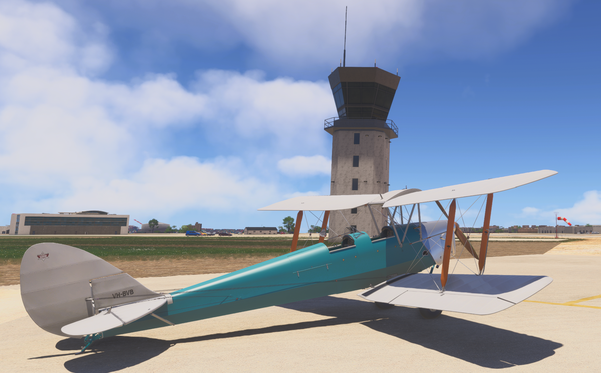
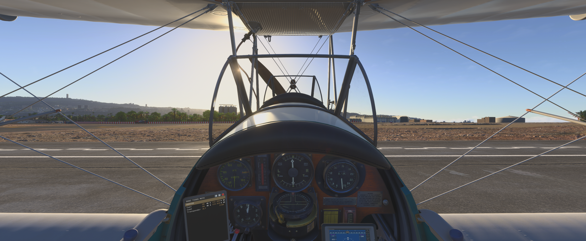

<!-- Explicit RTL lists and HTML tables preserve GitHub direction and column widths. -->

# בד״ח למטוס דה־הווילנד טייגר מות׳ DH.82A

<strong>!!! לשימוש סימולטור בלבד !!!</strong>

מיועד לשימוש עם Microsoft Flight Simulator 2024 ומודול Ant’s Airplanes Tiger Moth DH.82A

## תכונות המטוס ומעבר מססנה&nbsp;172

הטייגר מות׳ הוא דו־כנפי לאימון ראשוני עם שני תאים פתוחים בטנדם. זהו מטוס אימון ישן משנות ה-30 של המאה ה-20 ולכן יש הבדלים מהותיים ממטוסים מודרניים:

<ul dir="rtl">
<li dir="rtl">פעולת המאזנות חלשה יחסית – המטוס מתגלגל בעצלתיים.</li>
<li dir="rtl">פעולת הגה הגובה חזקה יחסית ולכן צריך להקפיד על משיכה (ודחיפה) עדינות של הסטיק.</li>
<li dir="rtl">פעולת הגה הכיוון חזקה מאוד, במיוחד כאשר המנוע בכוח מלא. הביטו בתמונה ותראו למה: הגה הכיוון הוא כמעט כל מייצב הכיוון! צריך להיות מאוד עדינים על הדוושות.</li>
<li dir="rtl">תא הטייס פרימיטיבי וחלק מהמכשירים (כגון המצפן) מאוד שונים מהמקובל היום, וחלקם לא קיימים כלל (לדוגמא, במטוס האמיתי אין כלל מכשיר קשר). בסימולטור יש טאבלט GPS נייד קטן – מומלץ מאוד להשתמש בו בשביל לקבל מצפן מודרני, ועוד טאבלט אשר שולט על הקשר והתוכי (טרנספונדר). מיקום מתגי השליטה על המגנטואים הוא בין שני תאי הישיבה, בצד שמאל על גבי גוף המטוס.</li>
<li dir="rtl">יש למטוס גרר מאוד גבוה עקב הכנף הכפולה והתומכות – הוא איננו נקי אווירודינאמית ומאבד מהירות מהר בטיפוס. זה נוח בגישה (כי קל לשמור על מהירות גישה והמטוס "לא בורח" לנו), פחות נוח כשמנסים לצבור גובה, והרבה פחות נוח כשיש תקלת מנוע.</li>
<li dir="rtl">אין התראת הזדקרות – המטוס פשוט יתחיל לשקוע כלפי מטה.</li>
<li dir="rtl">עם כל זאת, זהו מטוס שמתנהג ממש טוב באוויר – הוא יציב מאוד, טס מצוין במהירות נמוכה, וקל להטסה.</li>
</ul>

ההשוואה כאן היא ל־Cessna 172SP עם מכשירים אנלוגיים. התמונה הבאה מראה את ההמלצה למיקום הטאבלטים בתא הטייס בטיסת ראיה (טאבלט ה-GPS משמש רק כמצפן כאן):

### היגוי על הקרקע ובלימה בסימולטור

בטייגר מות׳ מטיסים מהתא האחורי. המרחק מאחורי הכנף והאף המוגבה מגבילים את הראות קדימה בהסעה. הטה את הראש או השתמש במבט הצדה. פניות S מתונות עוזרות לבדוק את הנתיב כשהשטח פנוי.

למטוס יש תצורות גלגל זנב או מחליק זנב שנגרר על הקרקע. הרגישות לכיוון על הקרקע מחייבת הסעה איטית ותיקונים קטנים בהגה הכיוון. אל תיתן לסטייה לגדול: סבסוב שמתגבר בהסעה או בריצת נחיתה עלול להפוך ל־Ground Loop.

מהו Ground Loop? זוהי תופעה הקיימת במטוסים בעלי גלגל זנב. מרכז הכובד של המטוס נמצא מאחורי הגלגלים הראשיים ולכן אם הזנב סוטה שמאלה או ימינה אין מומנט שישיב אותו למרכז חוץ מהשימוש של הטייס בהגה הכיוון. לעומת זאת, בססנה&nbsp;172, מרכז הכובד נמצא לפני הגלגלים הראשיים ולכן מומנט המאסה של המטוס עצמו "מיישר" סטיות מנתיב ההסעה. במילים אחרות, הססנה "רוצה" לנסוע ישר ואילו הטייגר מות' "מנסה לזרוק זנב".

בטייגר מות׳ האמיתי אין בלמי גלגלים כלל. בסימולטור למטוס בלמי דוושות. השתמש בבלמים מאוד בעדינות כדי שלא להרים את הזנב – בהסעה במהירות יש סכנת התהפכות לפנים בבלימה חזקה. אין נעילת "בלם חניה" ולכן יש להשתמש בבלמים בשביל למנוע מהמטוס לנוע (אפשר גם להשתמש בסדי גלגלים – אך זה פחות נוח בסימולטור). ההגדרה Rolling Resistance במודול משנה את ההתגלגלות, בעיקר במצערת סרק. כ־1,200&nbsp;RPM הם נקודת ייחוס להסעה כאשר ההגדרה היא HARD. התאם את הכוח למהירות ההסעה בפועל. ההמלצה היא להשתמש ב-HARD על מנת לעזור לעצירה בזמן נחיתה (וזה גם מציאותי יותר). השליטה על הגדרות התנהגות של המודול בסימולטור נמצאות בטאבלט ששולט על הקשר.

### מנוע, תערובת ושמן

מנוע Gipsy Major בעל 130 כוח סוס מניע מדחף עץ בעל פסיעה קבועה. המדחף מסתובב בכיוון ההפוך מזה של הססנה. בהמראה צפה לסטייה ימינה והשתמש ברגל שמאל לפי הצורך. התאם את התיקונים לרוח ולכיוון בפועל.

בתא האחורי ידית התערובת פועלת הפוך מהססנה. משיכה לאחור מעשירה ודחיפה קדימה מדללת. המצערת פועלת כרגיל: דחיפה לפנים מוסיפה כוח, ומשיכה לאחור מפחיתה כוח. ישנו מנגנון שמחבר בין התערובת למצערת ומגביל את תנועת ידית התערובת קדימה ביחס למצערת. התוצאה היא שכאשר מזיזים את המצערת לכיוון הסרק, ידית התערובת זזה לכיוון תערובת עשירה יותר. דילול מלא איננו גורם לדימום מנוע. לכיבוי יש לכבות את המגנטואים.

הבד״ח משתמש בהתנעה המהירה דרך הטאבלט (ההתנעה בעולם האמיתי דורשת שני אנשים וסיבוב מנוע ידני כי אין מתנע חשמלי). במצב Hard עבור Engine Realism  המודול מדמה הצטברות פיח מתחת ל־900&nbsp;RPM (ולכן אסור לשהות על פחות מ־900&nbsp;RPM לאורך זמן, כי אחרי כ-3-5 דקות המנוע יכבה ולא יניע) וירידת לחץ שמן עם התרוקנות המיכל. ירידה מתחת ל־50% שמן משפיעה על הלחץ, ומתחת ל־20% עלול להתרחש כשל מנוע במצב Hard.

### כנפיים, סלוטים ומהירויות

בשפת ההתקפה של הכנפיים העליונות מותקנים חריצים אוטומטיים (Auto Slots). הידית בתא האחורי נועלת אותם מאחור ומשחררת אותם קדימה. שחרור הידית מאפשר להם להיפתח מעצמם בזווית התקפה גבוהה ומהירות נמוכה ולהגדיל את העילוי. נעל להסעה (בשביל להימנע מאפקט מוגבר של רוחות) ושחרר לפני המראה.

אין מדפי נחיתה או בלמי אוויר. נהל את האנרגיה בעזרת כוח המנוע, וזווית ההתקפה. הגה הכיוון והגה הגובה מורגשים יותר מהמאזנות במהירות נמוכה. למד את שינוי שדה הראייה כשהזנב מתרומם והקפד לעקוב אחרי המהירות עקב העדר אזהרת הזדקרות.

אפשר להחליף את מד המהירות הראשי בין קשר לבין מייל לשעה. הטבלה והבד״ח כתובים לפי תצוגת קשר. מד המהירות המכני החיצוני המותקן על תומכות כנפי שמאל (Windy ASI), אם מותקן, מוצג במייל לשעה.

### קשר וניווט בסימולטור

המצפן ומבט החוצה הם בסיס הטיסה. בדוק את המצפן מול כיוון ידוע. הטאבלט מספק קשר וטרנספונדר, וה־GPS המוקפץ יכול לסייע בהתמצאות. הבד״ח מניח ניווט ראייה והטסה ידנית.

ברשת VATSIM, ‏CTAF (Common Traffic Advisory Frequency) משמש לתיאום מיקום וכוונות עם התנועה בשדה ללא פיקוח. כשאין תדר ייעודי, האזן בתדר ברירת המחדל (122.800&nbsp;MHz). ‏UNICOM/CTAF בבד״ח מציין את תדר התיאום החל בשדה.

<table dir="rtl" width="100%">
<thead>
<tr>
<th dir="rtl" align="right" width="25%"><strong>סקירה כללית ותפקיד</strong></th>
<th dir="rtl" align="right" width="30%"><strong>Cessna 172SP</strong></th>
<th dir="rtl" align="right" width="45%"><strong>de Havilland DH.82A Tiger Moth</strong></th>
</tr>
</thead>
<tbody>
<tr>
<td dir="rtl" align="right" width="2500">תפקיד</td>
<td dir="rtl" align="right" width="3000">אימון, תיור ותובלה קלה</td>
<td dir="rtl" align="right" width="4500">אימון ראשוני וטיסת פנאי קלאסית</td>
</tr>
<tr>
<td dir="rtl" align="right">תא טייס וראות</td>
<td dir="rtl" align="right">תא סגור, כנף עילית ומושבים זה לצד זה</td>
<td dir="rtl" align="right">שני תאים פתוחים בטנדם. הראות בהסעה מוגבלת כשהאף גבוה.</td>
</tr>
<tr>
<td dir="rtl" align="right">הטסה</td>
<td dir="rtl" align="right">הגה ודוושות. מדפים, גלגל אף ובלמי גלגלים.</td>
<td dir="rtl" align="right">סטיק ודוושות. עיקר ההבדל הוא ניהול הכיוון על הקרקע והמהירות ללא מדפים.</td>
</tr>
</tbody>
</table>

<table dir="rtl" width="100%">
<thead>
<tr>
<th dir="rtl" align="right" width="25%"><strong>ממדים ומשקלים</strong></th>
<th dir="rtl" align="right" width="30%"><strong>Cessna 172SP</strong></th>
<th dir="rtl" align="right" width="45%"><strong>de Havilland DH.82A Tiger Moth</strong></th>
</tr>
</thead>
<tbody>
<tr>
<td dir="rtl" align="right" width="2500">מוטת כנפיים</td>
<td dir="rtl" align="right" width="3000">36.08&nbsp;ft&nbsp;[11.00&nbsp;m]</td>
<td dir="rtl" align="right" width="4500">29.33&nbsp;ft&nbsp;[8.94&nbsp;m]</td>
</tr>
<tr>
<td dir="rtl" align="right">אורך</td>
<td dir="rtl" align="right">27.17&nbsp;ft&nbsp;[8.28&nbsp;m]</td>
<td dir="rtl" align="right">23.92&nbsp;ft&nbsp;[7.29&nbsp;m]</td>
</tr>
<tr>
<td dir="rtl" align="right">גובה</td>
<td dir="rtl" align="right">8.92&nbsp;ft&nbsp;[2.72&nbsp;m]</td>
<td dir="rtl" align="right">8.83&nbsp;ft&nbsp;[2.69&nbsp;m]</td>
</tr>
<tr>
<td dir="rtl" align="right">שטח כנף</td>
<td dir="rtl" align="right">174&nbsp;ft²&nbsp;[16.2&nbsp;m²]</td>
<td dir="rtl" align="right">כ־241&nbsp;ft²&nbsp;[22.4&nbsp;m²]</td>
</tr>
<tr>
<td dir="rtl" align="right">מבנה</td>
<td dir="rtl" align="right">אלומיניום, כנף עילית עם תמוכות</td>
<td dir="rtl" align="right">פלדה, עץ ובד. שתי כנפיים עם תמוכות וחוטי מתיחה.</td>
</tr>
<tr>
<td dir="rtl" align="right">משקל המראה מרבי</td>
<td dir="rtl" align="right">2,550&nbsp;lb&nbsp;[1,157&nbsp;kg]</td>
<td dir="rtl" align="right">‏1,825&nbsp;lb&nbsp;[828&nbsp;kg]</td>
</tr>
<tr>
<td dir="rtl" align="right">משקל ריק ומטען מועיל לדוגמה</td>
<td dir="rtl" align="right">1,665&nbsp;lb&nbsp;[755&nbsp;kg] ריק 885&nbsp;lb&nbsp;[401&nbsp;kg] מטען מועיל</td>
<td dir="rtl" align="right">כ־1,200&nbsp;lb&nbsp;[544&nbsp;kg] ריק וכ־625&nbsp;lb&nbsp;[283&nbsp;kg] מטען מועיל. אמת בפועל במסך העמסה.</td>
</tr>
</tbody>
</table>

<table dir="rtl" width="100%">
<thead>
<tr>
<th dir="rtl" align="right" width="25%"><strong>כנפיים והגאי טיסה</strong></th>
<th dir="rtl" align="right" width="30%"><strong>Cessna 172SP</strong></th>
<th dir="rtl" align="right" width="45%"><strong>de Havilland DH.82A Tiger Moth</strong></th>
</tr>
</thead>
<tbody>
<tr>
<td dir="rtl" align="right" width="2500">מדפים</td>
<td dir="rtl" align="right" width="3000">חשמליים. 0°, 10°, 20°, 30°.</td>
<td dir="rtl" align="right" width="4500">אין מדפים.</td>
</tr>
<tr>
<td dir="rtl" align="right">אמצעי עילוי במהירות נמוכה</td>
<td dir="rtl" align="right">מדפים</td>
<td dir="rtl" align="right">Auto Slots בכנפיים העליונות. שחרר לפני המראה.</td>
</tr>
<tr>
<td dir="rtl" align="right">מאזנות</td>
<td dir="rtl" align="right">בכנף העילית</td>
<td dir="rtl" align="right">בכנפיים התחתונות. תגובת הגלגול חלשה יחסית.</td>
</tr>
<tr>
<td dir="rtl" align="right">הגאים</td>
<td dir="rtl" align="right">הגה ודוושות כפולים</td>
<td dir="rtl" align="right">סטיק ודוושות בשני התאים</td>
</tr>
<tr>
<td dir="rtl" align="right">מקזז גובה</td>
<td dir="rtl" align="right">לשונית קיזוז</td>
<td dir="rtl" align="right">מנגנון קפיצים שמקל את הלחץ על הסטיק. משיכה לאחור מקזזת אף מעלה.</td>
</tr>
</tbody>
</table>

<table dir="rtl" width="100%">
<thead>
<tr>
<th dir="rtl" align="right" width="25%"><strong>מנוע ומדחף</strong></th>
<th dir="rtl" align="right" width="30%"><strong>Cessna 172SP</strong></th>
<th dir="rtl" align="right" width="45%"><strong>de Havilland DH.82A Tiger Moth</strong></th>
</tr>
</thead>
<tbody>
<tr>
<td dir="rtl" align="right" width="2500">מנוע</td>
<td dir="rtl" align="right" width="3000">Lycoming IO-360-L2A ארבעה צילינדרים, הזרקת דלק</td>
<td dir="rtl" align="right" width="4500">de Havilland Gipsy Major ארבעה צילינדרים הפוכים, קרבורטור</td>
</tr>
<tr>
<td dir="rtl" align="right">הספק מרבי</td>
<td dir="rtl" align="right">180 כ״ס ב־2,700&nbsp;RPM</td>
<td dir="rtl" align="right">130 כ״ס ב־2,350&nbsp;RPM למשך עד 5 דקות לפי מדריך המודול</td>
</tr>
<tr>
<td dir="rtl" align="right">המראה רגילה</td>
<td dir="rtl" align="right">כוח מלא</td>
<td dir="rtl" align="right">כ־2,100&nbsp;RPM בכוח מלא. מינימום 1,825&nbsp;RPM בבדיקת כוח.</td>
</tr>
<tr>
<td dir="rtl" align="right">מדחף</td>
<td dir="rtl" align="right">שני להבי אלומיניום, פסיעה קבועה קוטר 6.33&nbsp;ft&nbsp;[1.93&nbsp;m]</td>
<td dir="rtl" align="right">שני להבי עץ, פסיעה קבועה קוטר 6.33&nbsp;ft&nbsp;[1.93&nbsp;m]</td>
</tr>
<tr>
<td dir="rtl" align="right">התנעה</td>
<td dir="rtl" align="right">מתנע חשמלי</td>
<td dir="rtl" align="right">התנעה מהירה בטאבלט. המנוע המקורי הותנע בסיבוב ידני של המדחף.</td>
</tr>
</tbody>
</table>

<table dir="rtl" width="100%">
<thead>
<tr>
<th dir="rtl" align="right" width="25%"><strong>דלק ושמן</strong></th>
<th dir="rtl" align="right" width="30%"><strong>Cessna 172SP</strong></th>
<th dir="rtl" align="right" width="45%"><strong>de Havilland DH.82A Tiger Moth</strong></th>
</tr>
</thead>
<tbody>
<tr>
<td dir="rtl" align="right" width="2500">דלק</td>
<td dir="rtl" align="right" width="3000">100LL Avgas</td>
<td dir="rtl" align="right" width="4500">80/87 Avgas</td>
</tr>
<tr>
<td dir="rtl" align="right">קיבולת כוללת</td>
<td dir="rtl" align="right">56&nbsp;US&nbsp;gal&nbsp;[212.0&nbsp;L]</td>
<td dir="rtl" align="right">20&nbsp;US&nbsp;gal&nbsp;[75.7&nbsp;L] בסימולטור</td>
</tr>
<tr>
<td dir="rtl" align="right">קיבולת שמישה</td>
<td dir="rtl" align="right">53&nbsp;US&nbsp;gal&nbsp;[200.6&nbsp;L]</td>
<td dir="rtl" align="right">20&nbsp;US&nbsp;gal&nbsp;[75.7&nbsp;L] בסימולטור</td>
</tr>
<tr>
<td dir="rtl" align="right">מיקום ובקרה</td>
<td dir="rtl" align="right">מיכל בכל כנף, בורר מיכלים וברז ניתוק</td>
<td dir="rtl" align="right">מיכל יחיד בין הכנפיים העליונות. הזנת כבידה וברז ON / OFF.</td>
</tr>
<tr>
<td dir="rtl" align="right">חיווי</td>
<td dir="rtl" align="right">מדי דלק בלוח</td>
<td dir="rtl" align="right">מצוף מעל המיכל. הטאבלט יכול להציג את כמות הדלק והשמן.</td>
</tr>
<tr>
<td dir="rtl" align="right">שמן מנוע</td>
<td dir="rtl" align="right">בדיקה לפני טיסה</td>
<td dir="rtl" align="right">כמות שמן ניתנת להגדרה במסך Fuel. ניתן לשמור את הכמות בין טיסות.</td>
</tr>
</tbody>
</table>

<table dir="rtl" width="100%">
<thead>
<tr>
<th dir="rtl" align="right" width="25%"><strong>כן נסע ובלימה</strong></th>
<th dir="rtl" align="right" width="30%"><strong>Cessna 172SP</strong></th>
<th dir="rtl" align="right" width="45%"><strong>de Havilland DH.82A Tiger Moth</strong></th>
</tr>
</thead>
<tbody>
<tr>
<td dir="rtl" align="right" width="2500">כן נסע</td>
<td dir="rtl" align="right" width="3000">קבוע, עם גלגל אף</td>
<td dir="rtl" align="right" width="4500">קבוע וזנבי. גלגל או מחליק זנב לפי בחירת המשתמש.</td>
</tr>
<tr>
<td dir="rtl" align="right">היגוי</td>
<td dir="rtl" align="right">גלגל אף ובלימה דיפרנציאלית. סטייה שמאלה בהמראה.</td>
<td dir="rtl" align="right">תיקונים קטנים בהגה הכיוון. צפה לסטייה ימינה בהמראה.</td>
</tr>
<tr>
<td dir="rtl" align="right">בלימה</td>
<td dir="rtl" align="right">בלמי דיסק עם דוושות עצמאיות</td>
<td dir="rtl" align="right">המודול מגיב לפקודות בלימה. השתמש בבלימה קלה בהסעה.</td>
</tr>
<tr>
<td dir="rtl" align="right">אבטחה בעצירה</td>
<td dir="rtl" align="right">בלם חניה</td>
<td dir="rtl" align="right">הפקודה Parking Brake מתקינה סדי גלגלים.</td>
</tr>
</tbody>
</table>

<table dir="rtl" width="100%">
<thead>
<tr>
<th dir="rtl" align="right" width="25%"><strong>מהירויות תפעוליות עיקריות</strong></th>
<th dir="rtl" align="right" width="30%"><strong>Cessna 172SP</strong></th>
<th dir="rtl" align="right" width="45%"><strong>de Havilland DH.82A Tiger Moth</strong></th>
</tr>
</thead>
<tbody>
<tr>
<td dir="rtl" align="right" width="2500">הזדקרות</td>
<td dir="rtl" align="right" width="3000">48&nbsp;KIAS&nbsp;[89&nbsp;kph] נקי 40&nbsp;KIAS&nbsp;[74&nbsp;kph] עם מדפים מלאים</td>
<td dir="rtl" align="right" width="4500">כ־35&nbsp;KIAS&nbsp;[65&nbsp;kph] בגלישה ללא כוח כ־25&nbsp;KIAS&nbsp;[46&nbsp;kph] עם כוח</td>
</tr>
<tr>
<td dir="rtl" align="right">המראה</td>
<td dir="rtl" align="right">רוטציה ב־55&nbsp;KIAS&nbsp;[102&nbsp;kph]</td>
<td dir="rtl" align="right">אין יעד רוטציה בבד״ח. טיפוס ראשוני ב־60&nbsp;KIAS&nbsp;[111&nbsp;kph]. המטוס נוטה להתנתק ב־45&#8288;–&#8288;50&nbsp;kt&nbsp;[83&#8288;–&#8288;93&nbsp;kph].</td>
</tr>
<tr>
<td dir="rtl" align="right">טיפוס</td>
<td dir="rtl" align="right">Vy בגובה פני הים: 74&nbsp;KIAS&nbsp;[137&nbsp;kph]</td>
<td dir="rtl" align="right">58&nbsp;KIAS&nbsp;[107&nbsp;kph] ב־2,050&nbsp;RPM לאחר הטיפוס הראשוני.</td>
</tr>
<tr>
<td dir="rtl" align="right">גלישה</td>
<td dir="rtl" align="right">68&nbsp;KIAS&nbsp;[126&nbsp;kph]</td>
<td dir="rtl" align="right">58&nbsp;KIAS&nbsp;[107&nbsp;kph]</td>
</tr>
<tr>
<td dir="rtl" align="right">גישה סופית</td>
<td dir="rtl" align="right">60‑70&nbsp;KIAS&nbsp;[111‑130&nbsp;kph]</td>
<td dir="rtl" align="right">רגילה: 58&nbsp;KIAS&nbsp;[107&nbsp;kph] גישת זהירות או נחיתה קצרה: 48&nbsp;KIAS&nbsp;[89&nbsp;kph]</td>
</tr>
<tr>
<td dir="rtl" align="right">Vne</td>
<td dir="rtl" align="right">163&nbsp;KIAS&nbsp;[302&nbsp;kph]</td>
<td dir="rtl" align="right">‏139&nbsp;KIAS&nbsp;[257&nbsp;kph]</td>
</tr>
</tbody>
</table>

<table dir="rtl" width="100%">
<thead>
<tr>
<th dir="rtl" align="right" width="25%"><strong>ביצועים ושיוט</strong></th>
<th dir="rtl" align="right" width="30%"><strong>Cessna 172SP</strong></th>
<th dir="rtl" align="right" width="45%"><strong>de Havilland DH.82A Tiger Moth</strong></th>
</tr>
</thead>
<tbody>
<tr>
<td dir="rtl" align="right" width="2500">מהירות שיוט טיפוסית</td>
<td dir="rtl" align="right" width="3000">עד כ־124&nbsp;KTAS&nbsp;[230&nbsp;kph] בהגדרת שיוט מתאימה</td>
<td dir="rtl" align="right" width="4500">ב־1,950&nbsp;RPM: ‏65‑70&nbsp;kt&nbsp;[120‑130&nbsp;kph].</td>
</tr>
<tr>
<td dir="rtl" align="right">צריכת דלק בשיוט</td>
<td dir="rtl" align="right">8.5‑10&nbsp;US&nbsp;gal/h&nbsp;[32.2‑37.9&nbsp;L/h]</td>
<td dir="rtl" align="right">ב־1,950&nbsp;RPM: ‏6‑6.5&nbsp;US&nbsp;gal/h&nbsp;[22.7‑24.6&nbsp;L/h]</td>
</tr>
<tr>
<td dir="rtl" align="right">מגבלת היקף הבד״ח</td>
<td dir="rtl" align="right">הדרכת טיסה רגילה</td>
<td dir="rtl" align="right">טיסת ראייה ותפעול רגיל. תמרונים וסחרורים מחוץ להיקף הבד״ח.</td>
</tr>
</tbody>
</table>

<table dir="rtl" width="100%">
<thead>
<tr>
<th dir="rtl" align="right" width="25%"><strong>אוויוניקה והעמסה</strong></th>
<th dir="rtl" align="right" width="30%"><strong>Cessna 172SP</strong></th>
<th dir="rtl" align="right" width="45%"><strong>de Havilland DH.82A Tiger Moth</strong></th>
</tr>
</thead>
<tbody>
<tr>
<td dir="rtl" align="right" width="2500">מכשירים</td>
<td dir="rtl" align="right" width="3000">לוח אנלוגי עם מכשירי קשר וניווט</td>
<td dir="rtl" align="right" width="4500">מכשירים בסיסיים. מד מהירות ראשי לבחירה בקשר או במייל לשעה.</td>
</tr>
<tr>
<td dir="rtl" align="right">קשר וניווט</td>
<td dir="rtl" align="right">מכשירי COM/NAV ו־GNS לפי התצורה</td>
<td dir="rtl" align="right">קשר וטרנספונדר בטאבלט. GPS מוקפץ לפי הצורך.</td>
</tr>
<tr>
<td dir="rtl" align="right">מקומות ישיבה</td>
<td dir="rtl" align="right">ארבעה מושבים</td>
<td dir="rtl" align="right">שני מושבים בטנדם. הבד״ח מתייחס להטסה מהתא האחורי.</td>
</tr>
<tr>
<td dir="rtl" align="right">כבודה</td>
<td dir="rtl" align="right">עד 120&nbsp;lb&nbsp;[54&nbsp;kg], בכפוף למגבלות ההעמסה</td>
<td dir="rtl" align="right">אין תא מטען במודול.</td>
</tr>
</tbody>
</table>

## בד״ח לפני התנעה

<ol dir="rtl" type="1">
<li dir="rtl">דלק ושמן – בדוק לאחר טעינת הכמויות השמורות, אם מופעלות.</li>
<li dir="rtl">העמסה ומרכז כובד – בדוק. אבטח חפצים רופפים.</li>
<li dir="rtl">חצאי דלתות – סגורות ונעולות.</li>
<li dir="rtl">חגורות – מהודקות.</li>
<li dir="rtl">הגאים – חופשיים ובכיוון הנכון.</li>
<li dir="rtl">מקזז גובה – אף מעלה עד הסוף (Full Tail Heavy).</li>
<li dir="rtl">סלוטים – נעל, ידית לאחור.</li>
<li dir="rtl">הצתה – כבה מגנטואים.</li>
<li dir="rtl">מצערת – סגורה. תערובת – עשירה, ידית לאחור.</li>
<li dir="rtl">טאבלט, מפות ותדרים – מוכנים.</li>
</ol>

## בד״ח התנעה וחימום

<ol dir="rtl" type="1">
<li dir="rtl">אזור המדחף – פנוי.</li>
<li dir="rtl">ברז דלק – פתוח.</li>
<li dir="rtl">הפעל בלמי דוושות.</li>
<li dir="rtl"><strong>עם פיקוח, בדוק קשר ובקש מרשה התנעה אם נדרש.</strong></li>
<li dir="rtl"><strong>ללא פיקוח, האזן ב־</strong><strong>UNICOM/CTAF</strong><strong> ודווח על התנעה לפי התנועה.</strong></li>
<li dir="rtl">סטיק – משוך לאחור.</li>
<li dir="rtl">תערובת – עשירה. ידית לאחור.</li>
<li dir="rtl">מצערת – סרק.</li>
<li dir="rtl">מגנטואים – הדלק שניהם.</li>
<li dir="rtl">טאבלט – Engine Start, הפעל Click to Quick Start.</li>
<li dir="rtl">לחץ שמן – בדוק עלייה והתייצבות.</li>
<li dir="rtl">מצערת – 900‑1,000&nbsp;RPM לחימום במשך לפחות 4 דקות.</li>
<li dir="rtl">מד גובה – כייל ללחץ המקומי (QNH).</li>
<li dir="rtl">מד מהירות – תצוגת קשר. בדוק יתר מכשירים.</li>
<li dir="rtl">לחץ שמן – לפחות 35&nbsp;psi לפני מבחן המנוע.</li>
</ol>

## בד״ח מבחן מנוע

<ol dir="rtl" type="1">
<li dir="rtl">הפעל בלמי דוושות.</li>
<li dir="rtl">סטיק – משוך לאחור עד הסוף.</li>
<li dir="rtl">מצערת – 1,600&nbsp;RPM.</li>
<li dir="rtl">מגנטואים – בדוק בנפרד. ירידה של עד 100&nbsp;RPM בכל צד.</li>
<li dir="rtl">מגנטואים – החזר את שניהם ל־ON.</li>
<li dir="rtl">מצערת – מלאה עד 10 שניות. צפה לכ־2,100&nbsp;RPM ולפחות 1,825&nbsp;RPM.</li>
<li dir="rtl">לחץ שמן בכוח מלא – 40–45&nbsp;psi.</li>
<li dir="rtl">מצערת – סרק לכמה רגעים. בדוק יציבות סביב 550‑600&nbsp;RPM.</li>
<li dir="rtl">מצערת – החזר ל־900‑1,000&nbsp;RPM.</li>
</ol>

## בד״ח לפני הסעה והסעה

<ol dir="rtl" type="1">
<li dir="rtl">מקזז גובה – אף מעלה עד הסוף. סלוטים – נעולים.</li>
<li dir="rtl">קשר וטרנספונדר – תדר וקוד לפי המרחב והפיקוח.</li>
<li dir="rtl">רוח ונתיב הסעה – בדוק.</li>
<li dir="rtl"><strong>עם פיקוח, דווח מוכן להסעה וחזור על ההוראות.</strong></li>
<li dir="rtl"><strong>ללא פיקוח, דווח מיקום וכוונת הסעה ב־</strong><strong>UNICOM/CTAF</strong><strong>.</strong></li>
<li dir="rtl">סטיק – משוך לאחור.</li>
<li dir="rtl">שחרר בלמי דוושות.</li>
<li dir="rtl">בתחילת התנועה – בדוק היגוי ותגובה לבלימת הסימולטור.</li>
<li dir="rtl">מצערת – כוח מזערי למהירות הסעה איטית.</li>
<li dir="rtl">ראות – מבט צדי או פניות S מתונות כשהנתיב פנוי.</li>
<li dir="rtl">הגה כיוון – תיקונים קטנים. בלימה – עדינה בלבד, לפי הצורך. במהלך הבלימה – מנוע לסרק. בעמידה במקום – לפחות 900 סל"ד.</li>
</ol>

## בד״ח לפני המראה

<ol dir="rtl" type="1">
<li dir="rtl">הגאים – חופשיים ובכיוון הנכון.</li>
<li dir="rtl">מקזז גובה – ניטרלי.</li>
<li dir="rtl">דלק – ברז פתוח וכמות מספקת.</li>
<li dir="rtl">תערובת – עשירה. ידית לאחור.</li>
<li dir="rtl">סלוטים – משוחררים. ידית קדימה.</li>
<li dir="rtl">מגנטואים – בדוק כל צד סביב 900&nbsp;RPM והחזר לשניהם ON.</li>
<li dir="rtl">לחץ שמן – לפחות 35&nbsp;psi.</li>
<li dir="rtl">רוח ותיקון המתאים למסלול – בדוק.</li>
<li dir="rtl"><strong>עם פיקוח, דווח מוכן לעזיבה וחזור על הוראות הכניסה או ההמראה.</strong></li>
<li dir="rtl"><strong>ללא פיקוח, דווח מסלול וכוונת המראה ב־</strong><strong>UNICOM/CTAF</strong><strong>.</strong></li>
</ol>

## בד״ח המראה וטיפוס

<ol dir="rtl" type="1">
<li dir="rtl">מסלול – אמת כיוון.</li>
<li dir="rtl">שחרר בלמים.</li>
<li dir="rtl">מצערת – פתח בהדרגה לכוח מלא.</li>
<li dir="rtl">מכשירי מנוע – בדוק. מינימום 1,825&nbsp;RPM בכוח מלא.</li>
<li dir="rtl">הגה כיוון – שמור ציר. צפה לצורך ברגל שמאל.</li>
<li dir="rtl">מאזנות – תקן לפי רוח הצד.</li>
<li dir="rtl">ניתוק – אפשר למטוס להתרומם כשמהירותו מספקת.</li>
<li dir="rtl">טיפוס ראשוני – 60&nbsp;KIAS&nbsp;[111&nbsp;kph].</li>
<li dir="rtl">בגובה 200‑300&nbsp;ft&nbsp;AGL&nbsp;[61‑91&nbsp;m] – הפחת לכוח טיפוס, 2,050&nbsp;RPM.</li>
<li dir="rtl">טיפוס מבוסס – 58&nbsp;KIAS&nbsp;[107&nbsp;kph].</li>
<li dir="rtl">קזז מטוס.</li>
</ol>

## בד״ח שיוט

<ol dir="rtl" type="1">
<li dir="rtl">גובה – התיישר והאץ.</li>
<li dir="rtl">מצערת – 1,950&nbsp;RPM לשיוט רגיל. תחום שיוט רגיל 1,900‑2,050&nbsp;RPM.</li>
<li dir="rtl">קיזוז – התאם לטיסה ישרה ואופקית.</li>
<li dir="rtl">דלק ולחץ שמן – בדוק מדי פעם.</li>
<li dir="rtl">מיקום, נתיב ותדר – אמת.</li>
</ol>

<table dir="rtl" width="100%">
<thead>
<tr>
<th dir="rtl" align="right" width="25%"><strong>הגדרת שיוט במדריך המודול</strong></th>
<th dir="rtl" align="right" width="30%"><strong>מהירות שיוט</strong></th>
<th dir="rtl" align="right" width="45%"><strong>צריכת דלק וסבולת מוצגת</strong></th>
</tr>
</thead>
<tbody>
<tr>
<td dir="rtl" align="right" width="2500">1,950&nbsp;RPM</td>
<td dir="rtl" align="right" width="3000">65‑70&nbsp;kt&nbsp;[120‑130&nbsp;kph]</td>
<td dir="rtl" align="right" width="4500">6‑6.5&nbsp;US&nbsp;gal/h&nbsp;[22.7‑24.6&nbsp;L/h] 2 שעות ו־30 דקות</td>
</tr>
<tr>
<td dir="rtl" align="right">2,050&nbsp;RPM</td>
<td dir="rtl" align="right">70‑74&nbsp;kt&nbsp;[130‑137&nbsp;kph]</td>
<td dir="rtl" align="right">7‑7.5&nbsp;US&nbsp;gal/h&nbsp;[26.5‑28.4&nbsp;L/h] 2 שעות ו־15 דקות</td>
</tr>
<tr>
<td dir="rtl" align="right">2,100&nbsp;RPM</td>
<td dir="rtl" align="right">74‑78&nbsp;kt&nbsp;[137‑144&nbsp;kph]</td>
<td dir="rtl" align="right">7.75‑8&nbsp;US&nbsp;gal/h&nbsp;[29.3‑30.3&nbsp;L/h] 2 שעות</td>
</tr>
</tbody>
</table>

<strong>לסבולת הארוכה ביותר מבין האפשרויות בטבלה:</strong> 1,950&nbsp;RPM. הסבולת בטבלה היא נתון ייחוס של המודול. מגבלת הפעלה ב־2,100&nbsp;RPM היא 30 דקות. חשב דלק לטיסה ולרזרבה לפי ההעמסה והתנאים בפועל.

## בד״ח הנמכה ולפני נחיתה

<ol dir="rtl" type="1">
<li dir="rtl">מסלול, רוח ו־QNH – בדוק.</li>
<li dir="rtl">בהנמכה עם מנוע – 1,100‑1,200&nbsp;RPM ו־58&nbsp;KIAS&nbsp;[107&nbsp;kph].</li>
<li dir="rtl"><strong>עם פיקוח, דווח מיקום וקבל הנחיות הגעה.</strong></li>
<li dir="rtl"><strong>ללא פיקוח, דווח מיקום וכוונת הצטרפות ב־</strong><strong>UNICOM/CTAF</strong><strong>.</strong></li>
<li dir="rtl">דלק – ודא מספיק להקפה נוספת.</li>
<li dir="rtl">תערובת – עשירה. ידית לאחור.</li>
<li dir="rtl">סלוטים – משוחררים.</li>
<li dir="rtl">גישה רגילה – 58&nbsp;KIAS&nbsp;[107&nbsp;kph].</li>
<li dir="rtl">קזז מטוס.</li>
</ol>

## בד״ח נחיתה

<ol dir="rtl" type="1">
<li dir="rtl"><strong>עם פיקוח, דווח בפיינל לפי ההוראות וודא מרשה נחיתה.</strong></li>
<li dir="rtl"><strong>ללא פיקוח, דווח פיינל ב־</strong><strong>UNICOM/CTAF</strong><strong>.</strong></li>
<li dir="rtl">גישה ומהירות – ייצב. עבור להליכה סביב אם אינן מיוצבות.</li>
<li dir="rtl">הגה כיוון ומאזנות – שמור ציר ותקן לרוח צד.</li>
<li dir="rtl">בהצפה – הפחת כוח בהדרגה. התכונן לנגיעת שלוש נקודות.</li>
<li dir="rtl">לאחר נגיעה – סטיק לאחור ושמור על כיוון.</li>
<li dir="rtl">בלמי דוושות – השתמש בעדינות לפי הצורך.</li>
</ol>

## בד״ח הליכה סביב

<ol dir="rtl" type="1">
<li dir="rtl">מצערת – פתח לכוח מלא בצורה חלקה.</li>
<li dir="rtl">שמור כיוון ותקן לסטייה ימינה.</li>
<li dir="rtl">טיפוס ראשוני – 60&nbsp;KIAS&nbsp;[111&nbsp;kph].</li>
<li dir="rtl"><strong>דווח על הליכה סביב לפיקוח או ב־</strong><strong>UNICOM/CTAF</strong><strong>.</strong></li>
<li dir="rtl">בגובה 200‑300&nbsp;ft&nbsp;AGL&nbsp;[61‑91&nbsp;m] – הפחת ל־2,050&nbsp;RPM.</li>
<li dir="rtl">טיפוס מבוסס – 58&nbsp;KIAS&nbsp;[107&nbsp;kph].</li>
<li dir="rtl">קזז מטוס.</li>
</ol>

## בד״ח אחרי נחיתה ופינוי מסלול

<ol dir="rtl" type="1">
<li dir="rtl">מסלול – פנה במהירות הסעה בטוחה.</li>
<li dir="rtl"><strong>אחרי הפינוי, דווח לפיקוח או ב־</strong><strong>UNICOM/CTAF</strong><strong>.</strong></li>
<li dir="rtl">סלוטים – נעולים.</li>
<li dir="rtl">מקזז גובה – אף מעלה עד הסוף. סטיק לאחור להסעה.</li>
<li dir="rtl">מצערת – כוח להסעה איטית. הימנע משהייה ממושכת מתחת ל-900 סל"ד.</li>
</ol>

## בד״ח כיבוי מנוע

<ol dir="rtl" type="1">
<li dir="rtl">הפעל בלמי דוושות.</li>
<li dir="rtl">מקזז גובה – אף מעלה עד הסוף. החזק סטיק לאחור.</li>
<li dir="rtl">מצערת – 900‑1,000&nbsp;RPM לפני הכיבוי.</li>
<li dir="rtl">מגנטואים – כבה.</li>
<li dir="rtl">מדחף – לאחר עצירתו, סגור מצערת.</li>
<li dir="rtl">ברז דלק – סגור.</li>
<li dir="rtl">תא טייס וציוד – אבטח.</li>
</ol>

