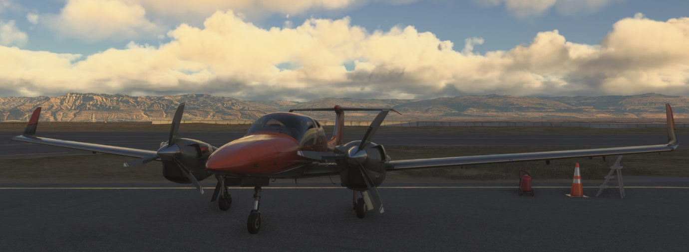

<!-- Explicit RTL lists and HTML tables preserve GitHub direction and column widths. -->

# בד״ח למטוס דיימונד DA42 VI Twin Star

<strong>!!! לשימוש סימולטור בלבד !!!</strong>

מיועד לשימוש עם מודול COWS DA42 VI עם מנועי AE300 עבור Microsoft Flight Simulator 2024

## תכונות מטוס והשוואה לססנה 172

הדיימונד DA42 VI Twin Star הוא מטוס דו־מנועי קל בעל כנף תחתית, ארבעה מושבים, כן נסע מתקפל ותא טייס "זכוכית" (כלומר מכשירי אוויוניקה ממוחשבים). שני מנועי הדיזל Austro Engine AE 300 מצוידים ב־FADEC (Full Authority Digital Engine Control), כלומר בקרת מנוע אלקטרונית עם שליטה מלאה על המנוע, כך שהטייס קובע את דרישת הכוח באמצעות שתי ידיות כוח (Power Levers) ואינו מנהל ידנית מצערת, תערובת או סל״ד מדחף. הטייס מבקש "תן לי אחוז רצוי מהכוח הזמין" והמחשב מכייל את המנוע בהתאם. עבור טייס המגיע מססנה 172, המעבר אינו רק למטוס מהיר יותר: הוא מוסיף ניהול של שני מנועים, התמודדות עם דחף א־סימטרי במקרה של אובדן מנוע או הגדרות מצערת א-סימטריות, וכן קצב עבודה גבוה יותר סביב כן הנסע, האוויוניקה וניהול האנרגיה.

המסמך כולו מתייחס לדגם DA42 VI עם מנועי AE300 במודול COWS עבור MSFS 2024. אין להחליף את הנתונים בנתוני דגם TDI או גרסה אחרת.

<ol dir="rtl">
<li dir="rtl"><strong>מטוס מורכב ודו־מנועי</strong> – לעומת הססנה 172, יש לנהל כן נסע מתקפל, שני מנועים ולכן גם מערכות דלק וחשמל מפוצלות. פעולות תצורה ואימות מצב המנועים הופכות לחלק מרכזי בכל שלב טיסה.</li>
<li dir="rtl"><strong>שני מנועים עם </strong><strong>FADEC</strong> – כל מנוע AE 300 מניע מדחף בעל פסיעה משתנה, אך ה־FADEC מנהל אוטומטית את הדלק, התערובת, סל״ד המנוע ופסיעת המדחף. בתא הטייס יש שתי ידיות כוח, ללא ידיות מצערת, תערובת או מדחף נפרדות.</li>
<li dir="rtl"><strong>טיסה א־סימטרית</strong> – אובדן מנוע יוצר סבסוב וגלגול לעבר המנוע שאינו פועל ומקטין מאוד את הביצועים. יש לשלוט בכיוון תחילה, לשמור מהירות בטוחה, לזהות ולאמת את המנוע הפגוע ורק אז לבצע את הנוהל המתאים להמשך טיסה לפי הבד"ח המתאים.</li>
<li dir="rtl"><strong>מהירות וניהול אנרגיה</strong> – מהירויות ההמראה, הטיפוס והגישה גבוהות מאלו של הססנה, והמטוס מאיץ במהירות בהנמכה. יש לתכנן האטה ותצורה מוקדם ולא להגיע לגישה עם עודף אנרגיה. ניתן להיעזר בגרר כן הנסע לצורך האטה, במסגרת מגבלות ההפעלה ותכנון הגישה. בטיסה עם מנוע אחד אין להוסיף את גרר כן הנסע לפני שהנחיתה מובטחת.</li>
<li dir="rtl"><strong>מבנה מרוכב וכנף תחתית</strong> – גוף המטוס והכנפיים בנויים במידה רבה מחומרים מרוכבים. הכנף התחתית מספקת ראות טובה לתוך פנייה, אך בתי המנוע והכנפיים משפיעים על הראות מטה ולצדדים. הראות לפנים מצויינת.</li>
<li dir="rtl"><strong>התנהגות בנחיתה ובהצפה</strong> – בססנה 172 מקובל לעיתים להמשיך ולמשוך את ההגה לאחור במידה ניכרת במהלך ההצפה כדי להחזיק את גלגל האף באוויר ולהגיע לנגיעה במהירות נמוכה. ב־DA42 אין צורך בהצפה עמוקה או במשיכה חזקה לאחור: יש להפחית כוח, ליישר בעדינות את קצב ההנמכה ולאפשר לכן הנסע הראשי לגעת בזווית אף מתונה. משיכה מוגזמת מגדילה במהירות את זווית העלרוד ועלולה לגרום לפגיעת זנב. לאחר הנגיעה יש להוריד את גלגל האף בעדינות ולא לנסות להחזיק תנוחת אף גבוהה.</li>
<li dir="rtl"><strong>קיזוז גובה וכיוון</strong> – לצד קיזוז הגובה, קיזוז הגה הכיוון חשוב במיוחד להפחתת עומס הדוושה בטיסה ממושכת עם דחף א־סימטרי. לפני המראה יש לוודא שהקיזוזים נמצאים בתחום ההמראה.</li>
<li dir="rtl"><strong>אוויוניקה וניטור מנועים</strong> – מערכת Garmin G1000 NXi כוללת צג טיסה ראשי (PFD) וצג רב־תכליתי (MFD), ומרכזת נתוני טיסה, ניווט וניטור של שני המנועים. יש לסרוק באופן סימטרי את ביצועי המנוע השמאלי והימני ולשים לב להבדלים בין עומס, טמפרטורה, לחץ, זרימת דלק וכמות דלק במיכלים.</li>
<li dir="rtl"><strong>ארבעה מושבים ותכנון העמסה</strong> – מספר המושבים זהה לססנה 172, אך יש לחשב משקל ומרכז כובד בכל טיסה ולבחון את השפעת כמות הדלק, הנוסעים והכבודה על ביצועי ההמראה והטיפוס, ובפרט על ביצועים עם מנוע אחד.</li>
</ol>

## מבוא לטיסה דו־מנועית ולניהול מנועים באמצעות FADEC

השינוי המהותי ביותר לעומת הססנה 172 הוא המעבר לשני מנועים וליכולת להמשיך לטוס לאחר אובדן מנוע בתנאים המתאימים. שתי ידיות הכוח הן למעשה Power Levers: כל ידית מבטאת דרישת כוח למנוע שלה, וה־FADEC מנהל את הזרקת הדלק, סל״ד המנוע ופסיעת המדחף. אין בתא הטייס ידיות תערובת או מדחף נפרדות.

### הכול כפול — ומנוהל כזוג

ב־DA42 כמעט כל מה ששייך להנעה מופיע פעמיים: שני מנועים, שני מדחפים, שתי ידיות כוח, שני בוררי ENGINE MASTER, שתי מערכות דלק והזנה, ושני ערוצי מחשב בקרת המנוע (ECU) יתירים לכל מנוע. המערכת מנהלת אוטומטית את בחירת הערוץ הפעיל ואת המעבר בין הערוצים; בדיקות ה־ECU לפני המראה נועדו לוודא ששני הערוצים והמעבר ביניהם פועלים כראוי. יש לחשוב תמיד שמאל וימין, להשוות בין הצדדים, ולהימנע מפעולה על מתג או ידית בלי לזהות תחילה לאיזה מנוע הם שייכים.

<strong>כלל זיכרון: לפני פעולה חד־צדדית — זהה, אמת ורק אז פעל.</strong> מנוע שזוהה באופן שגוי והופסק בטעות עלול להפוך תקלה נשלטת (מנוע אחד מקרטע ואחד עובד) לאובדן כוח מלא (מנוע אחד מקרטע ומנוע שני שכובה בטעות).

### הזנת דלק צולבת בין המיכלים

במצב רגיל, בורר הדלק של כל מנוע נמצא ב־ON, וכל מנוע ניזון מהמיכל הראשי שבכנף שלו. מצב CROSSFEED מזין את המנוע שנבחר מהמיכל הראשי שבכנף הנגדית. לכן, כאשר בורר אחד ב־ON והשני ב־CROSSFEED, שני המנועים ניזונים מאותו מיכל ראשי. לאחר אבטחת מנוע, ניתן לפי הבד״ח להעביר את בורר המנוע הפעיל ל־CROSSFEED כדי להשתמש בדלק שבצד המנוע המושבת ולשמור על האיזון.

<strong>מגבלות וזהירות:</strong> הזנה צולבת אינה מערבבת את שני המיכלים ואינה מאפשרת למנוע אחד לשאוב משניהם בו־זמנית. לפני בחירת CROSSFEED יש לוודא שמשאבת הדלק הרלוונטית במצב OFF בהתאם לנוהל. אין להפעיל כאשר שני הבוררים ב־CROSSFEED, ואין להמריא כאשר אחד מהם ב־CROSSFEED. עם מנוע מושבת, בורר הדלק שלו יהיה OFF. אין לכבות מנוע באמצעות בורר הדלק, כדי למנוע נזק למשאבת הלחץ הגבוה, אלא על ידי כיבוי בורר ה-ENGINE MASTER. כאשר שני המנועים ניזונים מאותו מיכל, יש לעקוב ברציפות אחר הכמות והאיזון ולא לעבור את הפרש הדלק המרבי המותר.

### דחף א־סימטרי ושליטה כיוונית

כאשר אחד המנועים מאבד כוח, המנוע הפעיל ממשיך לייצר דחף בצד אחד של ציר האורך. הדחף הא־סימטרי מסבסב את האף לעבר המנוע שאינו פועל. הסבסוב יוצר החלקה, ויחד עם הבדלים בעילוי ובגרר ותגובת הטייס נוצרת גם נטיית גלגול לעבר המנוע שאינו פועל. הפעולה הראשונה היא שליטה: לחץ דוושה לעבר המנוע הפעיל, שמירת כנפיים קרובות למאוזן או הטיה קלה לעבר המנוע הפעיל לפי הנוהל, ושמירה על המהירות המתאימה לטיסה על מנוע יחיד בהתאם לשלב הטיסה. רק לאחר שהכיוון והמהירות נשלטים עוברים לזיהוי התקלה, אימות המנוע וביצוע הנוהל המתאים.

### המנוע הקריטי — ומה משמעותו ב־DA42

״מנוע קריטי״ הוא המנוע שכשל בו יוצר את ההשפעה השלילית הגדולה ביותר על השליטה והביצועים. מדחף מסתובב יוצר מומנט, העמסת להבים א־סימטרית (P-factor) וזרימת אוויר סלילית. שני המדחפים ב־DA42 VI מסתובבים באותו כיוון; אין להסיק ששני מנועים מבטלים את כל השפעות הסיבוב. בהמראה יש לשמור כיוון באמצעות הגה הכיוון ולנטר כוח סימטרי.

כאשר מנוע אחד מפסיק לייצר כוח, המנוע הפעיל יוצר מומנט סבסוב לעבר המנוע שאינו פועל. בגלל P-factor, הלהב היורד מייצר יותר דחף מהלהב העולה ולכן קו הדחף האפקטיבי אינו עובר בדיוק במרכז המדחף. מאחר ששני המדחפים ב־DA42 VI מסתובבים באותו כיוון, קו הדחף האפקטיבי של המנוע הימני רחוק יותר מציר האורך מזה של המנוע השמאלי. לכן, כאשר המנוע השמאלי אובד והמנוע הימני נשאר פעיל, זרוע מומנט הסבסוב גדולה יותר.

לכן אובדן המנוע השמאלי חמור יותר: המנוע הימני הפעיל יוצר דחיפה חזקה יותר של האף שמאלה, ונדרש יותר הגה כיוון ימינה כדי לעצור את הסבסוב. אם המנוע הימני אובד, המנוע השמאלי הפעיל פועל בזרוע מומנט קצרה יותר ולכן הדחיפה ימינה מתונה יותר. זו הסיבה שהמנוע השמאלי הוא המנוע הקריטי.

הגיאומטריה מסבירה איזה אובדן מנוע חמור יותר, אך עוצמת הסבסוב והגלגול ברגע נתון תלויה בדחף שמייצר המנוע הפעיל. הדחף מושפע ממצב ידית הכוח, מהירות האוויר, תנאי הסביבה, סל״ד ופסיעת להבי המדחף, הנקבעים אוטומטית על־ידי ה־FADEC ומערכת המדחף. מאחר שהטייס אינו שולט ישירות בפסיעה ואינו מקבל חיווי ישיר לזווית הלהבים, עוצמת ההשפעה ניכרת בעיקר בכוח הדוושה הנדרש ליישר את המטוס, בהטיה הנדרשת לעבר המנוע הפעיל, במצב ההגאים ובביצועי המטוס בפועל.

בנפרד מכך, מצב המדחף של המנוע שאינו פועל קובע את הגרר שהוא יוצר ומשפיע מאוד על ביצועי הטיסה עם מנוע אחד. במצב הנצה  (Feathering) הלהבים מסתובבים לזווית גבוהה, כך ששפת הלהב מופנית כמעט לגמרי אל זרימת האוויר והגרר קטן. אם המדחף ממשיך להסתובב כתוצאה מזרימת האוויר, הוא פועל כבלם אוויר ויוצר גרר רב.

ב־DA42 VI יש להבחין בין שלושה מצבים של מדחף המנוע הפגוע.

<strong>1</strong><strong>) סל״ד המדחף גבוה מ־</strong><strong>1,300 RPM</strong>: זהו תנאי המאפשר את פעולת ההנצה. לאחר זיהוי ואימות המנוע הפגוע, העברת ENGINE MASTER שלו ל־OFF פותחת את שסתום וסת המדחף ומאפשרת ללהבים לעבור למצב הנצה. לאחר שההנצה הושלמה מתקבל מצב הגרר הנמוך ביותר.

<strong>2</strong><strong>) סל״ד המדחף נמוך מ־</strong><strong>1,300 RPM</strong><strong> והוא ממשיך להסתובב ברוח:</strong> מנגנון ההנצה אינו יכול להשלים הנצה, והמדחף שאינו מונץ פועל כבלם אוויר ויוצר גרר רב מאוד. מנוע שכבר הפסיק לפעול אינו יכול להעלות את הסל״ד; רק זרימת האוויר עשויה, בתנאים המתאימים, להאיץ את המדחף שוב מעל 1,300 סל״ד ולאפשר הנצה.

<strong>3</strong><strong>) המנוע והמדחף נעצרו, אך הלהבים אינם במצב הנצה:</strong> לא ניתן להניץ באמצעות מתג ה־MASTER, משום שהמדחף אינו מסתובב. המדחף העצור עדיין יוצר יותר גרר ממדחף מונץ, אך פחות ממדחף שאינו מונץ וממשיך להסתובב ברוח.

לכן סדר הגרר, מהנמוך לגבוה, הוא: מדחף מונץ — מדחף עצור שאינו מונץ — מדחף שאינו מונץ ומסתובב ברוח.

כשל של כל אחד מהמנועים מחייב שליטה מיידית בכיוון ובמהירות; הביצועים תלויים גם במשקל, גובה צפיפות, טמפרטורה ותצורת המטוס.

<strong>סדר העדיפויות לאחר אובדן כוח: שליטה ומהירות — כוח זמין לפי השליטה — תצורה כללית — זיהוי — אימות — אבטחה והנצה — בדיקת ביצועים — איזון דלק ותכנון נחיתה.</strong>

#### פירוש סדר הפעולות

<ul dir="rtl">
<li dir="rtl"><strong>שליטה</strong> – עצור מיד את הסבסוב והגלגול באמצעות הגה הכיוון והמאזנות, ושמור נתיב טיסה נשלט. בשלב זה המטרה היא להטיס את המטוס בקו ישר, לא לאבחן את התקלה.</li>
<li dir="rtl"><strong>כוח זמין</strong> – לפני שזוהה המנוע הפגוע, אין לבחור מנוע מסוים או להזיז ידית אחת בלבד. אם נדרש כוח, קדם את שתי ידיות הכוח יחד למצב המתאים תוך שמירת שליטה כיוונית ומעקב אחר חיוויי שני המנועים. המנוע התקין יפיק את הכוח הזמין, ואילו תגובת המנוע הפגוע תסייע בהמשך לזיהויו. אין להוסיף כוח אם לא ניתן לשמור שליטה כיוונית.</li>
<li dir="rtl"><strong>תצורה כללית</strong> – שמור מהירות ותצורה לפי שלב הטיסה. לטיפוס מיטבי במנוע יחיד היעד הוא 85&nbsp;KIAS&nbsp;[157&nbsp;kph]; בשיוט אין להאט אליו אוטומטית אם מהירות גבוהה יותר זמינה לנו בשיוט. כן נסע ומדפים נשארים UP להקטנת גרר, עד שנדרשת תצורת נחיתה לפי הנוהל. הימנע מבחירת מנוע מסוים עד לזיהוי ואימות; אין לפרש זאת כהוראה להפעיל יחד את שני מתגי ENGINE MASTER.</li>
<li dir="rtl"><strong>זיהוי</strong> – קבע איזה מנוע איבד כוח לפי תגובת המטוס, חיוויי המנוע והבדלי הביצועים בין שמאל לימין. תחושת הדוושות היא רמז בלבד ואינה תחליף לבדיקת החיוויים.</li>
<li dir="rtl"><strong>אימות</strong> – <strong>לפני פעולה בלתי־הפיכה, אמת שזה אכן המנוע הפגוע באמצעות הפחתה מבוקרת של ידית הכוח המתאימה ובדיקה שאין שינוי משמעותי בדחף או בתגובת המטוס</strong>. אם התגובה אינה תואמת, החזר את הידית וערוך זיהוי מחדש.</li>
<li dir="rtl"><strong>אבטחה והנצה</strong> – לאחר זיהוי ואימות, בצע לפי בד״ח החירום: ENGINE MASTER — OFF, אלטרנטור — OFF, משאבת דלק — ודא OFF, ובורר דלק — OFF. ודא שהמדחף אכן עבר למצב הנצה; סל״ד מעל 1,300 RPM הוא תנאי לביצוע ההנצה, לא אישור שהיא הושלמה בוודאות.</li>
<li dir="rtl"><strong>בדיקת ביצועים, איזון דלק ותכנון המשך</strong> – בחר מהירות לפי המשימה: 85&nbsp;KIAS&nbsp;[157&nbsp;kph] לטיפוס מיטבי במנוע יחיד, או מהירות מתאימה להמשך הטיסה. בדוק אם המטוס מסוגל לטפס, לשמור גובה או רק להנמיך בשליטה. הכרז חירום ובחר שדה מתאים לנחיתה בהקדם. לאחר התייצבות השתמש ב־CROSSFEED לפי הצורך והבד״ח, כדי לנצל דלק מהצד המושבת ולשמור על האיזון.</li>
</ul>

### ניהול כוח, מדחף וניטור באמצעות FADEC

בפעולה רגילה הטייס מזיז את שתי ידיות הכוח יחד וה־FADEC קובע לכל מנוע את אספקת הדלק, יחס התערובת ופסיעת המדחף המתאימים. אין צורך לדלל תערובת ואין צורך לבחור סל״ד מדחף ידנית. תצוגת המנוע ב־G1000 מציגה את שני הצדדים זה לצד זה; מעבר לצבעי התחום וההתראות, חשוב להשוות ביניהם ולזהות מוקדם סטייה בעומס, סל״ד, טמפרטורות, לחצים או זרימת דלק.

ה־FADEC מפחית עומס עבודה, אך אינו מבטל את הצורך בניטור או בהבנת המערכת. לכל מנוע שני ערוצי ECU, והמשך פעולת המנוע תלוי גם באספקת החשמל והדלק המתאימה. התראה, הבדל בין הצדדים או מעבר לערוץ גיבוי מחייבים קריאת ההודעה וביצוע הנוהל המתאים.

<table dir="rtl" width="100%">
<thead>
<tr>
<th dir="rtl" align="right" width="25%"><strong>סקירה כללית ותפקיד</strong></th>
<th dir="rtl" align="right" width="30%"><strong>Cessna 172SP Skyhawk</strong></th>
<th dir="rtl" align="right" width="45%"><strong>Diamond DA42 VI Twin Star</strong></th>
</tr>
</thead>
<tbody>
<tr>
<td dir="rtl" align="right" width="2500">תפקיד</td>
<td dir="rtl" align="right" width="3000">מטוס אימון ותיור בסיסי, ארבעה מושבים</td>
<td dir="rtl" align="right" width="4500">מטוס תיור ואימון דו־מנועי, ארבעה מושבים</td>
</tr>
<tr>
<td dir="rtl" align="right">מורכבות</td>
<td dir="rtl" align="right">כן נסע קבוע, מדחף פסיעה קבועה ומדפים חשמליים. מטוס "פשוט" לפי הגדרת ה־FAA.</td>
<td dir="rtl" align="right">שני מנועים, כן נסע מתקפל, מדחפים בעלי פסיעה משתנה ומדפים חשמליים. ה־FADEC מנהל אוטומטית דלק, סל״ד ופסיעת מדחף. נחשב למטוס "מורכב" על פי ה-FAA.</td>
</tr>
<tr>
<td dir="rtl" align="right">שדה ראייה</td>
<td dir="rtl" align="right">כנף עילית; ראות טובה מטה לצדדים, מוגבלת קדימה וכלפי מעלה. הכנפיים מסתירות את האופק בפנייה חדה.</td>
<td dir="rtl" align="right">כנף תחתית וחופת תא גדולה מספקות ראות טובה קדימה ולתוך פנייה. הכנפיים ובתי המנועים מסתירים חלק מהראות מטה ולצדדים.</td>
</tr>
</tbody>
</table>

<table dir="rtl" width="100%">
<thead>
<tr>
<th dir="rtl" align="right" width="25%"><strong>ממדים ומשקלים</strong></th>
<th dir="rtl" align="right" width="30%"><strong>Cessna 172SP</strong></th>
<th dir="rtl" align="right" width="45%"><strong>DA42 VI</strong></th>
</tr>
</thead>
<tbody>
<tr>
<td dir="rtl" align="right" width="2500">מוטת כנפיים</td>
<td dir="rtl" align="right" width="3000">36.08&nbsp;ft&nbsp;[11.00&nbsp;m]</td>
<td dir="rtl" align="right" width="4500">44.46&nbsp;ft&nbsp;[13.55&nbsp;m]</td>
</tr>
<tr>
<td dir="rtl" align="right">אורך</td>
<td dir="rtl" align="right">27.17&nbsp;ft&nbsp;[8.28&nbsp;m]</td>
<td dir="rtl" align="right">28.08&nbsp;ft&nbsp;[8.56&nbsp;m]</td>
</tr>
<tr>
<td dir="rtl" align="right">משקל המראה מרבי</td>
<td dir="rtl" align="right">2,550&nbsp;lb&nbsp;[1,157&nbsp;kg]</td>
<td dir="rtl" align="right">4,407&nbsp;lb&nbsp;[1,999&nbsp;kg]</td>
</tr>
<tr>
<td dir="rtl" align="right">השפעה בטיסה</td>
<td dir="rtl" align="right">קל יחסית ורגיש יותר למשבים</td>
<td dir="rtl" align="right">יציב ומהיר יותר, בעל מוטת כנף גדולה ותנע רב יותר; יש לתכנן האטה ופניות הסעה מראש.</td>
</tr>
</tbody>
</table>

<table dir="rtl" width="100%">
<thead>
<tr>
<th dir="rtl" align="right" width="25%"><strong>כנפיים, מדפים והגאי טיסה</strong></th>
<th dir="rtl" align="right" width="30%"><strong>Cessna 172SP</strong></th>
<th dir="rtl" align="right" width="45%"><strong>DA42 VI</strong></th>
</tr>
</thead>
<tbody>
<tr>
<td dir="rtl" align="right" width="2500">תצורת כנף</td>
<td dir="rtl" align="right" width="3000">כנף עילית נתמכת תמוכות</td>
<td dir="rtl" align="right" width="4500">כנף תחתית חופשית, מבנה מרוכב ושני בתי מנוע על הכנפיים</td>
</tr>
<tr>
<td dir="rtl" align="right">מדפים</td>
<td dir="rtl" align="right">חשמליים: 0°, 10°, 20°, 30°</td>
<td dir="rtl" align="right">מדפים חשמליים עם שלושה מצבי ידית: UP, APP ו־LDG. נוריות מצב מציגות שהמדפים הגיעו למצב שנבחר.</td>
</tr>
<tr>
<td dir="rtl" align="right">הגאי טיסה</td>
<td dir="rtl" align="right">זנב קונבנציונלי</td>
<td dir="rtl" align="right">זנב T; קיזוז גובה וכיוון. קיזוז הכיוון מסייע להפחית עומס דוושה בטיסה עם מנוע אחד.</td>
</tr>
</tbody>
</table>

<table dir="rtl" width="100%">
<thead>
<tr>
<th dir="rtl" align="right" width="25%"><strong>מנועים ומדחפים</strong></th>
<th dir="rtl" align="right" width="30%"><strong>Cessna 172SP</strong></th>
<th dir="rtl" align="right" width="45%"><strong>DA42 VI</strong></th>
</tr>
</thead>
<tbody>
<tr>
<td dir="rtl" align="right" width="2500">מנוע</td>
<td dir="rtl" align="right" width="3000">Lycoming IO-360-L2A <strong>נפח:</strong> 361&nbsp;in³&nbsp;[5.92&nbsp;L] <strong>הספק:</strong> 180 כוח סוס</td>
<td dir="rtl" align="right" width="4500">שני מנועי דיזל Austro Engine AE 300 <strong>נפח לכל מנוע:</strong> 121.5&nbsp;in³&nbsp;[1.991&nbsp;L] <strong>הספק לכל מנוע:</strong> 123.5 קילוואט (168 כ״ס) <strong>כוח המראה:</strong> עד 5 דקות <strong>כוח רציף מרבי:</strong> 92%</td>
</tr>
<tr>
<td dir="rtl" align="right">מדחף</td>
<td dir="rtl" align="right">שני להבים, פסיעה קבועה</td>
<td dir="rtl" align="right">שני מדחפים בעלי שלושה להבים, פסיעה משתנה ויכולת הנצה. שני המדחפים מסתובבים באותו כיוון; לכן המנוע השמאלי הוא המנוע הקריטי.</td>
</tr>
<tr>
<td dir="rtl" align="right">ניהול כוח</td>
<td dir="rtl" align="right">מצערת ותערובת</td>
<td dir="rtl" align="right">שתי ידיות כוח בלבד. ה־FADEC מנהל את הזרקת הדלק, סל״ד המנוע ופסיעת המדחף; אין ידיות תערובת או מדחף.</td>
</tr>
</tbody>
</table>

<table dir="rtl" width="100%">
<thead>
<tr>
<th dir="rtl" align="right" width="25%"><strong>מערכת דלק</strong></th>
<th dir="rtl" align="right" width="30%"><strong>Cessna 172SP</strong></th>
<th dir="rtl" align="right" width="45%"><strong>DA42 VI</strong></th>
</tr>
</thead>
<tbody>
<tr>
<td dir="rtl" align="right" width="2500">דלק</td>
<td dir="rtl" align="right" width="3000">100LL Avgas</td>
<td dir="rtl" align="right" width="4500">דלק סילוני: Jet A-1 / Jet A לפי הדלקים המאושרים בספר המטוס</td>
</tr>
<tr>
<td dir="rtl" align="right">מיכלים ראשיים — שמיש</td>
<td dir="rtl" align="right">53&nbsp;US&nbsp;gal&nbsp;[200.6&nbsp;L]</td>
<td dir="rtl" align="right"><strong>סך הכול:</strong> 50&nbsp;US&nbsp;gal&nbsp;[189.3&nbsp;L] <strong>בכל כנף:</strong> 25&nbsp;US&nbsp;gal&nbsp;[94.6&nbsp;L]</td>
</tr>
<tr>
<td dir="rtl" align="right">מיכלי עזר — שמיש</td>
<td dir="rtl" align="right">לא מותקנים בתצורת הייחוס</td>
<td dir="rtl" align="right"><strong>אם מותקנים, תוספת:</strong> 26.4&nbsp;US&nbsp;gal&nbsp;[99.9&nbsp;L] <strong>בכל כנף:</strong> 13.2&nbsp;US&nbsp;gal&nbsp;[50.0&nbsp;L]</td>
</tr>
<tr>
<td dir="rtl" align="right">קיבולת שמישה כוללת</td>
<td dir="rtl" align="right">53&nbsp;US&nbsp;gal&nbsp;[200.6&nbsp;L]</td>
<td dir="rtl" align="right"><strong>ללא מיכלי עזר:</strong> 50&nbsp;US&nbsp;gal&nbsp;[189.3&nbsp;L] <strong>עם מיכלי עזר:</strong> 76.4&nbsp;US&nbsp;gal&nbsp;[289.2&nbsp;L]</td>
</tr>
<tr>
<td dir="rtl" align="right">הפרש דלק בין צדדים</td>
<td dir="rtl" align="right">לא מוצג כאן ערך מגבלה לתצורת הייחוס</td>
<td dir="rtl" align="right"><strong>הפרש מרבי:</strong> 5&nbsp;US&nbsp;gal&nbsp;[18.9&nbsp;L]</td>
</tr>
<tr>
<td dir="rtl" align="right">בוררים והזנה</td>
<td dir="rtl" align="right">LEFT / BOTH / RIGHT</td>
<td dir="rtl" align="right">בורר נפרד לכל מנוע: ON / CROSSFEED / OFF. במצב רגיל כל מנוע ניזון מהמיכל שבכנף שלו</td>
</tr>
<tr>
<td dir="rtl" align="right">משאבות</td>
<td dir="rtl" align="right">משאבת עזר חשמלית לתיחול ולהתנעה</td>
<td dir="rtl" align="right">לכל מנוע משאבות דלק משלו; משאבת העברה מעבירה דלק ממיכל העזר למיכל הראשי כאשר המערכת מותקנת</td>
</tr>
</tbody>
</table>

<table dir="rtl" width="100%">
<thead>
<tr>
<th dir="rtl" align="right" width="25%"><strong>כן נסע ובלמים</strong></th>
<th dir="rtl" align="right" width="30%"><strong>Cessna 172SP</strong></th>
<th dir="rtl" align="right" width="45%"><strong>DA42 VI</strong></th>
</tr>
</thead>
<tbody>
<tr>
<td dir="rtl" align="right" width="2500">תצורה</td>
<td dir="rtl" align="right" width="3000">כן נסע קבוע בתצורת משולש</td>
<td dir="rtl" align="right" width="4500">כן נסע מתקפל בתצורת משולש, מופעל אלקטרו־הידראולית; גלגל האף מתקפל קדימה</td>
</tr>
<tr>
<td dir="rtl" align="right">בלמים והיגוי</td>
<td dir="rtl" align="right">בלמי דיסק הידראוליים והיגוי מחובר לדוושות</td>
<td dir="rtl" align="right">בלמי דיסק הידראוליים ודיפרנציאליים; גלגל האף מחובר מכנית לדוושות הגה הכיוון וניתן להיגוי לאורך מהלך הדוושות. בלימה דיפרנציאלית משמשת כתוספת לפניות הדוקות לפי הצורך.</td>
</tr>
<tr>
<td dir="rtl" align="right">דגש תפעולי</td>
<td dir="rtl" align="right">אין פעולת כן נסע</td>
<td dir="rtl" align="right">לאחר המראה: קצב טיפוס חיובי — כן נסע למעלה. לפני נחיתה: ידית למטה ושלוש נוריות ירוקות. קיימת מערכת הורדה בחירום</td>
</tr>
</tbody>
</table>

<table dir="rtl" width="100%">
<thead>
<tr>
<th dir="rtl" align="right" width="25%"><strong>מהירויות יעד והזדקרות — </strong><strong>KIAS</strong></th>
<th dir="rtl" align="right" width="30%"><strong>Cessna 172SP</strong></th>
<th dir="rtl" align="right" width="45%"><strong>DA42 VI</strong></th>
</tr>
</thead>
<tbody>
<tr>
<td dir="rtl" align="right" width="2500">Vr — רוטציה</td>
<td dir="rtl" align="right" width="3000">55&nbsp;KIAS&nbsp;[102&nbsp;kph]</td>
<td dir="rtl" align="right" width="4500">76&nbsp;KIAS&nbsp;[141&nbsp;kph]; מדפים UP</td>
</tr>
<tr>
<td dir="rtl" align="right">Vy — קצב טיפוס מיטבי</td>
<td dir="rtl" align="right">74&nbsp;KIAS&nbsp;[137&nbsp;kph]</td>
<td dir="rtl" align="right"><strong>מדפים </strong><strong>UP</strong> <strong>עד </strong><strong>4,189&nbsp;lb&nbsp;[1,900&nbsp;kg]</strong><strong>:</strong> 90&nbsp;KIAS&nbsp;[167&nbsp;kph] <strong>מעל </strong><strong>4,189&nbsp;lb&nbsp;[1,900&nbsp;kg]</strong><strong>:</strong> 92&nbsp;KIAS&nbsp;[170&nbsp;kph]</td>
</tr>
<tr>
<td dir="rtl" align="right">Vyse — קצב טיפוס מיטבי עם מנוע אחד</td>
<td dir="rtl" align="right">לא רלוונטי</td>
<td dir="rtl" align="right">85&nbsp;KIAS&nbsp;[157&nbsp;kph] — הקו הכחול במד המהירות.</td>
</tr>
<tr>
<td dir="rtl" align="right">Vs1 — הזדקרות, תצורה נקייה</td>
<td dir="rtl" align="right">48&nbsp;KIAS&nbsp;[89&nbsp;kph]</td>
<td dir="rtl" align="right"><strong>מהירות:</strong> 72&nbsp;KIAS&nbsp;[133&nbsp;kph] <strong>משקל:</strong> 4,407&nbsp;lb&nbsp;[1,999&nbsp;kg] <strong>תצורה:</strong> כן נסע ומדפים UP <strong>כוח:</strong> שתי ידיות הכוח ב־IDLE <strong>תנאים:</strong> ללא הטיה; מרכז כובד קדמי</td>
</tr>
<tr>
<td dir="rtl" align="right">Vso — הזדקרות, תצורת נחיתה</td>
<td dir="rtl" align="right">40&nbsp;KIAS&nbsp;[74&nbsp;kph]</td>
<td dir="rtl" align="right"><strong>מהירות:</strong> 64&nbsp;KIAS&nbsp;[119&nbsp;kph] <strong>משקל:</strong> 4,407&nbsp;lb&nbsp;[1,999&nbsp;kg] <strong>כן נסע:</strong> DOWN <strong>מדפים:</strong> LDG <strong>כוח:</strong> שתי ידיות הכוח ב־IDLE <strong>תנאים:</strong> ללא הטיה; מרכז כובד קדמי</td>
</tr>
</tbody>
</table>

### מגבלות מהירות

<table dir="rtl" width="100%">
<thead>
<tr>
<th dir="rtl" align="right" width="25%"><strong>מגבלה — </strong><strong>KIAS</strong></th>
<th dir="rtl" align="right" width="30%"><strong>Cessna 172SP</strong></th>
<th dir="rtl" align="right" width="45%"><strong>DA42 VI</strong></th>
</tr>
</thead>
<tbody>
<tr>
<td dir="rtl" align="right" width="2500">Vmca — שליטה מזערית עם מנוע אחד</td>
<td dir="rtl" align="right" width="3000">לא רלוונטי</td>
<td dir="rtl" align="right" width="4500">71&nbsp;KIAS&nbsp;[131&nbsp;kph] עם מדפים UP — הקו האדום; 68&nbsp;KIAS&nbsp;[126&nbsp;kph] עם מדפים APP. אינה מהירות יעד לטיפוס</td>
</tr>
<tr>
<td dir="rtl" align="right">Vo — מהירות תמרון תפעולית</td>
<td dir="rtl" align="right">105&nbsp;KIAS&nbsp;[194&nbsp;kph]</td>
<td dir="rtl" align="right"><strong>עד </strong><strong>3,748&nbsp;lb&nbsp;[1,700&nbsp;kg]</strong><strong>:</strong> 112&nbsp;KIAS&nbsp;[207&nbsp;kph] <strong>מעל </strong><strong>3,748&nbsp;lb&nbsp;[1,700&nbsp;kg]</strong> <strong>ועד </strong><strong>3,968&nbsp;lb&nbsp;[1,800&nbsp;kg]</strong><strong>:</strong> 119&nbsp;KIAS&nbsp;[220&nbsp;kph] <strong>מעל </strong><strong>3,968&nbsp;lb&nbsp;[1,800&nbsp;kg]</strong><strong>:</strong> 122&nbsp;KIAS&nbsp;[226&nbsp;kph]</td>
</tr>
<tr>
<td dir="rtl" align="right">VLE — כן נסע מורד</td>
<td dir="rtl" align="right">כן נסע קבוע</td>
<td dir="rtl" align="right">188&nbsp;KIAS&nbsp;[348&nbsp;kph]</td>
</tr>
<tr>
<td dir="rtl" align="right">VLO — הורדת כן נסע</td>
<td dir="rtl" align="right">כן נסע קבוע</td>
<td dir="rtl" align="right">188&nbsp;KIAS&nbsp;[348&nbsp;kph]</td>
</tr>
<tr>
<td dir="rtl" align="right">VLO — קיפול כן נסע</td>
<td dir="rtl" align="right">כן נסע קבוע</td>
<td dir="rtl" align="right">152&nbsp;KIAS&nbsp;[282&nbsp;kph]; מגבלת הקיפול שונה ממגבלת ההורדה</td>
</tr>
<tr>
<td dir="rtl" align="right">VFE APP — מהירות מירבית למדפים APP</td>
<td dir="rtl" align="right">110&nbsp;KIAS&nbsp;[204&nbsp;kph]; מדפים 10°</td>
<td dir="rtl" align="right">133&nbsp;KIAS&nbsp;[246&nbsp;kph]</td>
</tr>
<tr>
<td dir="rtl" align="right">VFE LDG — מהירות מירבית למדפים LDG</td>
<td dir="rtl" align="right">85&nbsp;KIAS&nbsp;[157&nbsp;kph]; מדפים 20°–30°</td>
<td dir="rtl" align="right">113&nbsp;KIAS&nbsp;[209&nbsp;kph]</td>
</tr>
<tr>
<td dir="rtl" align="right">VNO — שיוט מבני מרבי</td>
<td dir="rtl" align="right">129&nbsp;KIAS&nbsp;[239&nbsp;kph]</td>
<td dir="rtl" align="right">151&nbsp;KIAS&nbsp;[280&nbsp;kph]</td>
</tr>
<tr>
<td dir="rtl" align="right">VNE — אין לעבור</td>
<td dir="rtl" align="right">163&nbsp;KIAS&nbsp;[302&nbsp;kph]</td>
<td dir="rtl" align="right">188&nbsp;KIAS&nbsp;[348&nbsp;kph]</td>
</tr>
</tbody>
</table>

### שימוש במהירויות

<ul dir="rtl">
<li dir="rtl"><strong>שני מנועים, מדפים </strong><strong>UP</strong><strong>, עד </strong><strong>4,189&nbsp;lb&nbsp;[1,900&nbsp;kg]</strong> — טיפוס ב־90&nbsp;KIAS&nbsp;[167&nbsp;kph].</li>
<li dir="rtl"><strong>שני מנועים, מדפים </strong><strong>UP</strong><strong>, מעל </strong><strong>4,189&nbsp;lb&nbsp;[1,900&nbsp;kg]</strong> — טיפוס ב־92&nbsp;KIAS&nbsp;[170&nbsp;kph].</li>
<li dir="rtl"><strong>מנוע יחיד</strong> — טיפוס מיטבי ב־85&nbsp;KIAS&nbsp;[157&nbsp;kph].</li>
<li dir="rtl"><strong>Vmca</strong> — מגבלת שליטה בתנאי ההדגמה; אינה מבטיחה טיפוס ואינה מהירות יעד לטיפוס.</li>
<li dir="rtl"><strong>התאמה לתנאים</strong> — הבא בחשבון משקל, תצורה, רוח וביצועים בפועל.</li>
</ul>

<table dir="rtl" width="100%">
<thead>
<tr>
<th dir="rtl" align="right" width="25%"><strong>ביצועים ושיוט</strong></th>
<th dir="rtl" align="right" width="30%"><strong>Cessna 172SP</strong></th>
<th dir="rtl" align="right" width="45%"><strong>DA42 VI</strong></th>
</tr>
</thead>
<tbody>
<tr>
<td dir="rtl" align="right" width="2500">שיוט מרבי טיפוסי</td>
<td dir="rtl" align="right" width="3000">כ־124&nbsp;KTAS&nbsp;[230&nbsp;kph]</td>
<td dir="rtl" align="right" width="4500"><strong>מהירות אמת:</strong> 190&nbsp;KTAS&nbsp;[352&nbsp;kph] <strong>גובה לחץ:</strong> 16,000&nbsp;ft&nbsp;[4,877&nbsp;m] <strong>משקל:</strong> 4,407&nbsp;lb&nbsp;[1,999&nbsp;kg] <strong>תנאים:</strong> אטמוספרה תקנית (ISA); כוח 92%</td>
</tr>
<tr>
<td dir="rtl" align="right">שיעור טיפוס בגובה פני הים</td>
<td dir="rtl" align="right">כ־730&nbsp;fpm&nbsp;[223&nbsp;m/min]</td>
<td dir="rtl" align="right"><strong>שני מנועים:</strong> 1,115&nbsp;fpm&nbsp;[340&nbsp;m/min] <strong>גובה:</strong> פני הים <strong>משקל:</strong> 4,407&nbsp;lb&nbsp;[1,999&nbsp;kg] <strong>תנאים:</strong> ISA; כוח 92% <strong>תצורה:</strong> כן נסע ומדפים UP <strong>מנוע יחיד:</strong> הטיפוס קטן מאוד ותלוי במשקל ובגובה הצפיפות</td>
</tr>
<tr>
<td dir="rtl" align="right">צריכת דלק טיפוסית</td>
<td dir="rtl" align="right">8.5–10 US gal/h [32.2–37.9 L/h]</td>
<td dir="rtl" align="right">לשני המנועים יחד: 60% כוח — 10.3&nbsp;US&nbsp;gal/h&nbsp;[39.0&nbsp;L/h]. 75% כוח — 13.2&nbsp;US&nbsp;gal/h&nbsp;[50.0&nbsp;L/h]. 92% כוח — 16.6&nbsp;US&nbsp;gal/h&nbsp;[62.8&nbsp;L/h]. תנאי הביצועים בטבלת השיוט בהמשך.</td>
</tr>
<tr>
<td dir="rtl" align="right">משמעות תפעולית</td>
<td dir="rtl" align="right">קצב עבודה מתון</td>
<td dir="rtl" align="right">מהיר וחסכוני, אך אובדן מנוע אינו מבטיח טיפוס. להתחיל הנמכה והאטה מוקדם יותר מהססנה. יש לבדוק ביצועים עם מנוע יחיד בתנאים השוררים אל מול ספר המטוס לפני הטיסה.</td>
</tr>
</tbody>
</table>

<table dir="rtl" width="100%">
<thead>
<tr>
<th dir="rtl" align="right" width="25%"><strong>אוויוניקה וטייס אוטומטי</strong></th>
<th dir="rtl" align="right" width="30%"><strong>Cessna 172SP</strong></th>
<th dir="rtl" align="right" width="45%"><strong>COWS DA42 VI</strong></th>
</tr>
</thead>
<tbody>
<tr>
<td dir="rtl" align="right" width="2500">לוח ראשי</td>
<td dir="rtl" align="right" width="3000">לוח Six-Pack אנלוגי בתצורת הייחוס</td>
<td dir="rtl" align="right" width="4500">Garmin G1000 NXi: צג PFD, צג MFD, תצוגת מנועים כפולה, מפה ותכנון טיסה</td>
</tr>
<tr>
<td dir="rtl" align="right">טייס אוטומטי</td>
<td dir="rtl" align="right">KAP 140 או מערכת משולבת</td>
<td dir="rtl" align="right">GFC 700: טייס אוטומטי (AP) ומנחה טיסה (FD). יש לאמת מצב רוחבי, מצב אנכי, מקור ניווט וגובה יעד</td>
</tr>
<tr>
<td dir="rtl" align="right">ניטור מערכות</td>
<td dir="rtl" align="right">מכשירי מנוע בסיסיים</td>
<td dir="rtl" align="right">עמוד מנועים מציג עומס, סל״ד, טמפרטורות, לחצים, זרימת דלק והתראות לכל מנוע. יש להשוות תמיד בין שמאל לימין</td>
</tr>
<tr>
<td dir="rtl" align="right">VATSIM</td>
<td dir="rtl" align="right">קצב עבודה מתאים ללימוד בסיסי</td>
<td dir="rtl" align="right">להכין מראש תוכנית טיסה, תדרים ופרוצדורות; במהירות השיוט נותר פחות זמן להזנת שינויים באוויר</td>
</tr>
</tbody>
</table>

<table dir="rtl" width="100%">
<thead>
<tr>
<th dir="rtl" align="right" width="25%"><strong>נוסעים ומטען</strong></th>
<th dir="rtl" align="right" width="30%"><strong>Cessna 172SP</strong></th>
<th dir="rtl" align="right" width="45%"><strong>DA42 VI</strong></th>
</tr>
</thead>
<tbody>
<tr>
<td dir="rtl" align="right" width="2500">מושבים</td>
<td dir="rtl" align="right" width="3000">4 — שני מושבים קדמיים ושני מושבים אחוריים</td>
<td dir="rtl" align="right" width="4500">4 — שני מושבים קדמיים ושני מושבים אחוריים</td>
</tr>
<tr>
<td dir="rtl" align="right">העמסה</td>
<td dir="rtl" align="right">פשוטה יחסית אך עדיין מחייבת חישוב</td>
<td dir="rtl" align="right">יש לחשב משקל ומרכז כובד לכל טיסה. ארבעה אנשים, כבודה ודלק מלא אינם בהכרח שילוב מותר</td>
</tr>
<tr>
<td dir="rtl" align="right">תאי כבודה</td>
<td dir="rtl" align="right">תא מטען אחורי</td>
<td dir="rtl" align="right">תא כבודה קדמי ותא כבודה אחורי; חלוקת הכבודה ביניהם משפיעה על מרכז הכובד</td>
</tr>
<tr>
<td dir="rtl" align="right">גישה לתא</td>
<td dir="rtl" align="right">דלתות צד ותא מטען אחורי</td>
<td dir="rtl" align="right">חופה קדמית ודלת אחורית שמאלית; יש לוודא סגירה ונעילה מלאה לפני התנעה והמראה</td>
</tr>
</tbody>
</table>

### מהירות אמת לעומת מהירות מכשירית

190&nbsp;KTAS&nbsp;[352&nbsp;kph] בטבלת השיוט היא מהירות אמת ביחס לאוויר. מגבלת VNE היא 188&nbsp;KIAS&nbsp;[348&nbsp;kph] — מהירות מכשירית. בגובה מהירות האמת יכולה להיות גבוהה מהמהירות המכשירית, ולכן אין להשוות ישירות בין שני המספרים. שמור תמיד על מגבלת המהירות המכשירית; נתון השיוט אינו אישור לעבור את הקו האדום.

### שימוש בטייס האוטומטי

מנחה הטיסה (FD) מציג פקודות עלרוד וגלגול; כשהטייס האוטומטי (AP) מנותק, הטייס מבצע אותן ידנית. מחוון הסטייה מנתיב (CDI) מציג את הסטייה ממקור הניווט שנבחר.

<strong>YD (Yaw Damper)</strong> הוא משכך סבסוב: הוא מפעיל תיקונים בהגה הכיוון כדי לצמצם תנודות סבסוב ולסייע בתיאום פניות. הוא חלק ממערכת הטייס האוטומטי ואינו תחליף לשליטה בדוושות, במיוחד עם מנוע אחד. בדגם זה אין להפעילו בנפרד מהטייס האוטומטי; מגבלות הניתוק שלהלן חלות על שניהם.

<ul dir="rtl">
<li dir="rtl"><strong>מהירות </strong><strong>AP</strong> — בין 90&nbsp;KIAS&nbsp;[167&nbsp;kph] לבין 180&nbsp;KIAS&nbsp;[333&nbsp;kph].</li>
<li dir="rtl"><strong>ניתוק </strong><strong>AP</strong><strong> ו־</strong><strong>YD</strong> — בהמראה, בנחיתה ובטיסה עם מנוע אחד.</li>
<li dir="rtl"><strong>גובה מזערי ל־</strong><strong>AP</strong> — 200&nbsp;ft&nbsp;AGL&nbsp;[61&nbsp;m] בגישה ובשלב ההמראה; 800&nbsp;ft&nbsp;AGL&nbsp;[244&nbsp;m] בשאר שלבי הטיסה. בהמראה עצמה AP מנותק.</li>
<li dir="rtl"><strong>לכידת גובה נבחר</strong> — אסורה מתחת ל־1,200&nbsp;ft&nbsp;AGL&nbsp;[366&nbsp;m].</li>
<li dir="rtl"><strong>גישה במהירות נמוכה</strong> — נתק AP לפני האטה מתחת ל־90&nbsp;KIAS&nbsp;[167&nbsp;kph], גם אם עדיין נמצאים מעל גובה הניתוק המזערי.</li>
</ul>

### אוויר חלופי, חימום וקירור מנועים

ALTERNATE AIR וחימום פיטו הם שני דברים שונים. בטיסה בגשם, בשלג או בלחות נראית יש לפתוח ALTERNATE AIR; על הקרקע הוא חייב להיות CLOSED. חימום פיטו מופעל לפי התנאים, ובפרט בגשם, בשלג או בלחות נראית כשהטמפרטורה מתחת ל־5°C. אין להמתין לאובדן כוח כדי לפעול לפי הוראת האוויר החלופי.

לפני בדיקת ECU נדרשות טמפרטורות שמן מנוע ותיבת הפחתה בתחום הירוק. לפני כוח מלא נדרשות גם טמפרטורות המנוע המתאימות. כוח המראה MAX מוגבל לחמש דקות; כוח רציף מרבי הוא 92%. לפני כיבוי יש לאפשר קירור במשך דקה לפחות בעומס של עד 10%. לאחר ENGINE MASTER — OFF ממתינים לסימוני X בחיוויי המנוע לפני ELECTRIC MASTER — OFF.

### תכנון ביצועים ושיוט

לפני הטיסה בחר משקל ותצורה, וחשב מרחק המראה מעל מכשול, מרחק נחיתה וביצועי טיפוס עם מנוע אחד. לא מומלץ להמשיך המראה לאחר כשל מנוע אם שיפוע הטיפוס המחושב קטן מ־3.3%; גם נתון גבוה יותר אינו מבטיח מעבר מכשולים.

הטבלה הבאה מתייחסת למשקל 4,407&nbsp;lb&nbsp;[1,999&nbsp;kg], לתנאי ISA, למדפים UP ולכן נסע UP. מוצגות מהירות אמת וצריכת דלק כוללת לשני המנועים. המספרים מיועדים לתכנון ולהשוואה; בדוק את הביצועים בפועל במודול.

<table dir="rtl" width="100%">
<thead>
<tr>
<th dir="rtl" align="right" width="25%">גובה לחץ</th>
<th dir="rtl" align="right" width="30%">כוח לכל מנוע</th>
<th dir="rtl" align="right" width="45%">מהירות אמת / צריכה לשני מנועים</th>
</tr>
</thead>
<tbody>
<tr>
<td dir="rtl" align="right" width="2500">4,000&nbsp;ft&nbsp;[1,219&nbsp;m]</td>
<td dir="rtl" align="right" width="3000">60%</td>
<td dir="rtl" align="right" width="4500">142&nbsp;KTAS&nbsp;[263&nbsp;kph] 10.3&nbsp;US&nbsp;gal/h&nbsp;[39.0&nbsp;L/h]</td>
</tr>
<tr>
<td dir="rtl" align="right">4,000&nbsp;ft&nbsp;[1,219&nbsp;m]</td>
<td dir="rtl" align="right">75%</td>
<td dir="rtl" align="right">156&nbsp;KTAS&nbsp;[289&nbsp;kph] 13.2&nbsp;US&nbsp;gal/h&nbsp;[50.0&nbsp;L/h]</td>
</tr>
<tr>
<td dir="rtl" align="right">4,000&nbsp;ft&nbsp;[1,219&nbsp;m]</td>
<td dir="rtl" align="right">92%</td>
<td dir="rtl" align="right">169&nbsp;KTAS&nbsp;[313&nbsp;kph] 16.6&nbsp;US&nbsp;gal/h&nbsp;[62.8&nbsp;L/h]</td>
</tr>
<tr>
<td dir="rtl" align="right">8,000&nbsp;ft&nbsp;[2,438&nbsp;m]</td>
<td dir="rtl" align="right">60%</td>
<td dir="rtl" align="right">147&nbsp;KTAS&nbsp;[272&nbsp;kph] 10.3&nbsp;US&nbsp;gal/h&nbsp;[39.0&nbsp;L/h]</td>
</tr>
<tr>
<td dir="rtl" align="right">8,000&nbsp;ft&nbsp;[2,438&nbsp;m]</td>
<td dir="rtl" align="right">75%</td>
<td dir="rtl" align="right">162&nbsp;KTAS&nbsp;[300&nbsp;kph] 13.2&nbsp;US&nbsp;gal/h&nbsp;[50.0&nbsp;L/h]</td>
</tr>
<tr>
<td dir="rtl" align="right">8,000&nbsp;ft&nbsp;[2,438&nbsp;m]</td>
<td dir="rtl" align="right">92%</td>
<td dir="rtl" align="right">176&nbsp;KTAS&nbsp;[326&nbsp;kph] 16.6&nbsp;US&nbsp;gal/h&nbsp;[62.8&nbsp;L/h]</td>
</tr>
<tr>
<td dir="rtl" align="right"><strong>12,000&nbsp;ft&nbsp;[3,658&nbsp;m]</strong></td>
<td dir="rtl" align="right"><strong>60%</strong><strong> — לטווח</strong></td>
<td dir="rtl" align="right"><strong>152&nbsp;KTAS&nbsp;[282&nbsp;kph]</strong> <strong>10.3&nbsp;US&nbsp;gal/h&nbsp;[39.0&nbsp;L/h]</strong></td>
</tr>
<tr>
<td dir="rtl" align="right">12,000&nbsp;ft&nbsp;[3,658&nbsp;m]</td>
<td dir="rtl" align="right">75%</td>
<td dir="rtl" align="right">168&nbsp;KTAS&nbsp;[311&nbsp;kph] 13.2&nbsp;US&nbsp;gal/h&nbsp;[50.0&nbsp;L/h]</td>
</tr>
<tr>
<td dir="rtl" align="right">12,000&nbsp;ft&nbsp;[3,658&nbsp;m]</td>
<td dir="rtl" align="right">92%</td>
<td dir="rtl" align="right">183&nbsp;KTAS&nbsp;[339&nbsp;kph] 16.6&nbsp;US&nbsp;gal/h&nbsp;[62.8&nbsp;L/h]</td>
</tr>
</tbody>
</table>

<strong>לטווח הגדול ביותר מבין האפשרויות בטבלה:</strong> כוח 60% בגובה לחץ 12,000&nbsp;ft&nbsp;[3,658&nbsp;m]. זו השורה המודגשת: היא נותנת את המרחק הגדול ביותר לכל כמות דלק באוויר שקט. הבחירה אינה כוללת את השפעת הרוח, דלק הטיפוס והרזרבות; אין להסיק שהיא מיטבית לכל מסלול או לכל גובה.

### מהירויות גישה בשני מנועים

הנתונים הם מהירויות מינימום לפני תיקון נדרש לרוח ולתנאים. מהירות גבוהה יותר מאריכה את מרחק הנחיתה. בד״ח מנוע יחיד מובא בנפרד.

<table dir="rtl" width="100%">
<thead>
<tr>
<th dir="rtl" align="right" width="25%">תצורה</th>
<th dir="rtl" align="right" width="30%">עד 4,189&nbsp;lb&nbsp;[1,900&nbsp;kg]</th>
<th dir="rtl" align="right" width="45%">מעל 4,189&nbsp;lb&nbsp;[1,900&nbsp;kg]</th>
</tr>
</thead>
<tbody>
<tr>
<td dir="rtl" align="right" width="2500">מדפים UP</td>
<td dir="rtl" align="right" width="3000">86&nbsp;KIAS&nbsp;[159&nbsp;kph]</td>
<td dir="rtl" align="right" width="4500">92&nbsp;KIAS&nbsp;[170&nbsp;kph]</td>
</tr>
<tr>
<td dir="rtl" align="right">מדפים APP</td>
<td dir="rtl" align="right">84&nbsp;KIAS&nbsp;[156&nbsp;kph]</td>
<td dir="rtl" align="right">88&nbsp;KIAS&nbsp;[163&nbsp;kph]</td>
</tr>
<tr>
<td dir="rtl" align="right">מדפים LDG</td>
<td dir="rtl" align="right">84&nbsp;KIAS&nbsp;[156&nbsp;kph]</td>
<td dir="rtl" align="right">86&nbsp;KIAS&nbsp;[159&nbsp;kph]</td>
</tr>
</tbody>
</table>

## תכנון והכנה לטיסה

<ol dir="rtl">
<li dir="rtl">משקל ומרכז כובד — חושבו.</li>
<li dir="rtl">דלק שמיש ורזרבות — חושבו.</li>
<li dir="rtl">מרחקי המראה ונחיתה — נבדקו לתנאים.</li>
<li dir="rtl">ביצועי מנוע יחיד ומכשולים — נבדקו.</li>
<li dir="rtl">מזג אוויר, מסלול וחלופה — נבחרו.</li>
<li dir="rtl">תוכנית טיסה ומפות — הוכנו.</li>
<li dir="rtl">כיסוי בקרה ותדרי UNICOM/CTAF — נבדקו.</li>
<li dir="rtl">VATSIM — תוכנית הטיסה הוגשה כנדרש.</li>
<li dir="rtl">מצבי תקלות ונזק במודול — ידועים.</li>
</ol>

## בד״ח לפני התנעה

תיאום הקשר תלוי בכיסוי הבקרה ובנוהל המקומי. ללא בקרה מתאימה משתמשים ב־UNICOM/CTAF. להמשך ההתנעה השאר ELECTRIC MASTER במצב ON.

<ol dir="rtl">
<li dir="rtl">בדיקה חיצונית — הושלמה.</li>
<li dir="rtl">נוסעים — תודרכו.</li>
<li dir="rtl">דלת אחורית — סגורה ונעולה.</li>
<li dir="rtl">חופה — מצב 1 או 2, מרווח קירור.</li>
<li dir="rtl">דוושות — מכוונות ונעולות.</li>
<li dir="rtl">חגורות — מהודקות.</li>
<li dir="rtl">מדפים — UP.</li>
<li dir="rtl">מפסקים אוטומטיים — נבדקו; סיבת מפסק משוך ידועה.</li>
<li dir="rtl">ידיות כוח — IDLE.</li>
<li dir="rtl">בלם חניה — מופעל.</li>
<li dir="rtl">מתג חירום — OFF ומכוסה.</li>
<li dir="rtl">מפתח התנעה — הוצא.</li>
<li dir="rtl">AVIONIC MASTER — OFF.</li>
<li dir="rtl">ציוד חשמלי שאינו נדרש — OFF.</li>
<li dir="rtl">כן נסע — DOWN.</li>
<li dir="rtl">בוררי דלק שמאל וימין — ON.</li>
<li dir="rtl">כמות דלק ואיזון — נבדקו.</li>
<li dir="rtl">משאבות דלק — OFF.</li>
<li dir="rtl">ALTERNATE AIR — CLOSED.</li>
<li dir="rtl">ECU VOTER שמאל וימין — AUTO.</li>
<li dir="rtl">אלטרנטורים שמאל וימין — ON.</li>
<li dir="rtl">ENGINE MASTER שמאל וימין — OFF.</li>
<li dir="rtl">ELECTRIC MASTER — ON.</li>
<li dir="rtl">G1000 — המתן לאתחול ואשר הודעות.</li>
<li dir="rtl">מתח וטמפרטורת דלק — נבדקו.</li>
<li dir="rtl">AVIONIC MASTER — ON לצורך קשר, אם נדרש.</li>
<li dir="rtl">תדר מתאים — כוון.</li>
<li dir="rtl"><strong>מרשה טיסה / התנעה — קבל אם נדרש.</strong></li>
<li dir="rtl"><strong>ללא בקרה — הכרז כוונות ב־</strong><strong>UNICOM/CTAF</strong><strong>.</strong></li>
<li dir="rtl"><strong>מסלול, קוד והגבלות — רשום וקרא חזרה לבקר.</strong></li>
<li dir="rtl">AVIONIC MASTER — OFF לפני התנעה.</li>
</ol>

## בד״ח התנעה

<strong>מגבלת מתנע:</strong> עד 10 שניות לניסיון. מתחת ל־‎−22°C המתן 60 שניות בין ניסיונות. חיווי STARTER שנותר פעיל מחייב הפסקת ההתנעה: ידית הכוח הרלוונטית IDLE, ENGINE MASTER שלה OFF, ELECTRIC MASTER OFF והפסק הכנות לטיסה. סרק במודול עשוי לעלות בשדה גבוה.

<ol dir="rtl">
<li dir="rtl">פנס נצנוץ — ON, בהתחשב בתנועה סמוכה.</li>
<li dir="rtl">ידיות כוח — IDLE.</li>
<li dir="rtl">משאבות דלק — OFF.</li>
<li dir="rtl">אזורי המדחפים — פנויים.</li>
<li dir="rtl">ENGINE MASTER L — ON.</li>
<li dir="rtl">L ENGINE GLOW — המתן לכיבוי, אם הופיע.</li>
<li dir="rtl">מפתח — START L; שחרר כשהמנוע מתניע.</li>
<li dir="rtl">L STARTER — כבוי לאחר שחרור המפתח.</li>
<li dir="rtl">לחץ שמן שמאל — יצא מאדום תוך 3 שניות; אחרת ENGINE MASTER L — OFF.</li>
<li dir="rtl">חיוויי מנוע שמאל — תקינים.</li>
<li dir="rtl">אלטרנטור שמאל — טעינה תקינה, ללא ALTN FAIL.</li>
<li dir="rtl">סרק שמאל — 710 ± 30 RPM.</li>
<li dir="rtl">ENGINE MASTER R — ON.</li>
<li dir="rtl">R ENGINE GLOW — המתן לכיבוי, אם הופיע.</li>
<li dir="rtl">מפתח — START R; שחרר כשהמנוע מתניע.</li>
<li dir="rtl">R STARTER — כבוי לאחר שחרור המפתח.</li>
<li dir="rtl">לחץ שמן ימין — יצא מאדום תוך 3 שניות; אחרת ENGINE MASTER R — OFF.</li>
<li dir="rtl">חיוויי מנוע ימין — תקינים.</li>
<li dir="rtl">אלטרנטור ימין — טעינה תקינה, ללא ALTN FAIL.</li>
<li dir="rtl">סרק ימין — 710 ± 30 RPM.</li>
<li dir="rtl">מפסקים אוטומטיים — נבדקו.</li>
<li dir="rtl">AVIONIC MASTER — ON.</li>
</ol>

## בד״ח לפני הסעה

בדיקת חימום על הקרקע עשויה להציג STAL HT FAIL עקב התחממות החיישן. אין לקבוע אוטומטית שבדיקה נכשלה רק מפני שהחיווי הופיע על הקרקע; תקלה מתמשכת נבדקת לפי הנוהל המתאים.

<ol dir="rtl">
<li dir="rtl">חופה ודלת — סגורות ונעולות.</li>
<li dir="rtl">חגורות — מהודקות.</li>
<li dir="rtl">בלם חניה — מופעל.</li>
<li dir="rtl">ידיות כוח — לפי הצורך; עד 50% בחימום.</li>
<li dir="rtl">ציוד חשמלי — ON לפי הצורך.</li>
<li dir="rtl">הגאים — חופשיים, מלאים ובכיוון הנכון.</li>
<li dir="rtl">מקזזים — בתחום ההמראה.</li>
<li dir="rtl">מדפים — בדוק UP / APP / LDG; החזר UP.</li>
<li dir="rtl">בוררי דלק — ON.</li>
<li dir="rtl">כמות ואיזון דלק — נבדקו.</li>
<li dir="rtl">PFD / MFD ומכשירי גיבוי — תקינים.</li>
<li dir="rtl">כיוון — השווה למצפן.</li>
<li dir="rtl">QNH — כוון ואמת.</li>
<li dir="rtl">חימום פיטו והזדקרות — ON.</li>
<li dir="rtl">חיוויי PITOT HT OFF / STAL HT OFF — כבויים, תוך 20 שניות.</li>
<li dir="rtl">חימום פיטו והזדקרות — OFF לאחר הבדיקה.</li>
<li dir="rtl">בדיקת AP אוטומטית — הסתיימה ללא תקלה.</li>
<li dir="rtl">צליל ניתוק AP — נשמע.</li>
<li dir="rtl">AP DISC מוחזק + פקודת קיזוז — אין תנועת קיזוז.</li>
<li dir="rtl">AP — חבר, נתק באמצעות AP DISC ואמת ניתוק.</li>
<li dir="rtl">קיזוז גובה — החזר להמראה.</li>
<li dir="rtl">תוכנית טיסה ומקור ניווט — כוונו.</li>
<li dir="rtl">תדרים וקוד טרנספונדר — כוונו ואומתו.</li>
<li dir="rtl">פנס הסעה — ON.</li>
<li dir="rtl"><strong>עם בקרה — קבל מרשה הסעה.</strong></li>
<li dir="rtl"><strong>ללא בקרה — הכרז כוונות הסעה ב־</strong><strong>UNICOM/CTAF</strong><strong>.</strong></li>
<li dir="rtl"><strong>מסלול הסעה והוראות חצייה מהבקר — קרא חזרה.</strong></li>
<li dir="rtl">אזור ההסעה — פנוי.</li>
<li dir="rtl">בלם חניה — שחרר.</li>
</ol>

## בד״ח הסעה

בדיקת CROSSFEED מתבצעת כ־30 שניות. זו החרגת הבדיקה המתועדת להפעלת שני הבוררים יחד ב־CROSSFEED; אין להשאירם כך בפעולה רגילה ואין להמריא ב־CROSSFEED. עצור במקום בטוח לביצוע הבדיקה אם היא מסיחה מההסעה.

<ol dir="rtl">
<li dir="rtl">טרנספונדר — מצב ודיווח גובה לפי נוהל השדה/הבקר.</li>
<li dir="rtl">בלמים — בדוק בתחילת התנועה.</li>
<li dir="rtl">היגוי גלגל אף — בדוק באמצעות הדוושות.</li>
<li dir="rtl">מהירות — קצב הליכה ליד מכשולים ובפניות.</li>
<li dir="rtl">ידיות כוח — הכוח המזערי הנדרש.</li>
<li dir="rtl">מחווני כיוון, פנייה ואופק — בדוק בתנועה.</li>
<li dir="rtl">בלמים — הימנע מלחיצה רציפה.</li>
<li dir="rtl">משאבות דלק — OFF.</li>
<li dir="rtl">בדיקת CROSSFEED — שני הבוררים ל־CROSSFEED.</li>
<li dir="rtl">כ־30 שניות — ודא פעולה תקינה בשני המנועים.</li>
<li dir="rtl">שני בוררי הדלק — החזר ON לאחר הבדיקה.</li>
</ol>

### בדיקת כוח זמינה — LOAD מזערי

הנתונים הם למטוס עומד וללא רוח. לפני הבדיקה בחר גובה לחץ ו־OAT, טמפרטורת האוויר החיצונית. בכוח MAX למשך 10 שניות נדרשים 2,250–2,300 RPM ולפחות LOAD כמפורט בטבלה. אם הסל״ד או LOAD אינם מתייצבים כנדרש — הפסק הכנות לטיסה. טווחי OAT מקבצים נקודות זהות: ‎−35°C, ‎−20°C, ‎−10°C, 0°C ו־10°C. אין להרחיב נתונים מעבר לתנאים המוצגים.

<table dir="rtl" width="100%">
<thead>
<tr>
<th dir="rtl" align="right" width="25%">גובה לחץ</th>
<th dir="rtl" align="right" width="30%">OAT</th>
<th dir="rtl" align="right" width="45%">LOAD מזערי</th>
</tr>
</thead>
<tbody>
<tr>
<td dir="rtl" align="right" width="2500">0–6,000&nbsp;ft&nbsp;[0–1,829&nbsp;m]</td>
<td dir="rtl" align="right" width="3000">‎−35°C עד 10°C</td>
<td dir="rtl" align="right" width="4500">99%</td>
</tr>
<tr>
<td dir="rtl" align="right">0–6,000&nbsp;ft&nbsp;[0–1,829&nbsp;m]</td>
<td dir="rtl" align="right">20°C</td>
<td dir="rtl" align="right">97%</td>
</tr>
<tr>
<td dir="rtl" align="right">0–6,000&nbsp;ft&nbsp;[0–1,829&nbsp;m]</td>
<td dir="rtl" align="right">30°C</td>
<td dir="rtl" align="right">96%</td>
</tr>
<tr>
<td dir="rtl" align="right">0–6,000&nbsp;ft&nbsp;[0–1,829&nbsp;m]</td>
<td dir="rtl" align="right">40°C</td>
<td dir="rtl" align="right">93%</td>
</tr>
<tr>
<td dir="rtl" align="right">0&nbsp;ft&nbsp;[0&nbsp;m]</td>
<td dir="rtl" align="right">50°C</td>
<td dir="rtl" align="right">91%</td>
</tr>
<tr>
<td dir="rtl" align="right">8,000&nbsp;ft&nbsp;[2,438&nbsp;m]</td>
<td dir="rtl" align="right">‎−35°C עד ‎−20°C</td>
<td dir="rtl" align="right">99%</td>
</tr>
<tr>
<td dir="rtl" align="right">8,000&nbsp;ft&nbsp;[2,438&nbsp;m]</td>
<td dir="rtl" align="right">‎−10°C עד 10°C</td>
<td dir="rtl" align="right">98%</td>
</tr>
<tr>
<td dir="rtl" align="right">8,000&nbsp;ft&nbsp;[2,438&nbsp;m]</td>
<td dir="rtl" align="right">20°C</td>
<td dir="rtl" align="right">96%</td>
</tr>
<tr>
<td dir="rtl" align="right">8,000&nbsp;ft&nbsp;[2,438&nbsp;m]</td>
<td dir="rtl" align="right">30°C</td>
<td dir="rtl" align="right">95%</td>
</tr>
<tr>
<td dir="rtl" align="right">8,000&nbsp;ft&nbsp;[2,438&nbsp;m]</td>
<td dir="rtl" align="right">40°C</td>
<td dir="rtl" align="right">92%</td>
</tr>
<tr>
<td dir="rtl" align="right">10,000&nbsp;ft&nbsp;[3,048&nbsp;m]</td>
<td dir="rtl" align="right">‎−35°C</td>
<td dir="rtl" align="right">98%</td>
</tr>
<tr>
<td dir="rtl" align="right">10,000&nbsp;ft&nbsp;[3,048&nbsp;m]</td>
<td dir="rtl" align="right">‎−20°C עד ‎−10°C</td>
<td dir="rtl" align="right">97%</td>
</tr>
<tr>
<td dir="rtl" align="right">10,000&nbsp;ft&nbsp;[3,048&nbsp;m]</td>
<td dir="rtl" align="right">0°C</td>
<td dir="rtl" align="right">95%</td>
</tr>
<tr>
<td dir="rtl" align="right">10,000&nbsp;ft&nbsp;[3,048&nbsp;m]</td>
<td dir="rtl" align="right">10°C</td>
<td dir="rtl" align="right">94%</td>
</tr>
<tr>
<td dir="rtl" align="right">10,000&nbsp;ft&nbsp;[3,048&nbsp;m]</td>
<td dir="rtl" align="right">20°C</td>
<td dir="rtl" align="right">92%</td>
</tr>
<tr>
<td dir="rtl" align="right">10,000&nbsp;ft&nbsp;[3,048&nbsp;m]</td>
<td dir="rtl" align="right">30°C</td>
<td dir="rtl" align="right">89%</td>
</tr>
</tbody>
</table>

## בד״ח לפני המראה ובדיקת מנועים

<strong>בדיקת </strong><strong>ECU</strong><strong> או כוח לא תקינים — הפסק הכנות לטיסה.</strong>

<ol dir="rtl">
<li dir="rtl">המטוס — אל מול הרוח, ככל האפשר.</li>
<li dir="rtl">בלם חניה — מופעל.</li>
<li dir="rtl">ידיות כוח — IDLE.</li>
<li dir="rtl">סל״ד מדחפים — מתחת ל־1,000 RPM.</li>
<li dir="rtl">משאבות דלק — OFF.</li>
<li dir="rtl">בוררי VOTER — AUTO.</li>
<li dir="rtl">שמן מנוע ושמן תיבת הפחתה — בתחום הירוק.</li>
<li dir="rtl">ECU TEST — לחץ והחזק עד סיום הרצף.</li>
<li dir="rtl">ECU A/B FAIL — נדלקות במהלך הבדיקה.</li>
<li dir="rtl">מחזורי מדחף ומעבר ערוצים — נצפו.</li>
<li dir="rtl">סיום בדיקה — סרק, ECU A/B FAIL כבויות.</li>
<li dir="rtl">ECU TEST — שחרר.</li>
<li dir="rtl">לכל מנוע: VOTER — ECU A; ודא פעולה תקינה.</li>
<li dir="rtl">VOTER — AUTO; ודא פעולה תקינה.</li>
<li dir="rtl">VOTER — ECU B; ודא פעולה תקינה.</li>
<li dir="rtl">VOTER — AUTO בסיום.</li>
<li dir="rtl">בלמי רגל — החזק; בלם חניה — שחרר.</li>
<li dir="rtl">ידיות כוח — MAX למשך 10 שניות.</li>
<li dir="rtl">סל״ד — 2,250–2,300 RPM, יציב.</li>
<li dir="rtl">LOAD — לפחות הערך בטבלת בדיקת הכוח לתנאים.</li>
<li dir="rtl">חיוויי מנוע — תקינים; אחרת הפסק הכנות.</li>
<li dir="rtl">ידיות כוח — IDLE.</li>
<li dir="rtl">הגאים — חופשיים ונכונים.</li>
<li dir="rtl">קיזוז גובה — T/O; קיזוז כיוון — ניטרלי.</li>
<li dir="rtl">חופה, דלת ותאי מטען — נעולים, DOOR כבוי.</li>
<li dir="rtl">חגורות ומשענות מתכווננות — מאובטחות.</li>
<li dir="rtl">בוררי דלק — ON; משאבות דלק — ON.</li>
<li dir="rtl">חימום פיטו — ON בלחות נראית, גשם או שלג מתחת ל־5°C.</li>
<li dir="rtl">מדפים — UP רגיל / APP קצר.</li>
<li dir="rtl">כן נסע — DOWN, שלוש ירוקות.</li>
<li dir="rtl">נתיב, CDI, FD וגובה יעד — אומתו.</li>
<li dir="rtl">AP / YD — מנותקים להמראה.</li>
<li dir="rtl">תדרים וטרנספונדר — אומתו.</li>
<li dir="rtl">פנס הסעה — OFF; פנס נחיתה — כנדרש.</li>
<li dir="rtl">תדריך המראה וחירום — הושלם.</li>
<li dir="rtl"><strong>עם בקרה — קבל מרשה כניסה והמראה.</strong></li>
<li dir="rtl"><strong>ללא בקרה — הכרז מסלול וכוונות ב־</strong><strong>UNICOM/CTAF</strong><strong>.</strong></li>
</ol>

## בד״ח המראה

בצמדי המהירויות: עד 4,189&nbsp;lb&nbsp;[1,900&nbsp;kg] / מעל 4,189&nbsp;lb&nbsp;[1,900&nbsp;kg]. מבצעים רק את ענף ההמראה שנבחר. MAX מוגבל לחמש דקות. סיוע בבלמי אצבע ברוח צד מאריך את ריצת ההמראה ואינו שיטת ההיגוי הרגילה.

<ol dir="rtl">
<li dir="rtl">כיוון המסלול — אמת מול PFD ומצפן.</li>
<li dir="rtl">ידיות כוח — יחד ובהדרגה ל־MAX.</li>
<li dir="rtl">כוח וחיוויי מנועים — מלאים וסימטריים; אחרת הפסק.</li>
<li dir="rtl">הגה גובה — ניטרלי בתחילת הריצה.</li>
<li dir="rtl">כיוון — שמור בדוושות.</li>
<li dir="rtl">המראה רגילה, מדפים UP — רוטציה לא לפני 76&nbsp;KIAS&nbsp;[141&nbsp;kph].</li>
<li dir="rtl">טיפוס התחלתי, מדפים UP — לא פחות מ־83&nbsp;KIAS&nbsp;[154&nbsp;kph].</li>
<li dir="rtl">נקי ממכשולים, מדפים UP — 90&nbsp;KIAS&nbsp;[167&nbsp;kph] / 92&nbsp;KIAS&nbsp;[170&nbsp;kph] לפי המשקל.</li>
<li dir="rtl">המראה קצרה, מדפים APP — רוטציה 71&nbsp;KIAS&nbsp;[131&nbsp;kph] / 74&nbsp;KIAS&nbsp;[137&nbsp;kph] לפי המשקל.</li>
<li dir="rtl">טיפוס התחלתי, מדפים APP — לפחות 77&nbsp;KIAS&nbsp;[143&nbsp;kph] / 79&nbsp;KIAS&nbsp;[146&nbsp;kph] בהתאמה.</li>
<li dir="rtl">נקי ממכשולים, מדפים APP — 85&nbsp;KIAS&nbsp;[157&nbsp;kph].</li>
<li dir="rtl">טיפוס בטוח — בלמים, כן נסע UP; UNSAFE כבויה.</li>
<li dir="rtl">משאבות דלק — OFF בטיפוס בטוח.</li>
<li dir="rtl">ALTERNATE AIR — OPEN בגשם, שלג או לחות נראית.</li>
<li dir="rtl">מדפים APP, אם נבחרו — UP בגובה בטוח.</li>
<li dir="rtl">כוח טיפוס — 92%; המשך לבד״ח טיפוס.</li>
</ol>

## בד״ח טיפוס

טמפרטורת שמן או נוזל קירור בתחום הצהוב בטיפוס: הגדל מהירות ב־10&nbsp;kt&nbsp;[19&nbsp;kph] והפחת כוח ב־10% לשיפור הקירור; קצב הטיפוס יקטן. בדוק את ההתראה המתאימה אם החריגה נמשכת.

<ol dir="rtl">
<li dir="rtl">כן נסע — UP; נורת UNSAFE כבויה.</li>
<li dir="rtl">מדפים — UP.</li>
<li dir="rtl">מהירות עד 4,189&nbsp;lb&nbsp;[1,900&nbsp;kg] — 90&nbsp;KIAS&nbsp;[167&nbsp;kph].</li>
<li dir="rtl">מהירות מעל 4,189&nbsp;lb&nbsp;[1,900&nbsp;kg] — 92&nbsp;KIAS&nbsp;[170&nbsp;kph].</li>
<li dir="rtl">כוח — 92% לכל מנוע, לפי התנאים.</li>
<li dir="rtl">משאבות דלק — OFF.</li>
<li dir="rtl">ALTERNATE AIR — OPEN בגשם, שלג או לחות נראית.</li>
<li dir="rtl">קיזוזים — כוון; כדור ממורכז בשני מנועים.</li>
<li dir="rtl">חיוויי מנוע — נטר והשווה שמאל/ימין.</li>
<li dir="rtl">פנס נחיתה — לפי הצורך.</li>
<li dir="rtl"><strong>עם בקרה — החלף תדר וצור קשר עם הבקר הבא לפי ההוראות.</strong></li>
<li dir="rtl"><strong>ללא בקרה — הכרז יציאה מההקפה וכוונות ב־</strong><strong>UNICOM/CTAF</strong><strong>, לפי הצורך.</strong></li>
</ol>

## בד״ח שיוט

מיכלי עזר, אם מותקנים ומתודלקים: הדלק שבהם זמין למנועים רק לאחר העברתו למיכלים הראשיים. מבצעים שני מחזורי העברה, כמפורט להלן. משאבות AUX PUMP הן משאבות העברה, ולא משאבות ההזנה למנועים.

<ol dir="rtl">
<li dir="rtl">בגובה השיוט — האץ והתייצב.</li>
<li dir="rtl">כוח — בחר לפי טבלת שיוט; עד 92%.</li>
<li dir="rtl">קיזוזים — כוון.</li>
<li dir="rtl">כן נסע ומדפים — UP.</li>
<li dir="rtl">פנסי נחיתה והסעה — OFF לפי הצורך.</li>
<li dir="rtl">חיוויי מנועים והודעות — נטר והשווה.</li>
<li dir="rtl">דלק — נטר כמות, זרימה ואיזון.</li>
<li dir="rtl">בוררי דלק — ON בפעולה רגילה.</li>
<li dir="rtl">משאבות דלק — OFF בשיוט רגיל.</li>
<li dir="rtl">ALTERNATE AIR — OPEN בגשם, שלג או לחות נראית.</li>
<li dir="rtl">חימום פיטו — ON בלחות נראית, גשם או שלג מתחת ל־5°C.</li>
<li dir="rtl">G1000 — אמת מקור ניווט ונתיב.</li>
<li dir="rtl">FD/AP — אמת מצבים וגובה יעד.</li>
<li dir="rtl">מיכלי עזר: בכל מיכל ראשי 17&nbsp;US&nbsp;gal&nbsp;[64.4&nbsp;L] או פחות — שתי AUX PUMP ל־ON יחד.</li>
<li dir="rtl">העברה — ודא עליית כמות בשני הראשיים ושמור על איזון.</li>
<li dir="rtl">ראשיים מלאים — שתי AUX PUMP ל־OFF.</li>
<li dir="rtl">מחצית שנייה — חזור על ההעברה כששוב בכל ראשי 17&nbsp;US&nbsp;gal&nbsp;[64.4&nbsp;L] או פחות.</li>
<li dir="rtl">מזג אוויר, מיקום ודלק להמשך — בדוק תקופתית.</li>
</ol>

## בד״ח הנמכה

<ol dir="rtl">
<li dir="rtl">תכנון הנמכה והאטה — הושלם מוקדם.</li>
<li dir="rtl">ATIS ומזג אוויר — התקבלו.</li>
<li dir="rtl">גובה יעד ו־QNH — כוונו ואומתו.</li>
<li dir="rtl">גישה ומסלול — תודרכו.</li>
<li dir="rtl">מהירות גישה למשקל ולתצורה — נבחרה.</li>
<li dir="rtl">ידיות כוח — הפחת יחד ובהדרגה.</li>
<li dir="rtl">מהירות — במסגרת מגבלות המטוס והתנאים.</li>
<li dir="rtl">חיוויי מנוע — נטר.</li>
<li dir="rtl">דלק — כמות ואיזון נבדקו.</li>
<li dir="rtl">תדרים ומקור ניווט — הוכנו.</li>
<li dir="rtl"><strong>עם בקרה — צור קשר עם בקר ההגעה.</strong></li>
<li dir="rtl"><strong>ללא בקרה — הכרז מיקום וכוונות הגעה ב־</strong><strong>UNICOM/CTAF</strong><strong>.</strong></li>
</ol>

## בד״ח לפני נחיתה

בגישה בשני מנועים ניתן להיעזר בגרר כן הנסע להאטה: הורדה וטיסה עם כן נסע מורד מותרות עד 188&nbsp;KIAS&nbsp;[348&nbsp;kph], כמו VNE; קיפול מוגבל ל־152&nbsp;KIAS&nbsp;[282&nbsp;kph]. מגבלות המדפים נפרדות. עם מנוע אחד, השאר כן נסע ומדפים UP עד שהנחיתה מובטחת.

<ol dir="rtl">
<li dir="rtl">מסלול, גישה ו־QNH — אומתו.</li>
<li dir="rtl"><strong>עם בקרה — קבל מרשה גישה כנדרש.</strong></li>
<li dir="rtl"><strong>ללא בקרה — הכרז גישה וכוונות ב־</strong><strong>UNICOM/CTAF</strong><strong>.</strong></li>
<li dir="rtl">חגורות ומשענות — מאובטחות.</li>
<li dir="rtl">חופה ודלת — נעולות.</li>
<li dir="rtl">AP / YD — נתק לפי שלב הגישה והמגבלות.</li>
<li dir="rtl">בוררי דלק שמאל וימין — ON.</li>
<li dir="rtl">כמות ואיזון דלק — נבדקו.</li>
<li dir="rtl">משאבות דלק שמאל וימין — ON.</li>
<li dir="rtl">בלם חניה — משוחרר.</li>
<li dir="rtl">צופר ונוריות כן נסע — נבדקו.</li>
<li dir="rtl">מתחת ל־188&nbsp;KIAS&nbsp;[348&nbsp;kph] — כן נסע DOWN.</li>
<li dir="rtl">כן נסע — שלוש ירוקות.</li>
<li dir="rtl">מתחת ל־133&nbsp;KIAS&nbsp;[246&nbsp;kph] — מדפים APP לפי התכנון.</li>
<li dir="rtl">מתחת ל־113&nbsp;KIAS&nbsp;[209&nbsp;kph] — מדפים LDG לפי התכנון.</li>
<li dir="rtl">פנס נחיתה — ON לפי הצורך.</li>
<li dir="rtl">קיזוז כיוון — ניטרלי לקראת נגיעה.</li>
<li dir="rtl"><strong>עם בקרה — אמת מרשה נחיתה.</strong></li>
<li dir="rtl"><strong>ללא בקרה — הכרז כוונות נחיתה ב־</strong><strong>UNICOM/CTAF</strong><strong>.</strong></li>
</ol>

## בד״ח נחיתה

<ol dir="rtl">
<li dir="rtl">גישה — מיוצבת; אחרת הליכה סביב.</li>
<li dir="rtl">מהירות — לפי טבלת המשקל והתצורה, בתיקון לתנאים.</li>
<li dir="rtl">כן נסע — DOWN, שלוש ירוקות.</li>
<li dir="rtl">משאבות דלק — ON.</li>
<li dir="rtl">מדפים — במצב המתוכנן.</li>
<li dir="rtl">AP / YD — מנותקים לנחיתה.</li>
<li dir="rtl">כיוון ונתיב גלישה — שמור בתיאום כוח ועלרוד.</li>
<li dir="rtl"><strong>עם בקרה — מרשה נחיתה התקבל.</strong></li>
<li dir="rtl"><strong>ללא בקרה — הכרז סופית וכוונות ב־</strong><strong>UNICOM/CTAF</strong><strong>.</strong></li>
<li dir="rtl">מסלול — פנוי ומתאים לנחיתה.</li>
<li dir="rtl">בהצפה — הפחת כוח יחד ובהדרגה.</li>
<li dir="rtl">עלרוד — מתון; הימנע ממשיכה מוגזמת.</li>
<li dir="rtl">בנגיעה — שמור ציר מסלול.</li>
<li dir="rtl">גלגל אף — הורד בעדינות.</li>
<li dir="rtl">בלמים — לפי הצורך.</li>
</ol>

## בד״ח הליכה סביב בשני מנועים

<ol dir="rtl">
<li dir="rtl">ידיות כוח — יחד ובהדרגה ל־MAX.</li>
<li dir="rtl">כיוון — שמור; ודא כוח סימטרי.</li>
<li dir="rtl">מדפים — APP.</li>
<li dir="rtl">מהירות — לפחות 90&nbsp;KIAS&nbsp;[167&nbsp;kph].</li>
<li dir="rtl">קצב טיפוס חיובי — ודא.</li>
<li dir="rtl">בלמים — הפעל לפני קיפול גלגלים.</li>
<li dir="rtl">כן נסע — UP לאחר קצב טיפוס חיובי, גם כשנשארים בהקפה; UNSAFE כבויה.</li>
<li dir="rtl">מדפים — UP לאחר התבססות הטיפוס.</li>
<li dir="rtl">משאבות דלק — OFF בטיפוס בטוח.</li>
<li dir="rtl">כוח טיפוס — 92% בגובה בטוח.</li>
<li dir="rtl">מהירות טיפוס — 90&nbsp;KIAS&nbsp;[167&nbsp;kph] / 92&nbsp;KIAS&nbsp;[170&nbsp;kph] לפי המשקל.</li>
<li dir="rtl">נתיב הליכה סביב / גישה שהוחמצה — בצע כנדרש.</li>
<li dir="rtl"><strong>הליכה סביב — דווח לבקר כשניתן.</strong></li>
<li dir="rtl"><strong>ללא בקרה — הכרז כוונות ב־</strong><strong>UNICOM/CTAF</strong><strong>.</strong></li>
</ol>

## בד״ח אחרי נחיתה ופינוי מסלול

<ol dir="rtl">
<li dir="rtl">כל המטוס — מעבר לנקודת ההמתנה, פנוי מהמסלול.</li>
<li dir="rtl">ידיות כוח — הכוח המזערי להסעה.</li>
<li dir="rtl">ALTERNATE AIR — CLOSED.</li>
<li dir="rtl">חימום פיטו — OFF.</li>
<li dir="rtl">משאבות דלק — OFF.</li>
<li dir="rtl">מדפים — UP.</li>
<li dir="rtl">מקזזים — לפי הצורך.</li>
<li dir="rtl">פנס נחיתה — OFF; פנס הסעה — ON.</li>
<li dir="rtl">נצנוץ — לפי התנועה והראות.</li>
<li dir="rtl">טרנספונדר — מצב קרקע / לפי הנוהל.</li>
<li dir="rtl">חיוויי מנוע — נבדקו.</li>
<li dir="rtl"><strong>פינוי מסלול — דווח לבקר.</strong></li>
<li dir="rtl"><strong>ללא בקרה — הכרז מסלול פנוי ב־</strong><strong>UNICOM/CTAF</strong><strong>.</strong></li>
<li dir="rtl"><strong>החלפת תדר לקרקע — לפי הוראת הבקר.</strong></li>
<li dir="rtl"><strong>עם בקרה — קבל מרשה הסעה לחניה וקרא חזרה.</strong></li>
<li dir="rtl"><strong>ללא בקרה — הכרז כוונות ב־</strong><strong>UNICOM/CTAF</strong><strong>.</strong></li>
</ol>

## בד״ח כיבוי ואבטחה

<strong>זהירות:</strong> מכבים מנוע באמצעות ENGINE MASTER. אין להשתמש בבורר הדלק לכיבוי מנוע: הדבר עלול לפגוע במשאבת הלחץ הגבוה. אין להסיר חשמל לפני סיום שמירת נתוני המנוע.

<ol dir="rtl">
<li dir="rtl">בלם חניה — מופעל.</li>
<li dir="rtl">עומס מנועים — עד 10% למשך דקה לפחות לקירור.</li>
<li dir="rtl">מנועים ומערכות — בדוק חיוויים.</li>
<li dir="rtl">ELT — ודא שאינו משדר.</li>
<li dir="rtl">AVIONIC MASTER — OFF.</li>
<li dir="rtl">צרכני חשמל שאינם נדרשים — OFF.</li>
<li dir="rtl">בוררי דלק — ON במהלך כיבוי המנועים.</li>
<li dir="rtl">ENGINE MASTER שמאל וימין — OFF.</li>
<li dir="rtl">שני המנועים — ודא עצירה.</li>
<li dir="rtl">חיוויי מנוע ב־G1000 — המתן לסימוני X.</li>
<li dir="rtl">אלטרנטורים — OFF.</li>
<li dir="rtl">נצנוץ ושאר אורות — OFF.</li>
<li dir="rtl">ELECTRIC MASTER — OFF.</li>
<li dir="rtl">בוררי דלק — OFF לאחר עצירת המנועים.</li>
<li dir="rtl">מפתח — הוצא; כן נסע — DOWN.</li>
<li dir="rtl">תאורת פנים — ודא OFF.</li>
<li dir="rtl">סדי גלגלים ונועלי הגאים — התקן.</li>
<li dir="rtl">בלם חניה — שחרר לאחר התקנת סדים.</li>
<li dir="rtl">חופה, דלת וקשירה — אבטח.</li>
<li dir="rtl">VATSIM — התנתק בסיום.</li>
</ol>

## בד״חי חירום — אובדן מנוע

שליטה במטוס קודמת לאבחון. נתק AP ו־YD, שמור כיוון ומהירות, זהה ואמת לפני פעולה במנוע מסוים. מנוע יחיד אינו מבטיח יכולת טיפוס. לאחר התייצבות הכרז חירום ונחת בהקדם בשדה המתאים הקרוב — אין להמשיך ליעד כרגיל על מנוע אחד! החלק הבא עוסק באובדן מנוע ואינו מחליף את בד״חי האש, החשמל ושאר התקלות.

## אובדן מנוע בריצת ההמראה

הפסק המראה. שלוש פעולות ניתוק המערכות הן ענף מותנה בזמן שנותר ובסכנת התנגשות; אין לבצע אותן אוטומטית במקום בלימה ושליטה.

<ol dir="rtl">
<li dir="rtl">שתי ידיות הכוח — IDLE.</li>
<li dir="rtl">כיוון — שמור באמצעות הגה כיוון.</li>
<li dir="rtl">בלמים — לפי הצורך.</li>
<li dir="rtl">סכנת התנגשות ויש זמן — שני ENGINE MASTER ל־OFF.</li>
<li dir="rtl">סכנת התנגשות ויש זמן — שני בוררי הדלק OFF.</li>
<li dir="rtl">סכנת התנגשות ויש זמן — ELECTRIC MASTER OFF.</li>
</ol>

## אובדן מנוע לאחר ניתוק והמשך המראה

<ul dir="rtl">
<li dir="rtl"><strong>המשך המראה</strong> — הימנע ממנו אם ניתן לנחות בבטחה.</li>
<li dir="rtl"><strong>שיפוע טיפוס מחושב</strong> — לא מומלץ להמשיך אם הוא קטן מ־3.3%. רוח ומיומנות עלולות למנוע טיפוס גם בתנאים מחושבים טובים יותר.</li>
<li dir="rtl"><strong>גזירת רוח </strong><strong>(Windshear)</strong> — שינוי חד במהירות הרוח או בכיוונה על פני מרחק קצר; עלול לגרום לאובדן מהירות וביצועים.</li>
<li dir="rtl"><strong>Vmca</strong><strong> במדפים </strong><strong>UP</strong> — ‏71&nbsp;KIAS&nbsp;[131&nbsp;kph].</li>
<li dir="rtl"><strong>Vmca</strong><strong> במדפים </strong><strong>APP</strong> — ‏68&nbsp;KIAS&nbsp;[126&nbsp;kph].</li>
<li dir="rtl"><strong>משמעות </strong><strong>Vmca</strong> — מהירות השליטה הכיוונית המזערית באוויר עם מנוע אחד מושבת, בתנאי ההדגמה. מתחתיה הגה הכיוון עלול לא להספיק נגד הדחף הא־סימטרי. זו אינה מהירות טיפוס!</li>
</ul>

<ol dir="rtl">
<li dir="rtl">AP / YD — נתק.</li>
<li dir="rtl">כיוון ומהירות — שלוט מיד.</li>
<li dir="rtl">גלגלים למטה ושטח מתאים נותר — הפסק ונחת ישר לפנים.</li>
<li dir="rtl">ללא שטח מספיק — החלט נחיתה או המשך לפי הביצועים.</li>
<li dir="rtl">בהמשך המראה: שתי ידיות הכוח — MAX.</li>
<li dir="rtl">מהירות — 85&nbsp;KIAS&nbsp;[157&nbsp;kph] או כנדרש לשליטה.</li>
<li dir="rtl">כן נסע — UP להשגת קצב טיפוס חיובי.</li>
<li dir="rtl">מדפים — ודא UP.</li>
<li dir="rtl">מנוע פגוע — זהה לפי תגובת המטוס והחיוויים.</li>
<li dir="rtl">ידית המנוע החשוד — הפחת לאימות, ללא אובדן דחף נוסף.</li>
<li dir="rtl">ENGINE MASTER של המנוע המאומת — OFF.</li>
<li dir="rtl">אלטרנטור המנוע הפגוע — OFF.</li>
<li dir="rtl">משאבת דלק המנוע הפגוע — OFF.</li>
<li dir="rtl">בורר דלק המנוע הפגוע — OFF.</li>
<li dir="rtl">מדחף — ודא הנצה וירידת גרר.</li>
<li dir="rtl">הטיה — כ־3°–5° למנוע הפעיל, מינימום החלקה.</li>
<li dir="rtl">ביצועים — בדוק בפועל; אל תניח שקיימת יכולת טיפוס.</li>
<li dir="rtl">כוח — בתוך מגבלות הזמן והטמפרטורה.</li>
<li dir="rtl">נחיתה — בהקדם בשדה המתאים הקרוב.</li>
</ol>

## אובדן מנוע בטיפוס או בשיוט

<ul dir="rtl">
<li dir="rtl"><strong>מהירות בשיוט</strong> — אין צורך להאט מיד ל־85&nbsp;KIAS&nbsp;[157&nbsp;kph] אם מהירות גבוהה יותר מתאימה לשליטה ולתכנון הנחיתה.</li>
<li dir="rtl"><strong>Vmca</strong><strong> במדפים </strong><strong>UP</strong> — ‏71&nbsp;KIAS&nbsp;[131&nbsp;kph].</li>
<li dir="rtl"><strong>Vmca</strong><strong> במדפים </strong><strong>APP</strong> — ‏68&nbsp;KIAS&nbsp;[126&nbsp;kph].</li>
<li dir="rtl"><strong>הנצה</strong> — נדרש סל״ד מדחף מעל 1,300 RPM. אם הסל״ד נמוך והמדחף לא הונץ, הגדל מהירות בלי להקריב שליטה או מרווח מכשולים.</li>
</ul>

<ol dir="rtl">
<li dir="rtl">AP / YD — נתק.</li>
<li dir="rtl">כיוון ונתיב טיסה — שלוט תחילה.</li>
<li dir="rtl">מהירות — 85&nbsp;KIAS&nbsp;[157&nbsp;kph] לטיפוס מיטבי במנוע יחיד. אין צורך להאט למהירות זו ממהירות גבוהה יותר אם אין צורך לטפס!</li>
<li dir="rtl">שליטה כיוונית — ודא לפני הוספת כוח.</li>
<li dir="rtl">בטיפוס — כוח זמין לפי הצורך ובמגבלות הזמן.</li>
<li dir="rtl">בשיוט — כוח המנוע הפעיל לפי הצורך, עד 92%.</li>
<li dir="rtl">הטיה — כ־3°–5° למנוע הפעיל, מינימום החלקה.</li>
<li dir="rtl">מנוע פגוע — זהה לפי סבסוב וחיוויים.</li>
<li dir="rtl">ידית המנוע החשוד — הפחת לאימות.</li>
<li dir="rtl">ENGINE MASTER של המנוע המאומת — OFF.</li>
<li dir="rtl">אלטרנטור המנוע הפגוע — OFF.</li>
<li dir="rtl">משאבת דלק המנוע הפגוע — OFF.</li>
<li dir="rtl">בורר דלק המנוע הפגוע — OFF.</li>
<li dir="rtl">מדחף — ודא הנצה.</li>
<li dir="rtl">מנוע פעיל — נטר חיוויים ברציפות.</li>
<li dir="rtl">דלק ואיזון — נטר ברציפות.</li>
<li dir="rtl">משאבות דלק — ודא OFF לפני CROSSFEED.</li>
<li dir="rtl">יותר דלק בצד המנוע הפעיל — בורר המנוע הפעיל ON.</li>
<li dir="rtl">יותר דלק בצד המושבת — בורר המנוע הפעיל CROSSFEED.</li>
<li dir="rtl">איזון הושג — החזר את בורר המנוע הפעיל ל־ON.</li>
<li dir="rtl"><strong>חירום — הכרז ותאם עם הבקר כשניתן.</strong></li>
<li dir="rtl"><strong>ללא בקרה — שדר מיקום וכוונות ב־</strong><strong>UNICOM/CTAF</strong><strong>.</strong></li>
<li dir="rtl">נחיתה — בהקדם בשדה המתאים הקרוב.</li>
</ol>

## גישה ונחיתה עם מנוע אחד

<strong>הוספת גרר:</strong> כן נסע ומדפים נשארים UP עד שהנחיתה מובטחת. אין להעתיק גובה הקפה קבוע או להאריך סופית אוטומטית; תכנן נתיב המאפשר להגיע למסלול גם עם הביצועים הזמינים. מהירויות הגישה כאן מיועדות למנוע יחיד; טבלת הנחיתה הרגילה תלויה במשקל ואינה מחליפה נוהל זה. הוראת OFF/CROSSFEED שייכת לשלב הטיסה שלפני ההכנה לגישה; אין לחזור אליה לאחר השלמת תצורת הדלק לגישה.

<ol dir="rtl">
<li dir="rtl">AP / YD — מנותקים.</li>
<li dir="rtl">משענות מתכווננות — זקופות ונעולות.</li>
<li dir="rtl">חגורות — מהודקות.</li>
<li dir="rtl">פנס נחיתה — לפי הצורך.</li>
<li dir="rtl">צופר כן נסע — נבדק.</li>
<li dir="rtl">מנוע מושבת — מאובטח ומדחף מונץ.</li>
<li dir="rtl">בורר דלק המנוע המושבת — OFF.</li>
<li dir="rtl">משאבת המנוע הפעיל — OFF לפני שינוי הבורר.</li>
<li dir="rtl">בורר דלק המנוע הפעיל — ON לגישה.</li>
<li dir="rtl">משאבת דלק המנוע הפעיל — ON לגישה.</li>
<li dir="rtl">המנוע הפעיל — נטר ברציפות.</li>
<li dir="rtl">כוח — לפי הצורך לשליטה ולנתיב.</li>
<li dir="rtl">נחיתה מובטחת — אמת לפני הוספת גרר.</li>
<li dir="rtl">מהירות להורדת כן נסע — מתחת ל־188&nbsp;KIAS&nbsp;[348&nbsp;kph].</li>
<li dir="rtl">כן נסע — DOWN; שלוש ירוקות.</li>
<li dir="rtl">מהירות — הפחת לפי התצורה.</li>
<li dir="rtl">מדפים — APP / LDG רק כשהנחיתה מובטחת.</li>
<li dir="rtl">גישה במדפים UP — ‏86&nbsp;KIAS&nbsp;[159&nbsp;kph] לפי בד״ח מנוע יחיד.</li>
<li dir="rtl">גישה במדפים APP / LDG — ‏84&nbsp;KIAS&nbsp;[156&nbsp;kph] לפי בד״ח מנוע יחיד.</li>
<li dir="rtl">מהירות — הגדל לפי תנאי רוח, גזירת רוח או מערבולות.</li>
<li dir="rtl">ידיות כוח — יחד ולפי הצורך.</li>
<li dir="rtl">קיזוז כיוון — ניטרלי לקראת נגיעה.</li>
<li dir="rtl">נגיעה והאטה — כרגיל, תוך שמירת כיוון.</li>
</ol>

## הליכה סביב עם מנוע אחד

<strong>אזהרת ביצועים:</strong> הליכה סביב במנוע יחיד אינה מומלצת מתחת ל־800&nbsp;ft&nbsp;AGL&nbsp;[244&nbsp;m]. גם מעל גובה זה אין הבטחת טיפוס. הסרת גרר עלולה להיות כרוכה באובדן גובה; תכנן מראש את אפשרות הנחיתה. אם לא ניתן לטפס, בחר שטח נחיתה בר־השגה, שמור שליטה והימנע ממכשולים. רשימה זו אינה בד״ח נחיתת אונס מלא.

<ol dir="rtl">
<li dir="rtl">ידית כוח המנוע הפעיל — MAX.</li>
<li dir="rtl">כיוון — שמור באמצעות הגה כיוון ומאזנות.</li>
<li dir="rtl">מהירות — 85&nbsp;KIAS&nbsp;[157&nbsp;kph] או כנדרש.</li>
<li dir="rtl">כן נסע — UP.</li>
<li dir="rtl">מדפים — UP.</li>
<li dir="rtl">החלקה — מזער; הטיה קלה למנוע הפעיל.</li>
<li dir="rtl">קצב טיפוס — בדוק בפועל.</li>
<li dir="rtl">טיפוס אפשרי — תכנן ניסיון נחיתה נוסף.</li>
<li dir="rtl">ללא טיפוס — בחר נחיתה תוך הימנעות ממכשולים.</li>
<li dir="rtl"><strong>חירום — תאם עם הבקר כשניתן.</strong></li>
<li dir="rtl"><strong>ללא בקרה — שדר מיקום וכוונות ב־</strong><strong>UNICOM/CTAF</strong><strong>.</strong></li>
</ol>

